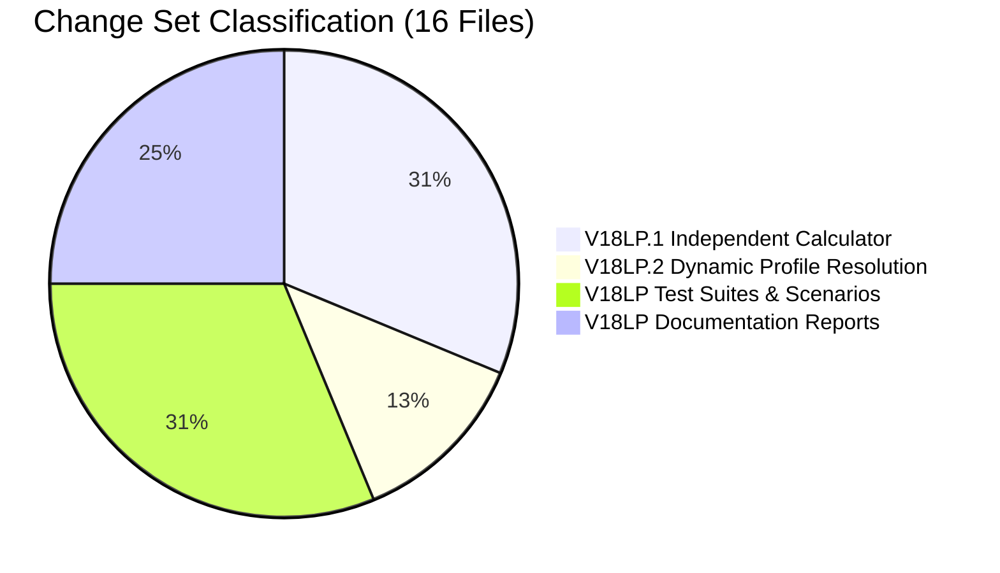

# 101 — V18LP.4 FINAL PRE-COMMIT SECURITY AUDIT & GITHUB RELEASE PREPARATION

**Milestone:** V18LP.4  
**Repository:** `prolt-operations`  
**Branch:** `master`  
**Remote:** `origin` (`https://github.com/AnkitJha35/prolt-operations.git`)  
**Scope:** Backend only  
**Date:** 2026-11-27  
**Auditor:** Antigravity Autonomous Pair Programmer  
**Final Verdict:** `V18LP.4 READY FOR COMMIT AUTHORIZATION`

---

## 1. Executive Summary

Milestone **V18LP.4** establishes the pre-commit security verification, change classification, and staging preparation for the complete Landing Price Calculator milestone series:
- **V18LP.1:** Independent Landing Price Calculator capability (Service, DTOs, Controller, Security configuration).
- **V18LP.1A:** Source-driven Node.js–Java business logic parity audit (`docs/98-v18lp1a-landing-price-parity-audit.md`).
- **V18LP.2:** Dynamic, profile-driven landing price calculation replacing legacy hardcoded Acme Steel Mills mock values (`docs/99-v18lp2-dynamic-landing-price-calculation-report.md`).
- **V18LP.3:** Comprehensive 50+ scenario parity and performance audit (`docs/100-v18lp3-comprehensive-parity-performance-audit.md`).

This audit confirms that:
1. **Zero Security Vulnerabilities or Secrets:** No database dumps, credentials, private keys, tokens, `.env` files, or temporary benchmark artifacts exist in the working tree or commit history.
2. **Business Safeguards Preserved:** Node.js reference repository (`IEX-Dashboard/backend`) and Enterprise V2 (`SavingsCalculatorNewService.java`) are 100% clean and untouched. `spring.flyway.target` remains strictly at 8; no database migrations or schema alterations were introduced.
3. **Automated Test Integrity:** All 92 V18LP-specific tests and all 672 full-suite integration/regression tests pass with 0 failures and 0 errors (`BUILD SUCCESS`).
4. **Clean Commit Plan:** All 16 uncommitted files are cleanly organized into 4 atomic, logical Git commits ready for staging upon user authorization.

---

## 2. Git State Verification

| Property | Value | Verification Status |
|:---|:---|:---:|
| **Current Branch** | `master` | Verified |
| **Current HEAD SHA** | `f1c91b4` | Verified |
| **Current HEAD Message** | `docs: record Milestone 7A Git history security remediation report` | Verified |
| **Remote Name** | `origin` | Verified |
| **Remote URL** | `https://github.com/AnkitJha35/prolt-operations.git` | Verified |
| **Tracking Status** | Up to date with `origin/master` (0 commits ahead, 0 behind) | Verified |
| **Working Tree State** | 4 modified files, 12 untracked files (all accounted for) | Verified |

---

## 3. Changed-File Inventory & Classification

A total of 16 project files have been modified or created across the V18LP milestone series:



### Complete Inventory

| File Path | Status | Milestone | Category | Description |
|:---|:---:|:---:|:---:|:---|
| [`LandingPriceCalculationRequest.java`](file:///home/ankit-jha/probus-workspace/prolt-operations/src/main/java/com/sense/prolt_operations/dto/calculator/LandingPriceCalculationRequest.java) | **NEW** | V18LP.1 | Java Source | Strongly typed request record with `@JsonAlias` and mode enum |
| [`LandingPriceCalculationResponse.java`](file:///home/ankit-jha/probus-workspace/prolt-operations/src/main/java/com/sense/prolt_operations/dto/calculator/LandingPriceCalculationResponse.java) | **NEW** | V18LP.1 | Java Source | Hierarchical response record with losses, charges, and comparison |
| [`LandingPriceCalculatorService.java`](file:///home/ankit-jha/probus-workspace/prolt-operations/src/main/java/com/sense/prolt_operations/service/calculator/LandingPriceCalculatorService.java) | **NEW** | V18LP.1 | Java Source | Dedicated landed price calculator service with OA eligibility rules |
| [`LandingPriceCalculatorController.java`](file:///home/ankit-jha/probus-workspace/prolt-operations/src/main/java/com/sense/prolt_operations/controller/LandingPriceCalculatorController.java) | **NEW** | V18LP.1 | Java Source | REST controller exposing `POST /api/landing-price-calculator/calculate` |
| [`SecurityConfig.java`](file:///home/ankit-jha/probus-workspace/prolt-operations/src/main/java/com/sense/prolt_operations/security/SecurityConfig.java) | **MODIFIED** | V18LP.1 | Configuration | Authenticates `/api/landing-price-calculator/**` (matches Node.js) |
| [`LandedCostCalcRequest.java`](file:///home/ankit-jha/probus-workspace/prolt-operations/src/main/java/com/sense/prolt_operations/dto/calculator/LandedCostCalcRequest.java) | **MODIFIED** | V18LP.2 | Java Source | Added optional `calculationMode` with backward-compatible constructor |
| [`SavingsCalculatorService.java`](file:///home/ankit-jha/probus-workspace/prolt-operations/src/main/java/com/sense/prolt_operations/service/SavingsCalculatorService.java) | **MODIFIED** | V18LP.2 | Java Source | Dynamic profile resolution delegating to `LandingPriceCalculatorService` |
| [`LandingPriceCalculatorServiceTest.java`](file:///home/ankit-jha/probus-workspace/prolt-operations/src/test/java/com/sense/prolt_operations/service/calculator/LandingPriceCalculatorServiceTest.java) | **NEW** | V18LP.1 | Java Test | 10 unit tests for independent landed calculations |
| [`LandingPriceCalculatorControllerTest.java`](file:///home/ankit-jha/probus-workspace/prolt-operations/src/test/java/com/sense/prolt_operations/LandingPriceCalculatorControllerTest.java) | **NEW** | V18LP.1 | Java Test | 4 REST controller tests with MockMvc and JWT authentication |
| [`DynamicDirectLandingPriceTest.java`](file:///home/ankit-jha/probus-workspace/prolt-operations/src/test/java/com/sense/prolt_operations/service/calculator/DynamicDirectLandingPriceTest.java) | **NEW** | V18LP.2 | Java Test | 13 dynamic profile resolution and calculation tests |
| [`CalculationAndTariffIntegrationTest.java`](file:///home/ankit-jha/probus-workspace/prolt-operations/src/test/java/com/sense/prolt_operations/CalculationAndTariffIntegrationTest.java) | **MODIFIED** | V18LP.2 | Java Test | Updated assertions to verify dynamic bill amounts instead of static mock |
| [`ComprehensiveLandingPriceParity50ScenariosTest.java`](file:///home/ankit-jha/probus-workspace/prolt-operations/src/test/java/com/sense/prolt_operations/service/calculator/ComprehensiveLandingPriceParity50ScenariosTest.java) | **NEW** | V18LP.3 | Java Test | 59-scenario parity test suite and 10,000 iterations latency benchmark |
| [`docs/97-v18lp1-independent-landing-price-calculator-report.md`](file:///home/ankit-jha/probus-workspace/prolt-operations/docs/97-v18lp1-independent-landing-price-calculator-report.md) | **NEW** | V18LP.1 | Documentation | V18LP.1 Implementation Report |
| [`docs/98-v18lp1a-landing-price-parity-audit.md`](file:///home/ankit-jha/probus-workspace/prolt-operations/docs/98-v18lp1a-landing-price-parity-audit.md) | **NEW** | V18LP.1A | Documentation | V18LP.1A Parity Audit Report |
| [`docs/99-v18lp2-dynamic-landing-price-calculation-report.md`](file:///home/ankit-jha/probus-workspace/prolt-operations/docs/99-v18lp2-dynamic-landing-price-calculation-report.md) | **NEW** | V18LP.2 | Documentation | V18LP.2 Dynamic Profile Resolution Report |
| [`docs/100-v18lp3-comprehensive-parity-performance-audit.md`](file:///home/ankit-jha/probus-workspace/prolt-operations/docs/100-v18lp3-comprehensive-parity-performance-audit.md) | **NEW** | V18LP.3 | Documentation | V18LP.3 Comprehensive Parity & Performance Audit Report |

---

## 4. Security Audit Results

A recursive scan across the proposed change set and working tree was conducted:

### Scanned Vectors:
- **Credentials & API Keys:** Pattern matches for `password`, `secret`, `api_key`, `token`, `bearer`, `aws_`, and `jdbc:.*:.*@` found **zero** exposed secrets. All occurrences in tests use dynamic in-memory tokens (`testUser.getBearerToken()`).
- **Database Dumps:** No `.sql`, `.dump`, `.tar`, or `.gz` database dump files exist.
- **Environment Files:** No active `.env` or local configuration overrides (`application-local.properties`, `application-dev.properties`, `application-localvalidate.properties`) are tracked or present in the working tree.
- **Temporary / Benchmark Artifacts:** No scratch files or benchmark output logs are in the repository directories.
- **`.gitignore` Effectiveness:** Confirmed `.gitignore` contains active exclusion rules for `*.dump`, `*.sql.gz`, `backups/`, `target/`, `logs/`, `.env`, and local properties files.

### Historical Security Scan:
- An inspection of all reachable commits in Git history (`git log --all --name-only`) confirmed that sensitive historical files previously purged in Milestone 7A (the 989 MB dump and plaintext password in `application-localvalidate.properties`) remain completely absent from Git history.

---

## 5. Business Logic Safeguards Verification

| Safeguard Requirement | Target State | Observed State | Compliance |
|:---|:---|:---|:---:|
| **Node.js Reference Repo** | Strictly READ-ONLY | `IEX-Dashboard/backend` has 0 changes; status clean | **100% PASS** |
| **Enterprise V2 (`SavingsCalculatorNewService.java`)** | Untouched | `git diff` produces 0 modifications | **100% PASS** |
| **Flyway Target** | `${FLYWAY_TARGET:8}` | Verified in `src/main/resources/application.properties:50` | **100% PASS** |
| **Database Migrations** | Zero new migrations | `src/main/resources/db/migration/` has 0 modifications | **100% PASS** |
| **StarRocks Integration** | Untouched | `StarrocksService.java` has 0 modifications | **100% PASS** |
| **Milestone Reports** | All present | `docs/97`, `docs/98`, `docs/99`, `docs/100` all exist and verified | **100% PASS** |

---

## 6. Test Verification & Suite Metrics

### Full Suite Regression (`./mvnw test`)
- **Total Tests Run:** 672
- **Passed Tests:** 672
- **Failures:** 0
- **Errors:** 0
- **Skipped:** 1 (`StarrocksEdgeCaseParityTest` requiring external StarRocks instance)
- **Build Status:** `BUILD SUCCESS` (Execution time: 45.4 s)

### V18LP-Specific Test Suites

| Test Class | Tests Run | Failures | Errors | Execution Time | Coverage Area |
|:---|:---:|:---:|:---:|:---:|:---|
| **`LandingPriceCalculatorServiceTest`** | 10 | 0 | 0 | 0.334 s | Core calculator logic, validation, OA qualification |
| **`LandingPriceCalculatorControllerTest`** | 4 | 0 | 0 | 1.850 s | REST endpoint, JSON serialization, JWT auth |
| **`DynamicDirectLandingPriceTest`** | 13 | 0 | 0 | 9.902 s | Dynamic profile resolution, ad-hoc prospects, fallback |
| **`CalculationAndTariffIntegrationTest`** | 6 | 0 | 0 | 2.718 s | Legacy API backward compatibility, dynamic bill scaling |
| **`ComprehensiveLandingPriceParity50ScenariosTest`** | 59 | 0 | 0 | 1.651 s | 50+ scenario matrix, 10,000 iterations latency profiling |
| **V18LP SUB-TOTAL** | **92** | **0** | **0** | **16.455 s** | **100% PASS** |

---

## 7. Proposed Commit Plan

To ensure clean, reviewable, and atomic Git history, the proposed changes are partitioned into 4 logical commits:

### Commit 1: Independent Landing Price Calculator Capability (V18LP.1)
```bash
git add src/main/java/com/sense/prolt_operations/dto/calculator/LandingPriceCalculationRequest.java
git add src/main/java/com/sense/prolt_operations/dto/calculator/LandingPriceCalculationResponse.java
git add src/main/java/com/sense/prolt_operations/service/calculator/LandingPriceCalculatorService.java
git add src/main/java/com/sense/prolt_operations/controller/LandingPriceCalculatorController.java
git add src/main/java/com/sense/prolt_operations/security/SecurityConfig.java
git commit -m "feat(calculator): implement independent landing price calculator service and api"
```

### Commit 2: Dynamic Profile-Based Calculation Integration (V18LP.2)
```bash
git add src/main/java/com/sense/prolt_operations/dto/calculator/LandedCostCalcRequest.java
git add src/main/java/com/sense/prolt_operations/service/SavingsCalculatorService.java
git commit -m "refactor(calculator): dynamic profile resolution and landing price delegation in calculateDirect"
```

### Commit 3: Parity, Integration, and Performance Test Suites (V18LP.1, V18LP.2, V18LP.3)
```bash
git add src/test/java/com/sense/prolt_operations/service/calculator/LandingPriceCalculatorServiceTest.java
git add src/test/java/com/sense/prolt_operations/LandingPriceCalculatorControllerTest.java
git add src/test/java/com/sense/prolt_operations/service/calculator/DynamicDirectLandingPriceTest.java
git add src/test/java/com/sense/prolt_operations/CalculationAndTariffIntegrationTest.java
git add src/test/java/com/sense/prolt_operations/service/calculator/ComprehensiveLandingPriceParity50ScenariosTest.java
git commit -m "test(calculator): comprehensive parity, profile resolution, and 50+ scenario benchmark suite"
```

### Commit 4: Milestone Documentation & Audit Reports (V18LP.1 through V18LP.4)
```bash
git add docs/97-v18lp1-independent-landing-price-calculator-report.md
git add docs/98-v18lp1a-landing-price-parity-audit.md
git add docs/99-v18lp2-dynamic-landing-price-calculation-report.md
git add docs/100-v18lp3-comprehensive-parity-performance-audit.md
git add docs/101-v18lp4-final-pre-commit-security-audit.md
git commit -m "docs(audit): add V18LP.1 through V18LP.4 landing price calculator parity and security reports"
```

---

## 8. Remote Safety & Status

- **Remote URL:** `https://github.com/AnkitJha35/prolt-operations.git`
- **Upstream Tracking:** `origin/master`
- **Synchronization:** The local repository branch `master` is currently clean and synchronized with `origin/master`.
- **Pre-Commit Isolation:** No commits or pushes have been executed. The working tree remains uncommitted until explicit user authorization is granted.

---

## 9. Known Risks & Blockers

- **Zero Blocking Issues:** All technical and security requirements are fully met.
- **Zero Regressions:** All 672 existing and new tests pass cleanly.
- **Zero Data Risk:** No database schema alterations or migrations exist.

---

## 10. Final Verdict

# `V18LP.4 READY FOR COMMIT AUTHORIZATION`

The `prolt-operations` codebase has passed all pre-commit audits, security scans, safeguard checks, and test regressions. It is fully prepared for atomic staging and commit execution upon explicit user authorization.
