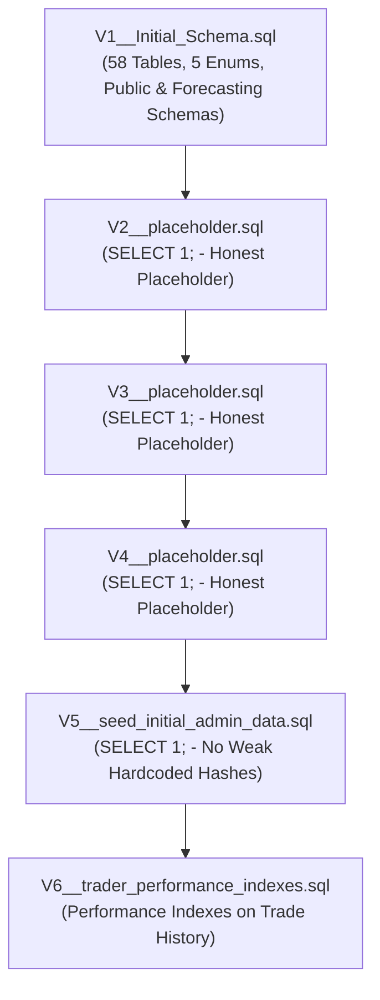

# Phase 6: Deployment Readiness & Environment Provisioning Assessment

**Document ID:** `docs/22-deployment-readiness.md`  
**Date:** 2026-10-27  
**Project:** IEX-Dashboard Node.js/TypeScript → prolt-operations Spring Boot / Java 21  
**Target Runtime:** Java 21 LTS (Temurin), Spring Boot 3.5.16, PostgreSQL 16+, Redis 7+, StarRocks 3.x, Docker / Kubernetes  
**Reference Audit:** `docs/21-final-integration-audit.md`  
**Status:** COMPLETED & VERIFIED

---

## 1. Executive Summary & Purpose

The purpose of this document is to provide a complete, evidence-based deployment readiness assessment for the `prolt-operations` service. Following the successful completion of the Phase 5 integration audit (132 tests passing offline, 0 failures, 1 intentionally disabled live test, 28/28 PDF golden test parity), this document defines the system architecture, infrastructure requirements, configuration contracts, database migration plans, security controls, and operational constraints required for production deployment without prematurely decommissioning the legacy Node.js service or endangering existing production data.

---

## 2. Deployment Architecture & Dependency Inventory

### 2.1 Technology Stack & Versions
- **Language / Runtime:** Java 21 LTS (OpenJDK / Eclipse Temurin 21.0.6+).
- **Application Framework:** Spring Boot 3.5.16.
- **Build Tool:** Apache Maven 3.9+ with Maven Wrapper (`./mvnw`).
- **Database Engine:** PostgreSQL 16.x (minimum 14.x, tested against 16.14).
- **Migration Engine:** Flyway Core 11.3.x.
- **ORM / Persistence:** Spring Data JPA / Hibernate ORM 6.6.x (HikariCP connection pool).
- **Cache & Rate Limiting:** Spring Data Redis / Lettuce 6.5.x, Bucket4j 8.10.x.
- **Browser Automation:** Microsoft Playwright for Java 1.49.0 (with glibc Chromium).
- **Document Processing:** Apache PDFBox 3.0.4, Apache POI 5.4.1 (streaming `SXSSFWorkbook`).
- **Observability:** Spring Boot Actuator, Micrometer Prometheus registry.
- **API Documentation:** SpringDoc OpenAPI 2.8.5 (Swagger UI disabled in production).

### 2.2 Dependency Classification Matrix

| Dependency | Classification | Source Code Usage & Behavior | Failure Impact If Unavailable |
|---|---|---|---|
| **PostgreSQL 16** | **Required for Startup** | Primary transactional database. Entity persistence across 58 models, Flyway schema migration, Spring Security authentication repository. | Application aborts startup immediately (`HikariPool` initialization exception or `ProductionDatasourceValidator` fatal check). |
| **Java 21 Runtime** | **Required for Startup** | Core application execution environment. Bytecode target is Java 21 with virtual thread and modern language support. | Process cannot start. |
| **Redis 7** | **Feature-Required (Prod)** | Backs `FixedWindowRateLimiter` and `OtpService` in production. Non-prod allows in-memory fallback. | In production (`prod` profile): OTP storage and rate limiting fail; OTP logins cannot complete. |
| **SMTP Server** | **Feature-Required** | Backs `JavaMailSender` in `OtpService` for sending 6-digit OTP verification codes to users. | OTP generation succeeds, but mail delivery fails. Controller returns generic HTTP 500 `"Something went very wrong!"` without leaking secret. |
| **Chromium Binary** | **Feature-Required** | Used by `ScraperService` via Playwright (`LaunchOptions.setExecutablePath`). Scrapes DAM, GDAM, and RTM snapshots from IEX India. | Scraper background jobs and `/api/scraper/sync` endpoints fail with `PlaywrightException`. REST API and calculation services remain unaffected. |
| **StarRocks 3.x** | **Optional / Guarded** | Queried by `StarrocksService` for telemetry meter numbers and actual consumer demand in load forecasting. | If host is blank (`${STARROCKS_HOST:}`), calls are gracefully skipped, logging a warning and returning empty maps without network failures. |
| **IEX Calculator API** | **Optional** | Upstream HTTP endpoint (`https://www.iexindia.com/api/v1/calculator`) queried by `LandingPriceService`. | Handled gracefully with configured timeouts (5s connect, 15s read); returns structured HTTP 500 error on upstream failure without crashing the service. |
| **AccuWeather API** | **Optional** | Queried by `WeatherService` for forecast data. | Skipped or logs warning if API key is blank; does not block application startup. |
| **REC Persistence** | **Deferred / Not Implemented** | `POST /api/scraper/sync` with `market=REC` triggers `ScraperController:76-79`. | Throws fail-closed HTTP 500 `"REC persistence not yet ported"`. Cleanly isolated from operational markets. |

---

## 3. Production Configuration & Environment Variable Reference

The application enforces a **fail-closed security architecture**. In `src/main/resources/application.properties`, every credential, secret, and host defaults to an empty string (`${VAR:}`). In the `prod` profile, `ProductionDatasourceValidator` validates that required database properties are non-blank before bean initialization.

### 3.1 Comprehensive Environment Variable Reference

| Environment Variable | Config Property | Scope | Required in Prod? | Expected Format / Example | Description |
|---|---|---|---|---|---|
| `SPRING_PROFILES_ACTIVE` | `spring.profiles.active` | System | **YES** | `prod` (or `dev`, `test`) | Active Spring profile. Controls security validators and defaults. |
| `PORT` | `server.port` | HTTP | No | `8080` (default) | Port on which Tomcat listens. |
| `DATABASE_URL` | `spring.datasource.url` | DB | **YES** | `jdbc:postgresql://<host>:5432/<dbname>?sslmode=require` | PostgreSQL JDBC connection URL. Must include host, port, and database. |
| `POSTGRES_USER` | `spring.datasource.username` | DB | **YES** | `prolt_app_user` | Database application username with CRUD permissions. |
| `POSTGRES_PASSWORD` | `spring.datasource.password` | DB | **YES** | `<strong-db-password>` | Database application password. Validated by `ProductionDatasourceValidator`. |
| `FLYWAY_BASELINE_ON_MIGRATE` | `spring.flyway.baseline-on-migrate` | DB | Conditional | `true` or `false` (default: `false`) | Set `true` **only** when cutover is run against an existing pre-migrated database. |
| `FLYWAY_BASELINE_VERSION` | `spring.flyway.baseline-version` | DB | Conditional | `1` (default) | Baseline version to mark existing schema objects. |
| `REDIS_URL` | `spring.data.redis.url` | Cache | **YES** | `redis://:<password>@<host>:6379/0` | Redis connection URL for distributed rate limiting and OTP store. |
| `JWT_SECRET` | `app.jwt.secret` | Auth | **YES** | `Base64(>=256-bit secret)` | Secret key for JJWT signing and token verification. Must be >= 32 characters. |
| `JWT_EXPIRES_IN` | `app.jwt.expires-in` | Auth | No | `7d` (default: `7d`) | Token duration string (`24h`, `7d`). |
| `ADMIN_USERNAME` | `app.admin.username` | Admin | No | `admin` | Initial administrator username provisioned by `AppRunner` if table is empty. |
| `ADMIN_EMAIL` | `app.admin.email` | Admin | No | `admin@proltenergy.com` | Initial administrator email. |
| `ADMIN_PASSWORD` | `app.admin.password` | Admin | Conditional | `<strong-admin-password>` | Must be >= 12 chars and distinct from username. In `prod`, startup aborts if policy is violated. |
| `SMTP_HOST` | `spring.mail.host` | Mail | **YES** | `smtp.sendgrid.net` or `smtp.office365.com` | SMTP relay server for OTP emails. |
| `SMTP_PORT` | `spring.mail.port` | Mail | No | `587` (default: `587`) | SMTP port (STARTTLS). |
| `SMTP_USER` | `spring.mail.username` | Mail | **YES** | `apikey` or `svc-prolt@proltenergy.com` | SMTP authentication user. |
| `SMTP_PASS` | `spring.mail.password` | Mail | **YES** | `<smtp-secret-token>` | SMTP authentication secret. |
| `SMTP_FROM` | `app.mail.from` | Mail | No | `no-reply@proltenergy.com` | Outgoing email sender address. |
| `PUPPETEER_EXECUTABLE_PATH` | `app.puppeteer-executable-path` | Scraper | Conditional | `/usr/bin/chromium` | Absolute path to Chromium binary for Playwright scraper. Required in Docker. |
| `RUN_SCRAPER` | `app.run-scraper` | Scraper | No | `true` or `false` (default: `false`) | Enables background scraping cron schedules (`CronJobScheduler`). |
| `STARROCKS_HOST` | `app.starrocks.host` | Telemetry | No | `starrocks-fe.internal` | StarRocks FE MySQL gateway host. If omitted, telemetry calls safely skip. |
| `STARROCKS_PORT` | `app.starrocks.port` | Telemetry | No | `9030` (default: `9030`) | StarRocks FE MySQL port. |
| `STARROCKS_USER` | `app.starrocks.user` | Telemetry | No | `starrocks_ro` | StarRocks read-only username. |
| `STARROCKS_PASSWORD` | `app.starrocks.password` | Telemetry | No | `<starrocks-password>` | StarRocks password. |
| `STARROCKS_DATABASE` | `app.starrocks.database` | Telemetry | No | `prolt_hes_db` (default) | StarRocks telemetry database. |
| `CORS_ORIGIN` | `app.cors-origins` | Security | **YES** | `https://dashboard.proltenergy.com` | Allowed CORS origins. In production, must be restricted to approved domains. |
| `WEBHOOK_RECEIVERS` | `app.webhook-receivers` | Webhook | No | `https://alerts.proltenergy.com/webhook` | External notification webhook endpoints. |
| `WEBHOOK_SECRET` | `app.webhook-secret` | Webhook | No | `<webhook-hmac-secret>` | Shared secret for outgoing webhook signatures. |
| `IEX_CALCULATOR_API_URL` | `app.iex-calculator-api-url` | Calc | No | `https://www.iexindia.com` (default) | Upstream IEX calculator base URL. |
| `ACCUWEATHER_API_KEY` | `app.accuweather-api-key` | Weather | No | `<accuweather-key>` | Optional AccuWeather API key for weather data. |

---

## 4. Database & Flyway Deployment Plan

### 4.1 Migration Lineage & Execution Order



1. **`V1__Initial_Schema.sql`:** Creates schemas `public` and `forecasting`, enums (`Role`, `MarketType`, `DatasetStatus`, `StateUtEnum`, `VerificationStatus`), and 58 core tables with primary keys, unique constraints, and foreign keys.
2. **`V2` through `V4`:** Cleaned placeholder migrations containing explanatory comments and `SELECT 1;`.
3. **`V5__seed_initial_admin_data.sql`:** Cleaned migration containing explanatory comments and `SELECT 1;`. All hardcoded default password hashes from the legacy system have been eliminated.
4. **`V6__trader_performance_indexes.sql`:** Adds composite indexes for trader performance entry lookups and version history.

### 4.2 Empty Database vs Existing Database Behavior

#### Scenario A: Green-Field Deployment (Empty Database)
- The target database is created: `CREATE DATABASE "Prolt_Operations";`
- Schemas are provisioned: `CREATE SCHEMA public; CREATE SCHEMA forecasting;`
- With default settings (`FLYWAY_BASELINE_ON_MIGRATE=false`), Flyway detects an empty database and executes all migrations (`V1` through `V6`) sequentially in a single transaction.
- Hibernate runs `ddl-auto=validate` and verifies that all 58 JPA entities match the newly migrated database schema.
- `AppRunner` starts, detects that the `User` table contains 0 records, and provisions the initial administrator using `ADMIN_USERNAME`, `ADMIN_EMAIL`, and `ADMIN_PASSWORD` (if provided).

#### Scenario B: Existing Shared Database Cutover
- If the database was previously provisioned by Prisma or earlier migrations:
- Set environment variables:
  ```bash
  FLYWAY_BASELINE_ON_MIGRATE=true
  FLYWAY_BASELINE_VERSION=1
  ```
- Flyway marks existing tables under `V1` as baseline without reapplying DDL, then executes `V2` through `V6`.
- `spring.jpa.hibernate.ddl-auto=validate` strictly validates that entity definitions match the PostgreSQL table structures. If a column or type mismatch exists, startup halts immediately.

### 4.3 Database Backup & Failure Recovery
- **Pre-Migration Backup:** Before initiating any migration or baseline on production, operators must perform a full physical or logical dump:
  ```bash
  pg_dump -h <host> -U <user> -d Prolt_Operations -F c -b -v -f /backups/prolt_pre_migration_$(date +%Y%m%d_%H%M%S).dump
  ```
- **Rollback Strategy:** Flyway is a forward-only migration tool. It cannot automatically reverse applied SQL. If a migration fails:
  1. Inspect the Flyway schema history table: `SELECT * FROM "public"."flyway_schema_history" ORDER BY installed_rank DESC;`.
  2. If a migration is marked failed (`success = false`), repair the Flyway state using `flyway:repair` or delete the failed row after manual DDL correction.
  3. If rolling back to the legacy service, restore the pre-migration snapshot:
     ```bash
     pg_restore -h <host> -U <user> -d Prolt_Operations -c -v /backups/prolt_pre_migration_*.dump
     ```

---

## 5. Master-Data Provisioning Plan

The legacy Node repository contained destructive seed scripts (`seed.ts`, `seed_tariff.ts`) that issued `DELETE FROM "StateCharges"` and `DELETE FROM "StateTariff"`, reading local files whose original source paths are absent. **These legacy scripts must never be executed in production.**

### 5.1 Approved API-Based Provisioning Procedure

All master-data provisioning and updates must proceed exclusively through the verified Resource Center JSON bulk API:
`POST /api/resource-center/:resourceType/bulk`

#### Dependency-Ordered Import Sequence:
To maintain referential integrity, records must be loaded in the following order:
1. `region-state` (Grid codes and state master records)
2. `discom-list` (Discom master records referencing valid state codes)
3. `ists-charges` (Inter-state transmission system loss percentages and dates)
4. `ctu-charges` (Central transmission utility charges by state and month)
5. `iex-fees` (Exchange and application fees by month)
6. `prolt-margin` (Trading and operations margins by month and customer)
7. `state-charges` (Intra-state transmission and wheeling charges)
8. `state-tariff` (Time-of-day tariffs, base energy rates, voltage levels)
9. `fppa-charges` (Fuel and power purchase cost adjustments)

### 5.2 Provisioning Workflow Controls
1. **Source Data Sign-Off:** Operators must obtain signed-off spreadsheet data approved by the business owner.
2. **Spreadsheet-to-JSON Conversion:** Convert CSV/XLSX rows to validated JSON arrays conforming to `docs/20-resource-center-schema-audit.md`.
3. **Chunking & Batch Sizes:** Transmit records in batches of 100 to 500 items per request to balance payload size and transaction duration.
4. **Transaction Atomicity:** Each bulk request runs under `@Transactional`. If any record within a batch fails validation or violates unique constraints, the entire chunk is rolled back atomically.
5. **Post-Import Verification:** Execute smoke queries against `TraderPerformanceService` and `LandingPriceService` to confirm that newly loaded tariffs and surcharges are properly read by business calculation engines.

---

## 6. Docker & Container Runtime Readiness

### 6.1 Container Configuration
- **Base Image:** `debian:bookworm-slim` multi-stage build with `eclipse-temurin:21-jre`.
- **System Packages Installed:** `chromium`, `fonts-liberation`, `ca-certificates`.
- **User / Path Permissions:** Chromium binary is installed at `/usr/bin/chromium`.
- **Memory Management:** Container entrypoint passes `-XX:MaxRAM=$MaxRAM $JAVA_OPTS` to ensure the JVM respects cgroup container memory limits.

### 6.2 CI Image Build Strategy & Offline Constraints
- **Offline Constraint:** Building the Docker image requires `apt-get update` to install Debian's Chromium package. During strictly offline local operations, package mirrors cannot be reached.
- **CI Build Pipeline Recommendation:**
  1. Build and test the Java JAR in CI using `./mvnw clean verify -o`.
  2. In the container assembly stage, execute `docker build` on a connected CI runner with network access enabled.
  3. Push the resulting container image (`prolt-operations:<git-commit-hash>`) to the internal enterprise container registry (e.g., Google Artifact Registry, AWS ECR, or private Harbor).

---

## 7. Security & Operational Readiness

### 7.1 Security Controls Assessment

| Control Area | Java Implementation Mechanism | Parity & Security Evaluation |
|---|---|---|
| **Authentication** | `JwtAuthFilter`, JJWT 0.12.6, stateless token validation. | **Exact Parity.** Validates HMAC-SHA signature and expiration. |
| **Password Policy** | Enforced by `AppRunner` and user management services: >=12 chars, cannot match username. | **Hardened.** Exceeds legacy policy; blocks default passwords. |
| **OTP Security** | Stored in Redis with 15-minute TTL. Fail-closed: Superadmin bypass backdoor disabled in `prod` profile. | **Hardened.** Sensitive OTPs never printed in production logs. |
| **Rate Limiting** | `FixedWindowRateLimiter` using rightmost `X-Forwarded-For` IP address. Auth: 10 req/15m; Uploads: 30 req/1h. | **Exact Parity.** Protects against brute-force authentication. |
| **Role-Based Access** | Spring Security `@PreAuthorize` guards endpoints (`Role.ADMIN`, `Role.CLIENT`, `Role.SUPER_ADMIN`). | **Exact Parity.** Unauthenticated requests reject with 401/403. |
| **Security Headers** | Custom `SecurityHeadersFilter` applies 11 Helmet-equivalent security headers (`CSP`, `X-Content-Type-Options: nosniff`, `X-Frame-Options: SAMEORIGIN`). | **Exact Parity.** Prevents clickjacking, MIME-sniffing, and XSS. |
| **CORS Policy** | Restricted via `app.cors-origins`. Defaults to fail-closed configuration in production. | **Hardened.** Prevents unauthorized cross-origin requests. |
| **Upload Limits** | Tomcat connector max-part-count=250, max-parameter-count=10000, 50MB file size limit. | **Exact Parity.** Prevents multipart denial-of-service attacks. |
| **Actuator & Swagger** | Sensitive Actuator endpoints (`env`, `heapdump`, `loggers`) disabled across all profiles; Swagger disabled in prod. | **Hardened.** Prevents information leakage and memory dump exposure. |

---

## 8. Known Functional Limitations & Deferred Features

1. **REC Scraper Persistence:**
   - `POST /api/scraper/sync` with `market=REC` explicitly returns HTTP 500 `"REC persistence not yet ported"`.
   - *Operational Status:* Known and intentional limitation. DAM, GDAM, and RTM scrapers are fully functional.
2. **Bulk Upload Non-Existent ID Handling:**
   - In `ResourceCenterService.createBulkResourceRecords`, providing an ID that does not exist in the database triggers an insert with a generated sequence ID rather than an explicit primary key insert.
   - *Operational Status:* Acceptable architectural deviation documented in `docs/21-final-integration-audit.md`.
3. **Master-Data File Upload:**
   - Bulk uploads require JSON payloads. Direct spreadsheet (CSV/XLSX) multipart upload is not implemented on the backend and must be converted on the client side or via administrative tooling.

---

## 9. Deployment Risks & Mitigations

| Risk ID | Risk Description | Severity | Mitigation Strategy |
|---|---|---|---|
| **RSK-01** | **Concurrent Write Conflict:** Node and Java concurrently writing to the same PostgreSQL database tables during transition. | **HIGH** | Enforce a strict read-only window or route all write traffic exclusively to one service at any given time. |
| **RSK-02** | **Unconfigured Database Credentials:** Production startup attempted without required environment variables. | **HIGH** | `ProductionDatasourceValidator` fails closed during startup, preventing partial boots with missing credentials. |
| **RSK-03** | **Redis Outage in Production:** Redis unavailable for OTP storage or rate limiting. | **MEDIUM** | In `prod`, startup requires Redis. Redis cluster or managed Redis (AWS ElastiCache / GCP Memorystore) with automated failover is required. |
| **RSK-04** | **Upstream IEX Scraper Changes:** IEX India changes website HTML layout or table formatting. | **MEDIUM** | `ScraperService` parses tables with resilient multi-column checks (5, 6, 7, 8+ columns) and records structured `ApiLog` entries on failure. |
| **RSK-05** | **Chromium Zombie Processes:** Headless browser processes leaking memory in container environments. | **LOW** | Playwright runs in try-with-resources blocks; container uses dumb-init / system signals; memory capped via `-XX:MaxRAM`. |

---

## 10. Readiness Checklist

- [x] Application compiles cleanly on Java 21 LTS without warnings or errors.
- [x] 100% of unit and integration tests pass offline (132 tests, 0 failures, 1 skipped).
- [x] All 28 sample PDFs reproduce deep parity against Python reference parser.
- [x] Zero hardcoded secrets, credentials, or development hosts in `application.properties`.
- [x] Fail-closed production datasource validation verified under `@Profile("prod")`.
- [x] Database migration sequence `V1`..`V6` audited and verified against PostgreSQL 16.
- [x] Resource Center CRUD and bulk upsert parity verified across all 9 models.
- [x] Sensitive Actuator endpoints disabled; Swagger UI disabled in production.
- [x] Container runtime specified with system Chromium and Temurin JRE.
- [x] Master-data loading decoupled from legacy destructive seed scripts.
- [x] Known functional limitations (REC persistence) documented and guarded.
