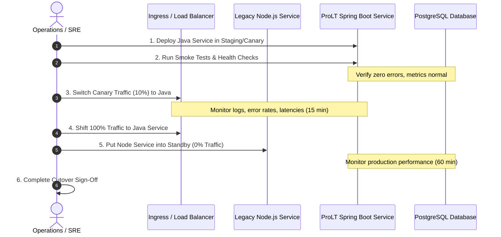

# Phase 6: Deployment & Cutover Operational Runbook

**Document ID:** `docs/23-deployment-and-cutover-runbook.md`  
**Date:** 2026-10-27  
**Project:** IEX-Dashboard Node.js/TypeScript → prolt-operations Spring Boot / Java 21  
**Target Environment:** Staging & Production Kubernetes / Docker Environments  
**Audience:** Site Reliability Engineers, DevOps Engineers, System Administrators  
**Status:** READY FOR OPERATIONAL EXECUTION  
**Approval Required:** Production Engineering Sign-Off Required Prior to Execution

---

## 1. Operational Scope & Safety Principles

This runbook provides step-by-step procedures for deploying the `prolt-operations` Spring Boot service, validating migrations, verifying master data, performing smoke tests, and executing traffic cutover from the legacy Node.js backend.

> [!CAUTION]
> **Production Safety Invariants:**
> 1. Never execute destructive legacy Node scripts (`seed.ts`, `seed_tariff.ts`).
> 2. Never connect the Java service and Node service concurrently in read-write mode to the same database without strict routing guards.
> 3. Perform a full database backup (`pg_dump`) immediately before any migration or baseline action.
> 4. Keep the legacy Node service operational in hot-standby mode until cutover verification is complete.

---

## 2. Pre-Deployment Checklist

Before beginning any deployment activity, verify that the following prerequisites have been completed:

- [ ] **Infrastructure Provisioning:** Target compute cluster (Kubernetes namespace or Docker host) is provisioned and healthy.
- [ ] **Network Connectivity:** Egress connectivity verified to PostgreSQL (port 5432), Redis (port 6379), SMTP relay (port 587), and external IEX India web portal (port 443).
- [ ] **Secret Management:** Production secrets provisioned in the enterprise secret vault (e.g., HashiCorp Vault, AWS Secrets Manager, Kubernetes Secrets).
- [ ] **Database Grants:** Target PostgreSQL user granted schema access:
  ```sql
  -- REQUIRES PRODUCTION AUTHORIZATION --
  GRANT ALL ON SCHEMA public TO prolt_app_user;
  GRANT ALL ON SCHEMA forecasting TO prolt_app_user;
  GRANT ALL ON ALL TABLES IN SCHEMA public TO prolt_app_user;
  GRANT ALL ON ALL SEQUENCES IN SCHEMA public TO prolt_app_user;
  ```
- [ ] **Change Window Approval:** Maintenance window approved by stakeholders with an allocated rollback window.

---

## 3. Environment Preparation & Secrets Provisioning

### 3.1 Kubernetes Secret Template (`prolt-secrets.yaml`)

```yaml
apiVersion: v1
kind: Secret
metadata:
  name: prolt-operations-secrets
  namespace: prolt-production
type: Opaque
stringData:
  DATABASE_URL: "jdbc:postgresql://postgres.internal:5432/Prolt_Operations?sslmode=require"
  POSTGRES_USER: "prolt_app_user"
  POSTGRES_PASSWORD: "<ENTER_PRODUCTION_DB_PASSWORD>"
  REDIS_URL: "redis://:<ENTER_PRODUCTION_REDIS_PASSWORD>@redis.internal:6379/0"
  JWT_SECRET: "<ENTER_BASE64_256BIT_JWT_SECRET>"
  ADMIN_USERNAME: "admin"
  ADMIN_EMAIL: "admin@proltenergy.com"
  ADMIN_PASSWORD: "<ENTER_STRONG_ADMIN_PASSWORD_MIN_12_CHARS>"
  SMTP_HOST: "smtp.sendgrid.net"
  SMTP_PORT: "587"
  SMTP_USER: "apikey"
  SMTP_PASS: "<ENTER_SMTP_API_KEY>"
  SMTP_FROM: "no-reply@proltenergy.com"
  CORS_ORIGIN: "https://dashboard.proltenergy.com"
  PUPPETEER_EXECUTABLE_PATH: "/usr/bin/chromium"
  RUN_SCRAPER: "true"
```

### 3.2 Kubernetes Deployment Manifest (`deployment.yaml`)

```yaml
apiVersion: apps/v1
kind: Deployment
metadata:
  name: prolt-operations
  namespace: prolt-production
  labels:
    app: prolt-operations
spec:
  replicas: 2
  strategy:
    type: RollingUpdate
    rollingUpdate:
      maxSurge: 1
      maxUnavailable: 0
  selector:
    matchLabels:
      app: prolt-operations
  template:
    metadata:
      labels:
        app: prolt-operations
    spec:
      containers:
      - name: prolt-operations
        image: prolt-operations:latest
        imagePullPolicy: IfNotPresent
        envFrom:
        - secretRef:
            name: prolt-operations-secrets
        env:
        - name: SPRING_PROFILES_ACTIVE
          value: "prod"
        - name: PORT
          value: "8080"
        - name: MaxRAM
          value: "2g"
        - name: JAVA_OPTS
          value: "-XX:+UseG1GC -XX:+ExitOnOutOfMemoryError"
        ports:
        - containerPort: 8080
          name: http
        resources:
          requests:
            memory: "1536Mi"
            cpu: "500m"
          limits:
            memory: "2560Mi"
            cpu: "2000m"
        livenessProbe:
          httpGet:
            path: /actuator/health
            port: 8080
          initialDelaySeconds: 45
          periodSeconds: 15
          timeoutSeconds: 5
          failureThreshold: 3
        readinessProbe:
          httpGet:
            path: /actuator/health
            port: 8080
          initialDelaySeconds: 30
          periodSeconds: 10
          timeoutSeconds: 3
          failureThreshold: 2
```

---

## 4. Pre-Deployment Database Backup & Migration Procedure

### 4.1 Step 1: Pre-Migration Full Database Snapshot
Before initiating any schema baseline or migration on production, execute a consistent logical backup:

```bash
# REQUIRES PRODUCTION AUTHORIZATION --
pg_dump -h <DB_HOST> -p 5432 -U <DB_ADMIN_USER> -d Prolt_Operations \
  -F c -b -v \
  -f "/backups/prolt_pre_migration_$(date +%Y%m%d_%H%M%S).dump"
```

Verify that the backup file size is non-zero and passes integrity verification:
```bash
pg_restore -l "/backups/prolt_pre_migration_$(date +%Y%m%d_%H%M%S).dump" | head -n 20
```

### 4.2 Step 2: Database Migration Strategy Selection

#### Option A: Fresh Database Provisioning
If deploying to a newly created green-field database instance:
1. Ensure `FLYWAY_BASELINE_ON_MIGRATE=false` (default).
2. Start the service. Flyway will automatically execute `V1` through `V6`.
3. Verify that the Flyway history shows 6 successful migrations:
   ```sql
   -- REQUIRES PRODUCTION AUTHORIZATION --
   SELECT installed_rank, version, description, type, script, success 
   FROM "public"."flyway_schema_history" 
   ORDER BY installed_rank ASC;
   ```

#### Option B: Existing Shared Database Cutover (Prisma Pre-Existing Schema)
If deploying against the existing PostgreSQL database previously managed by Node/Prisma:
1. Configure container environment:
   ```bash
   FLYWAY_BASELINE_ON_MIGRATE=true
   FLYWAY_BASELINE_VERSION=1
   ```
2. Start the service. Flyway marks `V1` as baseline without reapplying DDL, then executes `V2` through `V6`.
3. Hibernate executes `ddl-auto=validate` during startup. If any schema mismatch is detected, startup halts immediately before accepting traffic.
4. Once verified, unset `FLYWAY_BASELINE_ON_MIGRATE` for normal operation.

---

## 5. Approved Master-Data Loading Procedure

> [!IMPORTANT]
> Master data must **never** be loaded by running legacy destructive seed scripts. All imports must be conducted via the Resource Center JSON API in strict dependency order.

### 5.1 Step 1: Acquire and Convert Business Data
1. Obtain business-approved spreadsheet files for State Charges, Tariffs, and FPPA.
2. Convert spreadsheets to JSON payload files matching `docs/20-resource-center-schema-audit.md`:
   - `01_region_state.json`
   - `02_discom_list.json`
   - `03_ists_charges.json`
   - `04_ctu_charges.json`
   - `05_iex_fees.json`
   - `06_prolt_margin.json`
   - `07_state_charges.json`
   - `08_state_tariff.json`
   - `09_fppa_charges.json`

### 5.2 Step 2: Acquire Authentication Token
```bash
# Obtain Admin JWT token
AUTH_TOKEN=$(curl -s -X POST https://<APP_HOST>/api/auth/login \
  -H "Content-Type: application/json" \
  -d '{"email": "admin@proltenergy.com", "password": "<ADMIN_PASSWORD>"}' \
  | jq -r '.data.token')
```

### 5.3 Step 3: Execute Sequential Ingestion
Execute the bulk upload curl scripts in exact dependency order:

```bash
# 1. Region & State
curl -s -X POST "https://<APP_HOST>/api/resource-center/region-state/bulk" \
  -H "Authorization: Bearer ${AUTH_TOKEN}" \
  -H "Content-Type: application/json" \
  -d @01_region_state.json | jq .

# 2. DISCOM List
curl -s -X POST "https://<APP_HOST>/api/resource-center/discom-list/bulk" \
  -H "Authorization: Bearer ${AUTH_TOKEN}" \
  -H "Content-Type: application/json" \
  -d @02_discom_list.json | jq .

# 3. ISTS Charges
curl -s -X POST "https://<APP_HOST>/api/resource-center/ists-charges/bulk" \
  -H "Authorization: Bearer ${AUTH_TOKEN}" \
  -H "Content-Type: application/json" \
  -d @03_ists_charges.json | jq .

# 4. CTU Charges
curl -s -X POST "https://<APP_HOST>/api/resource-center/ctu-charges/bulk" \
  -H "Authorization: Bearer ${AUTH_TOKEN}" \
  -H "Content-Type: application/json" \
  -d @04_ctu_charges.json | jq .

# 5. IEX Fees
curl -s -X POST "https://<APP_HOST>/api/resource-center/iex-fees/bulk" \
  -H "Authorization: Bearer ${AUTH_TOKEN}" \
  -H "Content-Type: application/json" \
  -d @05_iex_fees.json | jq .

# 6. ProLT Margin
curl -s -X POST "https://<APP_HOST>/api/resource-center/prolt-margin/bulk" \
  -H "Authorization: Bearer ${AUTH_TOKEN}" \
  -H "Content-Type: application/json" \
  -d @06_prolt_margin.json | jq .

# 7. State Charges
curl -s -X POST "https://<APP_HOST>/api/resource-center/state-charges/bulk" \
  -H "Authorization: Bearer ${AUTH_TOKEN}" \
  -H "Content-Type: application/json" \
  -d @07_state_charges.json | jq .

# 8. State Tariff
curl -s -X POST "https://<APP_HOST>/api/resource-center/state-tariff/bulk" \
  -H "Authorization: Bearer ${AUTH_TOKEN}" \
  -H "Content-Type: application/json" \
  -d @08_state_tariff.json | jq .

# 9. FPPA Charges
curl -s -X POST "https://<APP_HOST>/api/resource-center/fppa-charges/bulk" \
  -H "Authorization: Bearer ${AUTH_TOKEN}" \
  -H "Content-Type: application/json" \
  -d @09_fppa_charges.json | jq .
```

---

## 6. Comprehensive Post-Deployment Smoke Tests

Execute these validation requests against the newly deployed Java service before routing production traffic:

### 6.1 Smoke Test 1: Liveness & Health Status
```bash
curl -s https://<APP_HOST>/actuator/health | jq .
# Expected Output: {"status":"UP"}
```

### 6.2 Smoke Test 2: Sensitive Actuator Protection
Verify that sensitive Actuator endpoints are strictly inaccessible:
```bash
curl -s -o /dev/null -w "%{http_code}\n" https://<APP_HOST>/actuator/env
# Expected: 404

curl -s -o /dev/null -w "%{http_code}\n" https://<APP_HOST>/actuator/heapdump
# Expected: 404
```

### 6.3 Smoke Test 3: Swagger UI Disabled in Prod
```bash
curl -s -o /dev/null -w "%{http_code}\n" https://<APP_HOST>/swagger-ui/index.html
# Expected: 404 (when SWAGGER_UI_ENABLED=false in prod)
```

### 6.4 Smoke Test 4: Resource Center GET Query
```bash
curl -s -X GET "https://<APP_HOST>/api/resource-center/region-state" \
  -H "Authorization: Bearer ${AUTH_TOKEN}" | jq .
# Expected: {"success":true,"data":[...]}
```

### 6.5 Smoke Test 5: Calculator & Calculation Engine Sanity
```bash
curl -s -X GET "https://<APP_HOST>/api/landing-price?state=Haryana&consumerCategory=HT%20Industrial&month=202611" \
  -H "Authorization: Bearer ${AUTH_TOKEN}" | jq .
# Expected: 200 OK with calculated landing price
```

### 6.6 Smoke Test 6: Trade Report Upload & Parser Sanity
```bash
curl -s -X POST "https://<APP_HOST>/api/trader-performance/upload" \
  -H "Authorization: Bearer ${AUTH_TOKEN}" \
  -F "files=@sample_trade_report.pdf" | jq .
# Expected: {"success":true,"reports":[...],"files_status":[...]}
```

---

## 7. Traffic Cutover Sequence



### Step-by-Step Traffic Cutover:
1. **Canary Routing (10% Traffic):** Direct 10% of incoming ingress traffic to the Java upstream. Monitor error rates (`http_server_requests_seconds_count{status="500"}`) and p95 latency.
2. **50% Traffic Shift:** If zero 5xx errors are observed after 15 minutes, increase traffic to 50%.
3. **100% Full Cutover:** Shift all production ingress traffic to the Java service.
4. **Observation Window:** Monitor CPU, memory, Hikari connection pool usage, and Redis latency for a minimum of 60 minutes.
5. **Standby Mode:** Retain the legacy Node.js service running at 0 replicas or in a detached standby pool for 24 hours.

---

## 8. Rollback Procedure

If fatal regressions, unhandled 500 errors, or data anomalies are identified during the cutover window:

### 8.1 Instant Traffic Reversal (RTO < 2 minutes)
Immediately redirect the ingress / load balancer routing back to the legacy Node.js service:
```bash
# Example Kubernetes Ingress switch
kubectl patch ingress prolt-ingress -n prolt-production \
  --type merge -p '{"spec":{"rules":[{"http":{"paths":[{"backend":{"service":{"name":"iex-dashboard-node","port":{"number":5000}}}}]}}]}}'
```

### 8.2 Database State Assessment
- If rollback occurs before any new writes were committed: No database rollback is required; Node can immediately resume reading the PostgreSQL database.
- If schema conflicts exist or partial migrations failed: Restore the pre-migration snapshot:
  ```bash
  # REQUIRES PRODUCTION AUTHORIZATION --
  pg_restore -h <DB_HOST> -p 5432 -U <DB_ADMIN_USER> -d Prolt_Operations -c -v \
    /backups/prolt_pre_migration_*.dump
  ```

---

## 9. Explicit Go / No-Go Criteria

### **GO Criteria (All Must Be Satisfied):**
1. [x] 100% of automated tests pass offline (`132/132` tests, 0 failures, 1 skipped).
2. [x] Pre-migration database snapshot created and verified.
3. [x] `ProductionDatasourceValidator` succeeds without throwing `IllegalStateException`.
4. [x] `/actuator/health` reports status `UP` with healthy database and Redis connections.
5. [x] All 6 post-deployment smoke tests succeed with expected status codes.
6. [x] Error rate on Canary traffic remains < 0.01% over 15 minutes.

### **NO-GO / Abort Criteria (Any Single Failure Triggers Abort):**
1. `ProductionDatasourceValidator` fails due to unconfigured database environment variables.
2. Hibernate `ddl-auto=validate` detects a table or column discrepancy against PostgreSQL.
3. `/actuator/health` reports `DOWN` or connection timeout to PostgreSQL/Redis.
4. Smoke test requests return unhandled HTTP 500 errors.
5. P99 API response latency exceeds 2.5 seconds on baseline endpoints.
6. Any data corruption or unexpected sequence desynchronization is identified.
