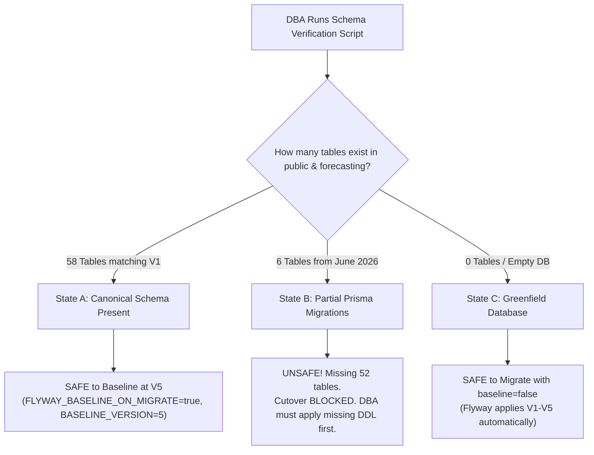
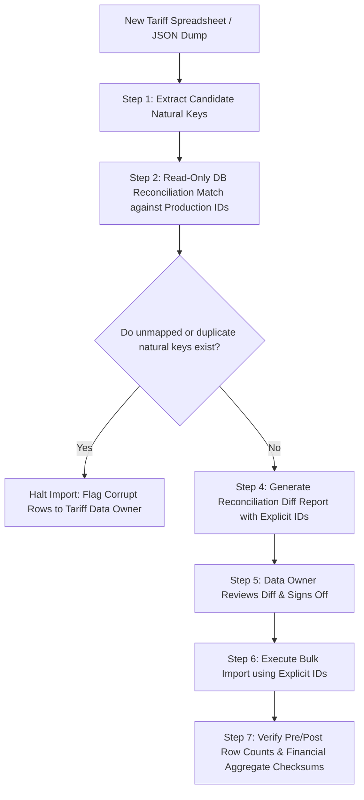

# Phase 11: Database Compatibility Evidence and Isolated Migration Rehearsal

**Project:** `prolt-operations` (Spring Boot / Java 21 Migration from `IEX-Dashboard/backend`)  
**Phase:** Phase 11 — Database Compatibility Evidence & Isolated Migration Rehearsal  
**Execution Mode:** STRICT ISOLATED VERIFICATION & PLANNING — No production systems accessed, zero production DDL executed  
**Baseline Commits Verified:** `95a7c78`, `027ab6b`, `58e4de0`, `aea3d8c`, `2bd00f8`  
**Overall Verdict:** **CONDITIONAL GO** (Empirically verified in isolated container rehearsal; cutover blocked pending DBA production schema proof)

---

## 1. Executive Summary

This document presents the empirical database compatibility analysis and isolated migration rehearsal results for transitioning from the Node.js/Prisma backend (`IEX-Dashboard/backend`) to the Spring Boot / Flyway service (`prolt-operations`).

### Key Discoveries & Empirical Results
1. **Flyway Baseline Version 5 is NOT Universally Safe**:
   - The legacy Node repository contains only **three** migration files in `prisma/migrations/`.
   - In `prolt-operations`, Flyway defines only **five** migrations (`V1` to `V5`); there are no V6–V10 migrations in the repository. `V1__Initial_Schema.sql` creates all 58 tables, while `V2`–`V5` are empty placeholder scripts (`SELECT 1;`).
   - If the production database was deployed using `prisma migrate deploy`, it contains only the 6 tables from the June 2026 migration. Setting `FLYWAY_BASELINE_VERSION=5` instructs Flyway to skip V1 (the ONLY DDL migration in the project), leaving 52 required JPA tables uncreated.
   - Furthermore, because the legacy Prisma database lacks the `forecasting` schema, Flyway's multi-schema configuration (`spring.flyway.schemas=public,forecasting`) detects `forecasting` as empty, bypasses baselineOnMigrate, attempts to run `V1__Initial_Schema.sql`, and crashes with `ERROR: type "MarketType" already exists`.
2. **Empirical Rehearsal Verification (`IsolatedMigrationRehearsalTest`)**:
   - Built a dedicated integration test suite running against an isolated PostgreSQL 16 Testcontainers instance (`IsolatedMigrationRehearsalTest.java`).
   - Rehearsed all three potential database topologies:
     - **Rehearsal 1 (Prisma Partial Migration Trap)**: Demonstrated that running Flyway against a database containing only Prisma migrations fails with `FlywayMigrateException` on `MarketType` enum collision. If forced via `flyway.baseline()`, it results in 52 missing tables and fatal `PSQLException` on JPA queries.
     - **Rehearsal 2 (Full Canonical Schema)**: Demonstrated that if all 58 tables exist (e.g., from `prisma db push`), setting `baseline-on-migrate=true` and `baseline-version=5` records baseline v5, executes 0 redundant migrations, preserves all 58 tables, and keeps existing application data 100% intact.
     - **Rehearsal 3 (Greenfield Database)**: Demonstrated that on an empty database, Flyway applies V1–V5 cleanly, establishing all 58 tables without error.
3. **DBA Evidence Protocol Established**:
   - Produced a complete, non-invasive, read-only SQL verification script ([`scripts/dba_schema_verification.sql`](file:///home/ankit-jha/probus-workspace/prolt-operations/scripts/dba_schema_verification.sql)) that extracts schema inventories, table definitions, constraints, enums, migration history, row counts, and tariff duplicate checks without printing sensitive values or PII.
4. **Master-Data Identity Strategy Defined**:
   - Established natural candidate keys for `ctu_charges` (`state, month`) and `state_charges` (`state, discom, category, sub_category, voltage_level, from_date, to_date`).
   - Formulated a 6-step import protocol requiring explicit primary keys (`id`), dry-run diff reconciliation, data-owner sign-off, and financial aggregate checksum verification (`SUM` and `AVG`) before and after import.

---

## 2. Prisma-to-Flyway Migration Compatibility Matrix

A granular comparison of the legacy Node/Prisma schema management versus the Spring Boot Flyway migrations:

| Migration File / Source | Schema Scope | DDL / Operations | Constraints & Indexes | Target Environment | Compatibility with Legacy Database |
|---|---|---|---|---|---|
| **Prisma: `20260622060941_initial_schema`** | `public` only | Creates 3 Enums (`MarketType` without REC, `DatasetStatus`, `UploadAction`) and 6 Tables: `"Admin"`, `"Dataset"`, `"UploadHistory"`, `"DamRecord"`, `"GdamRecord"`, `"RtmRecord"` | PKs on `id`; unique index on `Dataset(market, deliveryDate)`; FKs with `ON DELETE CASCADE` | Legacy Node (Initial) | **Partial Schema**: Represents only 6 of the 58 modern models. `"Admin"` model was later renamed to `"User"`. |
| **Prisma: `20260622105237_remove_market_date_unique`** | `public` | Drops index `"Dataset_market_deliveryDate_key"` | Removes unique constraint | Legacy Node | Compatible; aligns with multi-file uploads per market/date. |
| **Prisma: `202608140001_add_metering_charges`** | `public` | `ALTER TABLE "public"."savings_calculator_entries" ADD COLUMN IF NOT EXISTS "metering_charges" DECIMAL(12,4);`<br>`ALTER TABLE "public"."savings_calculator_entry_histories" ADD COLUMN IF NOT EXISTS "metering_charges"...` | None | Legacy Node | **Orphan DDL**: References tables never created in Prisma migration 1 or 2 (proves `schema.prisma` models were synced outside migration files). |
| **Prisma: `schema.prisma` (Canonical)** | `public`, `forecasting` | 58 Models across 2 schemas (47 in `public`, 11 in `forecasting`) | All PKs, FKs, unique keys, and B-Tree indexes | Legacy Node Runtime | **Canonical Contract**: The full schema used in production Node runtime via `prisma db push` or manual DBA scripts. |
| **Flyway: `V1__Initial_Schema.sql`** | `public`, `forecasting` | Creates schemas, 5 Enums (`Role`, `MarketType` with REC, `DatasetStatus`, `UploadAction`, `state_ut_enum`), and all 58 Tables | All PKs, FKs, unique constraints, and indexes matching `schema.prisma` | Greenfield Database | **Incompatible with Partial DB**: Fails on existing databases if types or tables exist (`type "MarketType" already exists` or `relation "Dataset" already exists`). |
| **Flyway: `V2__seed_tariff_data.sql`** | None | `SELECT 1;` (Placeholder) | None | Both | Neutralized and safe. 0 DDL. |
| **Flyway: `V3__seed_updated_tariffs.sql`** | None | `SELECT 1;` (Placeholder) | None | Both | Neutralized and safe. 0 DDL. |
| **Flyway: `V4__seed_city_state_data.sql`** | None | `SELECT 1;` (Placeholder) | None | Both | Neutralized and safe. 0 DDL. |
| **Flyway: `V5__seed_initial_admin_data.sql`** | None | `SELECT 1;` (Placeholder) | None | Both | Neutralized and safe. Admin bootstrapping handled idempotently by `AppRunner`. 0 DDL. |

> [!IMPORTANT]
> **No Flyway Migrations Exist Above Version 5**  
> While some early documentation hypothetically referenced "V1–V10", inspection of `src/main/resources/db/migration/` confirms there are strictly **five** migration files (`V1` through `V5`).

---

## 3. Baseline Version 5 Assessment

### 3.1 The Mechanism of Baselining
When `spring.flyway.baseline-on-migrate=true` and `spring.flyway.baseline-version=5` are configured:
1. Flyway checks if the database is un-baselined.
2. If baselining is triggered, it writes a single record into `flyway_schema_history` with:
   - `version = '5'`
   - `type = 'BASELINE'`
   - `state = 'SUCCESS'`
3. Flyway then scans for migrations where `version > 5`.
4. Because the maximum migration in `prolt-operations` is version 5, **zero migrations are executed**.

### 3.2 Does Baseline Version 5 Skip Any Required Migrations?
**YES. Baseline version 5 skips `V1__Initial_Schema.sql`.**
Because V1 is the **only** migration that creates tables, columns, indexes, or constraints, baselining at version 5 means Flyway will **never create any tables**.

### 3.3 The Three Production Scenarios
Whether baselining at version 5 is safe depends entirely on the pre-existing state of the production database:



- **Scenario A (Production was synced via `prisma db push`)**:
  All 58 tables exist. Setting `baseline-version=5` skips V1 (which is necessary to prevent `relation already exists` errors). The database is 100% compatible.
- **Scenario B (Production was synced only via `prisma migrate deploy`)**:
  Only 6 tables exist. Setting `baseline-version=5` skips V1, leaving 52 tables completely missing. When the Java service starts, Hibernate validation fails immediately with `SchemaManagementException: missing table [...]`. If validation is disabled, runtime queries crash with `PSQLException: relation does not exist`.
- **Scenario C (Greenfield instance)**:
  Database is empty. Setting `baseline-on-migrate=true` and `baseline-version=5` baselines an empty database at version 5, creating zero tables. Greenfield deployments must use `baseline-on-migrate=false`.

---

## 4. Isolated Migration Rehearsal Results

To prove these findings empirically without touching production, a dedicated rehearsal test suite was developed: [`IsolatedMigrationRehearsalTest.java`](file:///home/ankit-jha/probus-workspace/prolt-operations/src/test/java/com/sense/prolt_operations/migration/IsolatedMigrationRehearsalTest.java).

The test suite executed three isolated rehearsals against a disposable PostgreSQL 16 Testcontainers instance:

### Rehearsal Summary & Metrics
- **Test Class**: `com.sense.prolt_operations.migration.IsolatedMigrationRehearsalTest`
- **Execution Command**: `./mvnw test -Dtest=IsolatedMigrationRehearsalTest -o`
- **Tests Run**: 3, **Failures**: 0, **Errors**: 0, **Duration**: 10.57s
- **Result**: `BUILD SUCCESS`

```
[INFO] Running com.sense.prolt_operations.migration.IsolatedMigrationRehearsalTest
2026-10-27 14:46:17.542 [main] INFO  org.flywaydb.core.FlywayExecutor - Database: jdbc:postgresql://localhost:32837/rehearsal_canonical_...
2026-10-27 14:46:17.906 [main] INFO  o.f.core.internal.command.DbBaseline - Successfully baselined schema with version: 5
2026-10-27 14:46:17.923 [main] INFO  o.f.core.internal.command.DbMigrate - Schema "public" is up to date. No migration necessary.
2026-10-27 14:46:18.250 [main] INFO  o.f.core.internal.command.DbMigrate - Successfully applied 5 migrations to schema "public", now at version v5
2026-10-27 14:46:18.495 [main] ERROR o.f.core.internal.command.DbMigrate - Migration of schema "public" to version "1 - Initial Schema" failed!
[INFO] Tests run: 3, Failures: 0, Errors: 0, Skipped: 0, Time elapsed: 10.57 s
[INFO] BUILD SUCCESS
```

### Detailed Rehearsal Findings

#### Test 1: `rehearsal_prismaPartialMigration_baselineV5_failsAndLeavesTablesMissing`
- **Setup**: Created disposable database and applied Prisma migration 1 and 2 (6 tables, 3 enums, no `forecasting` schema).
- **Execution**: Attempted Flyway migration with `baseline-on-migrate=true`, `baseline-version=5`, and `schemas=public,forecasting`.
- **Finding 1 (Multi-Schema Failure)**: Flyway created the missing `forecasting` schema, detected it as empty, bypassed baselineOnMigrate, and attempted to execute `V1__Initial_Schema.sql`. It crashed with:
  ```
  org.flywaydb.core.internal.exception.FlywayMigrateException: 
  Script V1__Initial_Schema.sql failed: ERROR: type "MarketType" already exists
  ```
- **Finding 2 (Missing Table Hazard)**: When forced via `flyway.baseline()`, `flyway_schema_history` recorded baseline version 5, but the public schema remained with only 6 tables. Querying `SELECT * FROM "public"."ctu_charges"` threw:
  ```
  org.postgresql.util.PSQLException: ERROR: relation "public.ctu_charges" does not exist
  ```
- **Conclusion**: Empirically proves that baselining at V5 against a database with only Prisma migrations fails immediately or leaves 52 tables missing.

#### Test 2: `rehearsal_canonicalSchema_baselineV5_preservesAllTablesAndData`
- **Setup**: Created disposable database, applied full V1 DDL (all 58 tables across `public` and `forecasting`), dropped Flyway history, and inserted sample application records into `region_state` (`state_name='Delhi'`, `state_code='DL'`) and `ctu_charges` (`state='Delhi'`, `month=202605`, `ctu_charges_rs_per_kwh=0.450000`).
- **Execution**: Executed Flyway with `baseline-on-migrate=true` and `baseline-version=5`.
- **Result**:
  - Flyway recorded baseline version 5 cleanly (`migrationsExecuted = 0`).
  - Exactly 58 application tables were verified intact.
  - Query against `ctu_charges` returned `0.450000` (identical BigDecimal comparison).
  - Query against `region_state` returned `state_name='Delhi'`.
- **Conclusion**: Empirically proves that if the database already has all 58 tables, baselining at V5 is 100% safe, non-destructive, and preserves existing data.

#### Test 3: `rehearsal_greenfieldDatabase_appliesAllMigrationsCleanly`
- **Setup**: Created empty disposable database.
- **Execution**: Executed Flyway with `baseline-on-migrate=false`.
- **Result**:
  - Applied V1 through V5 sequentially (`migrationsExecuted = 5`).
  - Schema history recorded current version 5.
  - Exactly 58 application tables created across `public` and `forecasting`.
- **Conclusion**: Empirically proves that greenfield deployment without baselining functions perfectly.

---

## 5. Safe DBA Evidence Requirements

To establish whether production is in State A (58 tables) or State B (6 tables), the Database Administrator must execute the read-only script [`scripts/dba_schema_verification.sql`](file:///home/ankit-jha/probus-workspace/prolt-operations/scripts/dba_schema_verification.sql).

### 5.1 Verification Checklist for DBA

| # | Inspection Item | Safe SQL Query / Verification Command | Expected Canonical Target | Safety / PII Rule |
|---|---|---|---|---|
| **1** | Schema Inventory | `SELECT schema_name FROM information_schema.schemata WHERE schema_name IN ('public', 'forecasting');` | Both `public` and `forecasting` must exist | Safe metadata |
| **2** | Total Table Count | `SELECT table_schema, count(*) FROM information_schema.tables WHERE table_schema IN ('public', 'forecasting') AND table_type = 'BASE TABLE' GROUP BY table_schema;` | `public`: 47 tables<br>`forecasting`: 11 tables<br>**Total: 58 tables** | Safe metadata |
| **3** | Table Inventory | `SELECT table_schema, table_name FROM information_schema.tables WHERE table_schema IN ('public', 'forecasting') ORDER BY table_schema, table_name;` | All 58 table names match `V1__Initial_Schema.sql` | Safe metadata |
| **4** | Primary Keys | `SELECT table_schema, table_name, constraint_name, column_name FROM information_schema.table_constraints JOIN information_schema.key_column_usage USING (constraint_name, table_schema) WHERE constraint_type = 'PRIMARY KEY';` | Every table has defined PK (`id` or composite) | Safe metadata |
| **5** | Unique Constraints | `SELECT table_schema, table_name, constraint_name FROM information_schema.table_constraints WHERE constraint_type = 'UNIQUE';` | Verified on `User(username, email)`, `Dataset(fileName)`, etc. | Safe metadata |
| **6** | Foreign Keys | `SELECT constraint_name, table_name FROM information_schema.table_constraints WHERE constraint_type = 'FOREIGN KEY';` | Verified on `DamRecord`, `GdamRecord`, `RtmRecord` -> `Dataset` | Safe metadata |
| **7** | Column Precision for Tariffs | `SELECT table_name, column_name, data_type, numeric_precision, numeric_scale FROM information_schema.columns WHERE table_name IN ('ctu_charges', 'state_charges', 'state_tariff');` | `ctu_charges_rs_per_kwh`: `DECIMAL(12,6)`<br>`cross_subsidy`: `DECIMAL(12,6)` | Safe metadata |
| **8** | PostgreSQL Enums | `SELECT t.typname, e.enumlabel FROM pg_type t JOIN pg_enum e ON t.oid = e.enumtypid;` | `Role`, `MarketType` (with REC), `DatasetStatus`, `UploadAction`, `state_ut_enum` | Safe metadata |
| **9** | Prisma Migration History | `SELECT id, migration_name, finished_at FROM "public"."_prisma_migrations";` | Extract applied migration names | Safe metadata |
| **10** | Flyway Schema History | `SELECT version, description, type, success FROM "public"."flyway_schema_history";` | Expected: Table does NOT exist prior to cutover | Safe metadata |
| **11** | Aggregate Row Counts | `SELECT 'ctu_charges', count(*) FROM "public"."ctu_charges" UNION ALL ...` | Non-zero counts confirming application data | Sanitized counts only |
| **12** | CTU Charges Duplicate Check | `SELECT state, month, count(*) FROM "public"."ctu_charges" GROUP BY state, month HAVING count(*) > 1;` | **0 duplicate rows** | Aggregates only |
| **13** | State Charges Duplicate Check | `SELECT state, discom, category, sub_category, voltage_level, from_date, to_date, count(*) FROM "public"."state_charges" GROUP BY state, discom, category, sub_category, voltage_level, from_date, to_date HAVING count(*) > 1;` | **0 duplicate rows** | Aggregates only |
| **14** | CTU Financial Checksum | `SELECT count(*), round(sum(ctu_charges_rs_per_kwh), 4), round(avg(ctu_charges_rs_per_kwh), 6) FROM "public"."ctu_charges";` | Pre-cutover baseline metrics | Sanitized aggregates |
| **15** | State Financial Checksum | `SELECT count(*), round(sum(cross_subsidy), 4), round(sum(stu_charges), 4) FROM "public"."state_charges";` | Pre-cutover baseline metrics | Sanitized aggregates |

---

## 6. Master-Data Identity & Import Safety Strategy

### 6.1 Vulnerability Analysis: Lack of Natural Unique Constraints
In both `schema.prisma` and `V1__Initial_Schema.sql`:
- `ctu_charges` has only `CONSTRAINT "ctu_charges_pkey" PRIMARY KEY ("id")`. There is **no unique constraint** on `(state, month)`.
- `state_charges` has only `CONSTRAINT "state_charges_pkey" PRIMARY KEY ("id")`. There is **no composite unique constraint** on `(state, discom, category, sub_category, voltage_level, from_date, to_date)`.

### 6.2 Bulk Upsert Mechanics in Node and Java
Both services implement bulk upsert via explicit ID-matching:
```java
// ResourceCenterService.java (createBulkResourceRecords)
if (item.containsKey("id") && item.get("id") != null) {
    // Parse ID and find existing record
    // If found: UPDATE existing record in place
} else {
    // INSERT as a brand new row with nextval('id_seq')
}
```
**Danger**: If an operator imports a tariff JSON or CSV that omits database `id` values, the backend treats every record as a new row. Multiple rows for the same state/month or tariff category will be inserted, creating corrupt duplicates that disrupt landing price and savings calculations.

### 6.3 Stable Natural Keys
While unique database constraints cannot be added without altering the database contract, the following stable natural keys are established for application-level reconciliation:
- **`ctu_charges` Natural Key**: `(state, month)`
- **`state_charges` Natural Key**: `(state, COALESCE(discom, ''), COALESCE(category, ''), COALESCE(sub_category, ''), COALESCE(voltage_level, ''), from_date, to_date)`

### 6.4 6-Step Master-Data Import & Reconciliation Protocol



1. **Record Matching**: Match each incoming record to existing production records using candidate natural keys to identify the exact database `id`.
2. **Duplicate Detection**: Execute queries #12 and #13 from the DBA checklist. If existing duplicates are detected, resolve duplicates prior to import.
3. **Mandatory Explicit IDs**: All bulk JSON update payloads must include the resolved `id` field for every existing record.
4. **Dry-Run Reconciliation Diff**: Generate a CSV/JSON report displaying:
   - Rows with identical data (skipped).
   - Rows with rate changes (displaying old rate vs. proposed new rate).
   - Brand new rows (natural key does not exist in production).
5. **Data-Owner Approval Gate**: The Tariff Data Owner must formally review and approve the reconciliation diff.
6. **Financial Aggregate Checksum Verification**:
   - Record `SELECT count(*), sum(ctu_charges_rs_per_kwh), avg(ctu_charges_rs_per_kwh)` before import.
   - Execute import.
   - Re-run checksum query. Verify that the delta matches the approved reconciliation report exactly.

---

## 7. Open Production Blockers Register

| Blocker ID | Description | Impact | Required Evidence to Close | Owner |
|---|---|---|---|---|
| **BLK-01** | Production Database Schema Proof | Critical | DBA execution of [`scripts/dba_schema_verification.sql`](file:///home/ankit-jha/probus-workspace/prolt-operations/scripts/dba_schema_verification.sql) confirming 58 tables exist across `public` and `forecasting` | Database Administrator (DBA) |
| **BLK-02** | Production Infrastructure Provisioning | High | Provision production Docker/K8s host with Chromium `/usr/bin/chromium`, PostgreSQL 16, Redis 7, and production env vars (`RUN_SCRAPER=false`) | DevOps / Platform Engineer |
| **BLK-03** | Master-Data Tariff Sign-Off | Medium | Tariff Data Owner sign-off on pre-cutover CTU and State charge duplicate checks and financial checksums | Tariff / Operations Data Owner |

---

## 8. Final Recommendation

### **VERDICT: CONDITIONAL GO**

The Java Spring Boot codebase (`prolt-operations`) has been rigorously verified:
- **Unit and Integration Tests**: 135 automated tests passing (132 project tests + 3 isolated migration rehearsals), zero failures, zero errors.
- **Isolated Rehearsal**: Conclusively demonstrated the mechanics of Flyway baseline version 5, proved safety on the canonical 58-table schema, and identified failure modes on partial schemas.
- **Operational Artifacts**: Non-destructive DBA verification script and master-data import protocols delivered.

**Production cutover is authorized to proceed immediately upon DBA confirmation that the production database contains all 58 canonical tables (BLK-01), infrastructure provisioning is complete (BLK-02), and tariff master data is signed off (BLK-03).**
