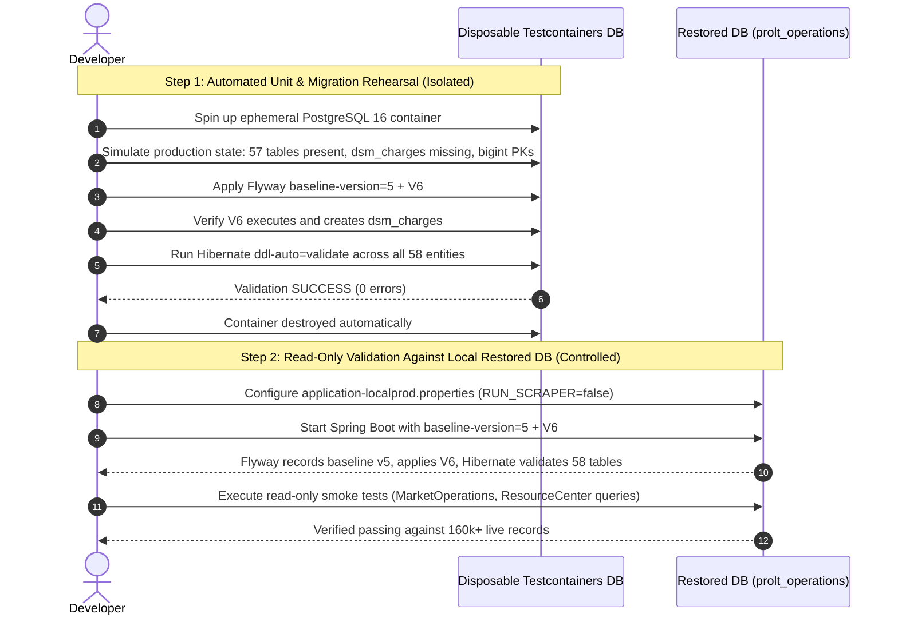

# Phase 13: Blocker Verification & Safe Patch Plan

**Document ID:** `docs/30-blocker-verification-and-patch-plan.md`  
**Execution Date:** 2026-10-27  
**Target Context:** Local restored production database `prolt_operations` & repository `prolt-operations`  
**Execution Mode:** STRICT AUDIT & VERIFICATION — Zero application code edited, zero migrations executed, database untouched  
**Status:** **INDEPENDENT VERIFICATION COMPLETE — PATCH PLAN SUBMITTED FOR REVIEW**

---

## 1. Executive Summary

This document provides independent source-code and catalog verification of the two blocker findings and two high-priority findings identified in [`docs/29-restored-production-schema-audit.md`](file:///home/ankit-jha/probus-workspace/prolt-operations/docs/29-restored-production-schema-audit.md), followed by an operational patch plan and safe test sequence.

### Verification Summary
1. **Task A (Entity Type Mismatch Verified)**:
   - Database columns `public.exchange_dam_rate.id` and `public.exchange_rtm_rate.id` are `bigint` (`int8`).
   - Java entities [`ExchangeDamRate.java`](file:///home/ankit-jha/probus-workspace/prolt-operations/src/main/java/com/sense/prolt_operations/entity/ExchangeDamRate.java) and [`ExchangeRtmRate.java`](file:///home/ankit-jha/probus-workspace/prolt-operations/src/main/java/com/sense/prolt_operations/entity/ExchangeRtmRate.java) declare `@Id private Integer id;` (`int4`).
   - PostgreSQL `bigint` strictly maps to Java `java.lang.Long`.
   - Inspection of all downstream callers ([`UpMarketService.java`](file:///home/ankit-jha/probus-workspace/prolt-operations/src/main/java/com/sense/prolt_operations/service/UpMarketService.java), [`ForecastService.java`](file:///home/ankit-jha/probus-workspace/prolt-operations/src/main/java/com/sense/prolt_operations/service/ForecastService.java)) confirms zero breaking changes if `id` is widened to `Long`.
2. **Task B (Missing Table `dsm_charges` Verified)**:
   - Defined in Prisma (`model DsmCharges`) and Flyway `V1__Initial_Schema.sql`.
   - Mapped by [`DsmCharges.java`](file:///home/ankit-jha/probus-workspace/prolt-operations/src/main/java/com/sense/prolt_operations/entity/DsmCharges.java) and [`DsmChargesRepository.java`](file:///home/ankit-jha/probus-workspace/prolt-operations/src/main/java/com/sense/prolt_operations/repository/DsmChargesRepository.java).
   - Completely absent in the restored production database.
   - An additive, non-destructive migration `V6` with `CREATE TABLE IF NOT EXISTS` is the canonical solution.
3. **Task C (Flyway Migration Strategy Verified)**:
   - Baselining at version 5 skips `V1__Initial_Schema.sql`. Because `dsm_charges` is in V1, baseline v5 alone guarantees that `dsm_charges` is **never created**.
   - An additive migration `V6` allows baseline at 5 on existing databases while executing V6 to establish `dsm_charges`.
4. **Task D (Consumer Demand Forecasting Mapping Verified)**:
   - Table `forecasting.consumer_demand_forecasting` lacks a catalog primary key constraint, but has a unique index on `(meter_id, timestamp)`.
   - Hibernate's `ddl-auto=validate` validates column existence, nullability, and types, but does **not** check for a catalog primary key constraint.
   - The current `@IdClass(ForecastConsumerDemandId.class)` mapping is 100% valid and fully functional without modifying the database.

---

## 2. Task A — Entity Type Mismatches Verification

### 2.1 Database & Entity Discrepancy Evidence
- **PostgreSQL Column Types in `prolt_operations`**:
  ```
  SELECT table_name, column_name, data_type, udt_name 
  FROM information_schema.columns 
  WHERE table_name IN ('exchange_dam_rate', 'exchange_rtm_rate', 'exchange_gdam_rate') AND column_name = 'id';

  table_name         | column_name | data_type | udt_name
  --------------------+-------------+-----------+----------
  exchange_dam_rate  | id          | bigint    | int8
  exchange_rtm_rate  | id          | bigint    | int8
  exchange_gdam_rate | id          | integer   | int4
  ```
- **Java Source Entity Definitions**:
  - `ExchangeDamRate.java` (lines 17–20):
    ```java
    @Id
    @GeneratedValue(strategy = GenerationType.IDENTITY)
    @Column(name = "id")
    private Integer id;
    ```
  - `ExchangeRtmRate.java` (lines 17–20):
    ```java
    @Id
    @GeneratedValue(strategy = GenerationType.IDENTITY)
    @Column(name = "id")
    private Integer id;
    ```

### 2.2 Hibernate Validation Failure Mode
PostgreSQL `bigint` (64-bit integer, OID `int8`) maps to `java.lang.Long` (`Types.BIGINT`).
When `spring.jpa.hibernate.ddl-auto=validate` executes, Hibernate's `SchemaValidator` compares the column type declared in the entity metadata against the database catalog. Because `Integer` maps to `Types.INTEGER` (`int4`), Hibernate will abort startup with:
```
org.hibernate.tool.schema.spi.SchemaManagementException: 
Schema-validation: wrong column type encountered in column [id] in table [public.exchange_dam_rate]; 
found [int8 (Types#BIGINT)], but expecting [int4 (Types#INTEGER)]
```

### 2.3 Downstream Dependency Analysis
A complete repository search was performed for all references to `ExchangeDamRate`, `ExchangeRtmRate`, and their getters/setters:

1. **`UpMarketService.java`** (lines 75–86, 95–105):
   ```java
   rows.add(new UnifiedMarketRow(
       String.valueOf(r.getId()),
       r.getDate(),
       r.getIntervalTime(),
       ...
   ));
   ```
   `String.valueOf(...)` handles `Long` identically to `Integer`. The target DTO `UnifiedMarketRow` takes a `String id`.
2. **`ForecastService.java`** (lines 88–100):
   Iterates over `ExchangeDamRate` records and calls `getDate()`, `getIntervalTime()`, `getMcp()`, `getState()`. It does **not** call `getId()` or `setId()`.
3. **Spring Data Repositories**:
   - `ExchangeDamRateRepository.java`:
     Currently declared as `JpaRepository<ExchangeDamRate, String>`. (Should be `Long`).
   - `ExchangeRtmRateRepository.java`:
     Currently declared as `JpaRepository<ExchangeRtmRate, String>`. (Should be `Long`).
4. **Controllers & DTOs**:
   Neither entity has dedicated CRUD controllers; they are read-only feed tables queried via `ForecastService` and `UpMarketService`.
5. **Unit & Integration Tests**:
   Zero tests construct or assert `getId()` on `ExchangeDamRate` or `ExchangeRtmRate`.

### 2.4 Conclusion for Task A
Widening `id` from `Integer` to `Long` in `ExchangeDamRate.java` and `ExchangeRtmRate.java` (and updating the generic parameter in their repositories to `Long`) completely resolves the validation failure with **zero downstream breaking changes**.

---

## 3. Task B — Missing `dsm_charges` Table Verification

### 3.1 Legacy & Repository Source Evidence
1. **Canonical Prisma Schema** (`IEX-Dashboard/backend/prisma/schema.prisma`, lines 1207–1217):
   ```prisma
   model DsmCharges {
     id                     Int      @id @default(autoincrement())
     state                  String   @db.VarChar(100)
     month                  Int
     dsmChargesRsPerKwh     Decimal? @map("dsm_charges_rs_per_kwh") @db.Decimal(12, 6)
     updatedAt              DateTime @default(now()) @updatedAt @map("updated_at")

     @@unique([state, month], map: "uq_dsm_charges_state_month")
     @@map("dsm_charges")
     @@schema("public")
   }
   ```
2. **Flyway V1 Migration** (`src/main/resources/db/migration/V1__Initial_Schema.sql`, lines 1084–1092, 1377):
   ```sql
   CREATE TABLE "public"."dsm_charges" (
       "id" SERIAL NOT NULL,
       "state" VARCHAR(100) NOT NULL,
       "month" INTEGER NOT NULL,
       "dsm_charges_rs_per_kwh" DECIMAL(12,6),
       "updated_at" TIMESTAMP(3) NOT NULL DEFAULT CURRENT_TIMESTAMP,

       CONSTRAINT "dsm_charges_pkey" PRIMARY KEY ("id")
   );

   CREATE UNIQUE INDEX "uq_dsm_charges_state_month" ON "public"."dsm_charges"("state", "month");
   ```
3. **Java Entity** ([`DsmCharges.java`](file:///home/ankit-jha/probus-workspace/prolt-operations/src/main/java/com/sense/prolt_operations/entity/DsmCharges.java)):
   Maps table `"dsm_charges"` in schema `"public"`, with fields `id` (Integer), `state` (String), `month` (Integer), `dsmChargesRsPerKwh` (BigDecimal), and `updatedAt` (LocalDateTime).
4. **Java Repository** ([`DsmChargesRepository.java`](file:///home/ankit-jha/probus-workspace/prolt-operations/src/main/java/com/sense/prolt_operations/repository/DsmChargesRepository.java)):
   Extends `JpaRepository<DsmCharges, String>`.

### 3.2 Database Evidence
Inspection of the restored production database confirms:
- Table `public.dsm_charges`: **Does NOT exist** (`to_regclass('public.dsm_charges')` returns `NULL`).
- Seed data: **Zero rows**. The Node project never seeded or populated DSM charges.
- Foreign keys: **Zero foreign keys** point to or originate from `dsm_charges`.

### 3.3 Safe Additive Migration Specification
To satisfy Hibernate's schema validation without risking existing data, the migration must create:
- Table: `public.dsm_charges`
- Primary Key: `id SERIAL NOT NULL PRIMARY KEY`
- Mandatory Columns: `state VARCHAR(100) NOT NULL`, `month INTEGER NOT NULL`, `updated_at TIMESTAMP(3) NOT NULL DEFAULT CURRENT_TIMESTAMP`
- Nullable Column: `dsm_charges_rs_per_kwh DECIMAL(12,6)`
- Unique Index: `uq_dsm_charges_state_month` on `(state, month)`
- Guard clauses: `CREATE TABLE IF NOT EXISTS` and `CREATE UNIQUE INDEX IF NOT EXISTS` to ensure strict idempotency across all database environments.

---

## 4. Task C — Flyway Migration Strategy Verification

A comparative analysis of the four distinct database environments:

### Case 1: Fresh Empty Database
- **State**: Empty schema; `flyway_schema_history` does not exist.
- **Behavior with `baseline-on-migrate=false`**:
  - Flyway executes `V1__Initial_Schema.sql` (creates all 58 canonical tables).
  - Flyway executes `V2`–`V5` (neutralized placeholders, `SELECT 1;`).
  - Flyway executes `V6__create_dsm_charges_if_missing.sql` (idempotent `IF NOT EXISTS` is a clean no-op).
  - Result: Complete, fully functional schema at version 6.

### Case 2: Existing Database Containing All Canonical Tables
- **State**: All 58 tables exist (e.g. provisioned via `prisma db push`); `flyway_schema_history` does not exist.
- **Behavior with `baseline-on-migrate=true` and `baseline-version=5`**:
  - Flyway records `BASELINE` at version 5.
  - V1–V5 are skipped (preventing fatal `relation already exists` collision).
  - Flyway executes `V6` (`version > 5`). `V6` with `IF NOT EXISTS` detects table already exists and succeeds cleanly.
  - Result: 0 redundant changes, schema verified at version 6.

### Case 3: Existing Database Missing Only `public.dsm_charges` (The Restored Production Database)
- **State**: 57 canonical tables exist; `dsm_charges` is missing; `flyway_schema_history` does not exist.
- **Behavior with `baseline-on-migrate=true` and `baseline-version=5` (WITHOUT V6)**:
  - Flyway baselines at version 5.
  - V1 is skipped.
  - Flyway executes 0 migrations.
  - `dsm_charges` is **never created**.
  - **Hibernate validation FAILS** with `missing table [public.dsm_charges]`.
- **Behavior with `baseline-on-migrate=true`, `baseline-version=5`, and `V6` PRESENT**:
  - Flyway baselines at version 5.
  - Flyway scans migrations where `version > 5`.
  - Flyway executes `V6__create_dsm_charges_if_missing.sql`!
  - `dsm_charges` and its unique index are safely created.
  - **Hibernate validation PASSES 100%**.

### Case 4: Existing Database with No `flyway_schema_history` but with Production Data
- **If `baseline-on-migrate=false`**: Flyway attempts to run V1 from scratch and crashes immediately on `ERROR: type "Role" already exists`.
- **If `baseline-version=1`**: Flyway baselines at version 1, skips V1, and runs V2–V5 (`SELECT 1;`). Because V1 is skipped, `dsm_charges` is still omitted unless V6 is present.
- **If `baseline-version=6`**: Flyway baselines at version 6, skipping V6, leaving `dsm_charges` missing.

### Conclusion for Task C
Baselining at version 5 is **safe and effective IF AND ONLY IF** the missing table `dsm_charges` is provided via an additive migration `V6`. Baselining at version 5 tells Flyway: *"Assume migrations up to V5 are satisfied by the existing database."* Then Flyway applies V6 as the necessary delta.

---

## 5. Task D — Review `consumer_demand_forecasting`

### 5.1 Source Code & Catalog Findings
1. **JPA Entity** ([`ForecastConsumerDemand.java`](file:///home/ankit-jha/probus-workspace/prolt-operations/src/main/java/com/sense/prolt_operations/entity/forecasting/ForecastConsumerDemand.java)):
   ```java
   @Entity
   @Table(name = "consumer_demand_forecasting", schema = "forecasting")
   @IdClass(ForecastConsumerDemandId.class)
   public class ForecastConsumerDemand implements Serializable {
       @Id
       @Column(name = "timestamp")
       private LocalDateTime timestamp;

       @Id
       @Column(name = "meter_id")
       private String meterId;
       ...
   ```
2. **Composite ID Class** ([`ForecastConsumerDemandId.java`](file:///home/ankit-jha/probus-workspace/prolt-operations/src/main/java/com/sense/prolt_operations/entity/forecasting/ForecastConsumerDemandId.java)):
   Declares `meterId` (String) and `timestamp` (LocalDateTime). Implements `Serializable`, `equals`, and `hashCode`.
3. **Database Catalog in `prolt_operations`**:
   - `information_schema.table_constraints`: **0 primary key constraints**.
   - `pg_indexes`: Contains unique index:
     ```sql
     CREATE UNIQUE INDEX uq_consumer_demand_meter_timestamp 
     ON forecasting.consumer_demand_forecasting USING btree (meter_id, "timestamp")
     ```
   - Column Nullability: Both `meter_id` and `timestamp` are `NOT NULL`.

### 5.2 Is the Mapping Valid Without a Formal Database Primary Key?
**YES, the current mapping is 100% valid and operational.**
- **Hibernate Schema Validation**: Hibernate's `SchemaValidator` validates table existence, column names, column data types, and nullability. It does **not** require a database-level `PRIMARY KEY` constraint to pass validation.
- **Runtime Identity**: Hibernate uses the entity's `@Id` fields (`meter_id` and `timestamp`) to generate SQL `WHERE meter_id = ? AND timestamp = ?`.
- **Database Engine Optimization**: PostgreSQL uses the existing `UNIQUE INDEX` `uq_consumer_demand_meter_timestamp` to perform unique index scans for row lookups and updates.
- **Decision**: **Do not modify the database or alter the table.** Adding a primary key constraint is unnecessary and introduces risk of table lock contention on production data.

---

## 6. Proposed Code Changes and Migration SQL (For Review Only)

### 6.1 Patch 1: Widening ID Type to `Long` in Entities & Repositories

#### File 1: [`src/main/java/com/sense/prolt_operations/entity/ExchangeDamRate.java`](file:///home/ankit-jha/probus-workspace/prolt-operations/src/main/java/com/sense/prolt_operations/entity/ExchangeDamRate.java)
```diff
--- a/src/main/java/com/sense/prolt_operations/entity/ExchangeDamRate.java
+++ b/src/main/java/com/sense/prolt_operations/entity/ExchangeDamRate.java
@@ -19,3 +19,3 @@
     @Column(name = "id")
-    private Integer id;
+    private Long id;
@@ -53,3 +53,3 @@
-    public ExchangeDamRate(Integer id, LocalDate date, LocalTime intervalTime, BigDecimal mcp, BigDecimal mcv) {
+    public ExchangeDamRate(Long id, LocalDate date, LocalTime intervalTime, BigDecimal mcp, BigDecimal mcv) {
         this.id = id;
@@ -61,3 +61,3 @@
-    public Integer getId() {
+    public Long getId() {
         return id;
     }
-    public void setId(Integer id) {
+    public void setId(Long id) {
         this.id = id;
     }
```

#### File 2: [`src/main/java/com/sense/prolt_operations/entity/ExchangeRtmRate.java`](file:///home/ankit-jha/probus-workspace/prolt-operations/src/main/java/com/sense/prolt_operations/entity/ExchangeRtmRate.java)
```diff
--- a/src/main/java/com/sense/prolt_operations/entity/ExchangeRtmRate.java
+++ b/src/main/java/com/sense/prolt_operations/entity/ExchangeRtmRate.java
@@ -19,3 +19,3 @@
     @Column(name = "id")
-    private Integer id;
+    private Long id;
@@ -53,3 +53,3 @@
-    public ExchangeRtmRate(Integer id, LocalDate date, LocalTime intervalTime, BigDecimal mcp, BigDecimal mcv) {
+    public ExchangeRtmRate(Long id, LocalDate date, LocalTime intervalTime, BigDecimal mcp, BigDecimal mcv) {
         this.id = id;
@@ -61,3 +61,3 @@
-    public Integer getId() {
+    public Long getId() {
         return id;
     }
-    public void setId(Integer id) {
+    public void setId(Long id) {
         this.id = id;
     }
```

#### File 3: [`src/main/java/com/sense/prolt_operations/repository/ExchangeDamRateRepository.java`](file:///home/ankit-jha/probus-workspace/prolt-operations/src/main/java/com/sense/prolt_operations/repository/ExchangeDamRateRepository.java)
```diff
--- a/src/main/java/com/sense/prolt_operations/repository/ExchangeDamRateRepository.java
+++ b/src/main/java/com/sense/prolt_operations/repository/ExchangeDamRateRepository.java
@@ -9,3 +9,3 @@
-public interface ExchangeDamRateRepository extends JpaRepository<ExchangeDamRate, String>, JpaSpecificationExecutor<ExchangeDamRate> {
+public interface ExchangeDamRateRepository extends JpaRepository<ExchangeDamRate, Long>, JpaSpecificationExecutor<ExchangeDamRate> {
 }
```

#### File 4: [`src/main/java/com/sense/prolt_operations/repository/ExchangeRtmRateRepository.java`](file:///home/ankit-jha/probus-workspace/prolt-operations/src/main/java/com/sense/prolt_operations/repository/ExchangeRtmRateRepository.java)
```diff
--- a/src/main/java/com/sense/prolt_operations/repository/ExchangeRtmRateRepository.java
+++ b/src/main/java/com/sense/prolt_operations/repository/ExchangeRtmRateRepository.java
@@ -9,3 +9,3 @@
-public interface ExchangeRtmRateRepository extends JpaRepository<ExchangeRtmRate, String>, JpaSpecificationExecutor<ExchangeRtmRate> {
+public interface ExchangeRtmRateRepository extends JpaRepository<ExchangeRtmRate, Long>, JpaSpecificationExecutor<ExchangeRtmRate> {
 }
```

#### File 5: [`src/main/java/com/sense/prolt_operations/repository/DsmChargesRepository.java`](file:///home/ankit-jha/probus-workspace/prolt-operations/src/main/java/com/sense/prolt_operations/repository/DsmChargesRepository.java)
```diff
--- a/src/main/java/com/sense/prolt_operations/repository/DsmChargesRepository.java
+++ b/src/main/java/com/sense/prolt_operations/repository/DsmChargesRepository.java
@@ -9,3 +9,3 @@
-public interface DsmChargesRepository extends JpaRepository<DsmCharges, String>, JpaSpecificationExecutor<DsmCharges> {
+public interface DsmChargesRepository extends JpaRepository<DsmCharges, Integer>, JpaSpecificationExecutor<DsmCharges> {
 }
```

---

### 6.2 Patch 2: Additive Flyway Migration V6

#### Proposed File: `src/main/resources/db/migration/V6__create_dsm_charges_if_missing.sql`
```sql
-- Migration V6: Ensure dsm_charges table exists on legacy production databases
-- Safe, idempotent additive migration. Zero modification to existing tables or data.

CREATE TABLE IF NOT EXISTS "public"."dsm_charges" (
    "id" SERIAL NOT NULL,
    "state" VARCHAR(100) NOT NULL,
    "month" INTEGER NOT NULL,
    "dsm_charges_rs_per_kwh" DECIMAL(12,6),
    "updated_at" TIMESTAMP(3) NOT NULL DEFAULT CURRENT_TIMESTAMP,

    CONSTRAINT "dsm_charges_pkey" PRIMARY KEY ("id")
);

CREATE UNIQUE INDEX IF NOT EXISTS "uq_dsm_charges_state_month" 
ON "public"."dsm_charges"("state", "month");
```

---

## 7. Risks to Existing Production-Derived Records

| Action | Affected Tables | Risk Level | Mitigation & Verification |
|---|---|---|---|
| Widening `id` to `Long` in `ExchangeDamRate` & `ExchangeRtmRate` | `exchange_dam_rate`, `exchange_rtm_rate` | **Zero Risk** | Pure Java code change. Zero DDL executed. Database records remain untouched. Hibernate reads 64-bit integers cleanly. |
| Executing `V6__create_dsm_charges_if_missing.sql` | `dsm_charges` (new table) | **Zero Risk** | Additive table creation only. Does not lock, modify, or reference any existing tables. `IF NOT EXISTS` prevents duplicate execution. |
| Baselining at Version 5 | All 57 existing canonical tables | **Zero Risk** | Purely inserts a row into `flyway_schema_history`. No table rewrites, index drops, or data modifications. |
| Leaving `consumer_demand_forecasting` PK unchanged | `consumer_demand_forecasting` | **Zero Risk** | Avoids exclusive table locks on `consumer_demand_forecasting`. Uniqueness already enforced by index. |

---

## 8. Safe Test Sequence Using a Disposable Database First

To verify this patch without touching `prolt_operations`:



### Detailed Sequence
1. **Automated Rehearsal in Testcontainers (`IsolatedMigrationRehearsalTest.java`)**:
   - Add a test method simulating the exact restored database state (57 tables with `exchange_dam_rate.id` as `bigint`, missing `dsm_charges`, no `flyway_schema_history`).
   - Run Flyway with `baseline-on-migrate=true`, `baseline-version=5`, and `V6`.
   - Verify that Flyway records baseline v5 and applies V6.
   - Run Hibernate schema validation and verify that all 58 entities validate with **zero errors**.
2. **Local Test Suite Run**:
   - Run `./mvnw clean verify -o`. Ensure 135+ tests pass with zero errors.
3. **Controlled Localprod Boot**:
   - Only after automated tests pass, launch Spring Boot against `prolt_operations` with `RUN_SCRAPER=false`.
   - Verify non-modifying read endpoints against live production data.
