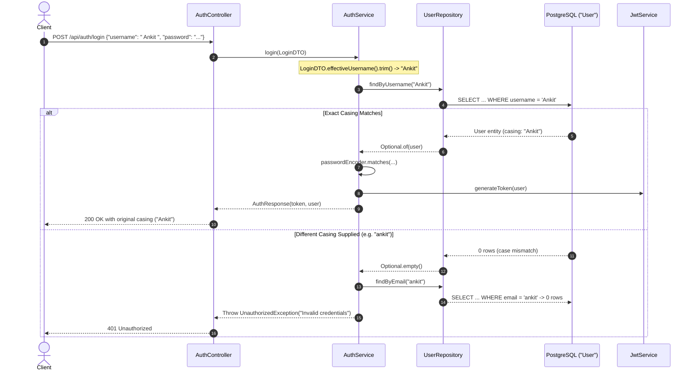

# Read-Only Audit: Case-Insensitive Username Uniqueness and Authentication

**Document Reference**: `docs/32-username-case-insensitive-audit.md`  
**Date**: 2026-10-30  
**Repository**: `prolt-operations`  
**Target Database**: Local restored production PostgreSQL database `prolt_operations` (PostgreSQL 16.14 on `localhost:5432`)  
**Audit Status**: STRICTLY READ-ONLY (Zero mutations performed)

---

## Executive Summary

The business requirement mandates that usernames in `prolt-operations` be treated as case-insensitive and whitespace-insensitive for uniqueness and authentication:
- Inputs `Ankit`, `ankit`, `ANKIT`, and ` Ankit ` must resolve to the identical user account.
- New user registration or admin creation must reject any variant of an existing username regardless of casing or surrounding whitespace.
- The original casing provided upon account creation must be preserved in storage for user profile display throughout the application and APIs.
- Username immutability after account creation must remain strictly enforced.

This read-only audit inspected the restored production-derived database and Java codebase to determine current behavior, evaluate migration strategies, and establish the implementation and testing plan.

---

## 1. Current Implementation Findings

### 1.1 JPA Entity Mapping (`User.java`)
- The `User` entity maps the `username` column as:
  ```java
  @Column(name = "username", nullable = false, unique = true, updatable = false)
  private String username;
  ```
- The entity maps to standard PostgreSQL `VARCHAR(50)`.
- No casing normalization occurs in entity lifecycle callbacks (`@PrePersist`, `@PreUpdate`).
- When an entity is persisted, the string is saved with whatever casing was supplied to `user.setUsername(...)`.
- `username` is strictly marked `updatable = false`, preventing Hibernate from including `username` in SQL `UPDATE` statements.

### 1.2 Data Access Layer (`UserRepository.java`)
- The repository interface defines:
  ```java
  Optional<User> findByUsername(String username);
  boolean existsByUsername(String username);
  ```
- In Spring Data JPA against PostgreSQL, these derived queries translate to exact, case-sensitive equality:
  ```sql
  SELECT ... FROM "public"."User" WHERE "username" = ?;
  SELECT COUNT(*) > 0 FROM "public"."User" WHERE "username" = ?;
  ```
- Because PostgreSQL `VARCHAR` equality operator (`=`) is case-sensitive, queries fail to match if the casing differs in any character.

### 1.3 Authentication Service (`AuthService.java`)
- In `AuthService.login(LoginDTO dto)`:
  ```java
  String username = dto.effectiveUsername().trim();
  String password = dto.password().trim();

  User user = userRepository.findByUsername(username)
          .or(() -> userRepository.findByEmail(username))
          .orElseThrow(() -> new UnauthorizedException("Invalid credentials"));
  ```
- While `LoginDTO.effectiveUsername()` and `AuthService` trim leading and trailing whitespace, the lookup uses `userRepository.findByUsername(username)`.
- If an account was registered as `Ankit`, logging in with `ankit`, `ANKIT`, or ` Ankit ` will result in:
  1. `findByUsername("ankit")` -> empty `Optional`.
  2. Fallback `findByEmail("ankit")` -> empty `Optional`.
  3. Throws `UnauthorizedException("Invalid credentials")` (HTTP 401).

### 1.4 User Provisioning and Administration (`UserService.java` & `AppRunner.java`)
- In `UserService.createUser(CreateUserDTO dto, String performedBy)`:
  ```java
  String username = dto.username().trim();
  String email = dto.email().trim();

  if (userRepository.existsByUsername(username) || userRepository.existsByEmail(email)) {
      throw new BadRequestException("Username or email already exists");
  }
  ```
- Because `existsByUsername(username)` is case-sensitive:
  - If `Ankit` already exists, an attempt to create `ankit` or `ANKIT` passes the Java-level validation check because `existsByUsername("ankit")` evaluates to `false`.
  - At the database level, the current unique index `User_username_key` is a standard B-tree index on raw `(username)`. PostgreSQL considers `'Ankit'` and `'ankit'` distinct, allowing the second user to be inserted successfully.
  - This violates the business requirement of case-insensitive uniqueness.
- In `AppRunner.java` (system bootstrap admin creation):
  ```java
  if (userRepository.findByUsername(adminUsername).isPresent()) {
      log.info("Admin user already exists, skipping: {}", adminUsername);
      return;
  }
  ```
  Case mismatch between environment configuration and database results in duplicate creation attempts.

---

## 2. Database Findings

The audit connected directly to the local restored production database `prolt_operations` (PostgreSQL 16.14) using read-only SQL queries.

### 2.1 Schema Definition
- **Table**: `public."User"`
- **Column**: `username`
- **Data Type**: `character varying(50)`
- **Nullability**: `NOT NULL` (`is_nullable = NO`)
- **Default Value**: `NULL`

### 2.2 Existing Indexes & Constraints
```
    index_name     | column_name | is_unique | is_primary |                                    index_def                                    
-------------------+-------------+-----------+------------+---------------------------------------------------------------------------------
 User_username_key | username    | t         | f          | CREATE UNIQUE INDEX "User_username_key" ON public."User" USING btree (username)
 User_username_idx | username    | f         | f          | CREATE INDEX "User_username_idx" ON public."User" USING btree (username)
```
- Existing uniqueness is enforced solely by `User_username_key`, which indexes raw `(username)` in a standard case-sensitive B-tree.

### 2.3 Aggregate Data Profile (Zero PII Exposed)
The following aggregate queries were executed against `public."User"`:

```sql
SELECT
    COUNT(*) AS total_users,
    COUNT(CASE WHEN username IS NULL OR TRIM(username) = '' THEN 1 END) AS null_or_empty_usernames,
    COUNT(CASE WHEN username != TRIM(username) THEN 1 END) AS whitespace_padded_usernames
FROM public."User";
```
**Results:**
- `total_users`: **12**
- `null_or_empty_usernames`: **0**
- `whitespace_padded_usernames`: **0**

### 2.4 Duplicate Check
```sql
SELECT LOWER(TRIM(username)) AS normalized_username, COUNT(*)
FROM public."User"
GROUP BY LOWER(TRIM(username))
HAVING COUNT(*) > 1;
```
**Results:**
- **0 rows** returned.
- There are currently **no** case-insensitive duplicate usernames in the database.

```sql
SELECT TRIM(username) AS trimmed_username, COUNT(*)
FROM public."User"
GROUP BY TRIM(username)
HAVING COUNT(*) > 1;
```
**Results:**
- **0 rows** returned.
- There are **no** whitespace-padded duplicate usernames in the database.

### 2.5 Column Length Statistics
- Minimum length: 4 characters
- Maximum length: 13 characters
- Average length: 8.75 characters

---

## 3. Authentication Flow Findings

Tracing the complete authentication flow for username-based login (`POST /api/auth/login`):



### Trace Details
1. **Request Ingestion**: `LoginDTO` receives `username`, `email`, and `password`. Method `effectiveUsername()` checks `username` first, trimming whitespace, and falls back to `email`.
2. **Repository Lookup**: Currently calls `userRepository.findByUsername(username)`. In the database, this executes `WHERE username = $1`, which is case-sensitive.
3. **Password & JWT**: If the user record is retrieved, password comparison is done against BCrypt `user.getPasswordHash()`. If valid, `jwtService.generateToken(user)` serializes `user.getUsername()` (the stored casing) into the JWT token payload.
4. **Session / Principal**: When subsequent authenticated requests arrive with the JWT, `JwtAuthenticationFilter` deserializes the stored casing into `ProltUserPrincipal.getUsername()`.
5. **Key Takeaway**: Storing the original casing on `User` while querying via case-insensitive matching allows seamless login regardless of the casing typed by the user, while preserving the user's preferred casing in JWTs, audit logs, and UI profiles.

---

## 4. Existing Data Compatibility Risks

1. **Duplicate Collisions**:
   - Because our audit verified that `COUNT(*) HAVING COUNT(*) > 1` on `LOWER(TRIM(username))` returns **0 rows**, there is **zero risk of migration collision or failure** when applying a unique case-insensitive functional index to the existing production-derived data.
2. **Whitespace Collisions**:
   - Aggregate inspection confirmed **0** usernames containing leading or trailing whitespace.
3. **Foreign Key or Downstream Reference Integrity**:
   - In `prolt-operations`, relational associations use `User.id` (UUID string), not `User.username`.
   - Tables such as `UserAuditLog` store `targetUser` and `performedBy` as denormalized informational strings. They do not maintain relational foreign keys on `username`.
   - Modifying username uniqueness indexing will have **zero downstream foreign key impact**.

---

## 5. Recommended Implementation Approach

### 5.1 Evaluation of Evaluated Approaches

| Evaluation Criterion | Approach A: PostgreSQL Unique Functional Index | Approach B: Dedicated Normalized Column | Approach C: PostgreSQL `CITEXT` Type |
|---|---|---|---|
| **SQL Definition** | `CREATE UNIQUE INDEX ... ON "User" (LOWER(TRIM(username)))` | `ALTER TABLE "User" ADD COLUMN normalized_username VARCHAR(50)` | `CREATE EXTENSION citext; ALTER TABLE "User" ALTER COLUMN username TYPE citext` |
| **Casing Preservation** | **Yes** (Original casing preserved in `username` column) | **Yes** (Original casing in `username`, lowercase in second column) | **Yes** (`citext` preserves original casing on retrieval) |
| **Hibernate Validation (`ddl-auto=validate`)** | **100% Compatible** (Column remains `VARCHAR(50)`. Hibernate ignores expression indexes) | **Requires Entity Update** (Must add field & keep in sync via JPA) | **Breaks Validation** (Hibernate reports type mismatch between `citext` and `VARCHAR`) |
| **Database Portability & Permissions** | **Standard SQL / High** (No superuser extensions required) | **Standard SQL** | **Low** (Requires `CREATE EXTENSION` rights, often restricted in RDS) |
| **Application Complexity** | **Low** (No dual-column synchronization or trigger needed) | **High** (Requires dual column maintenance on inserts/pre-persist) | **Medium/High** (Requires custom Hibernate dialect / Type mapping) |
| **Index Scan Performance** | **Optimal** (Native PostgreSQL functional B-tree index) | **Optimal** (Standard B-tree on normalized column) | **Optimal** (`citext` uses native B-tree) |
| **Risk Rating** | **Low / Minimal Disruption** | **Moderate / Medium Disruption** | **High / High Disruption** |

### 5.2 Recommendation
**Approach A (Unique Functional Index on `LOWER(TRIM(username))` + Case-Insensitive JPA Repository Queries)** is strongly recommended as the least disruptive, most robust, and highest performance approach:
1. It requires no changes to table structure or column types.
2. It passes Hibernate schema validation without modifying entity column definitions.
3. It enforces case-insensitive and whitespace-trimmed uniqueness at the database engine level.
4. It preserves the exact casing entered by the user for presentation across all read APIs.

---

## 6. Proposed Migration SQL

### Flyway Migration: `V7__enforce_case_insensitive_username_uniqueness.sql`

```sql
-- Migration: V7__enforce_case_insensitive_username_uniqueness.sql
-- Description: Enforce case-insensitive and whitespace-trimmed uniqueness on public."User"(username)

-- 1. Preflight safety check: Ensure no duplicate normalized usernames exist before creating the unique index
DO $$
DECLARE
    dup_count INT;
BEGIN
    SELECT COUNT(*) INTO dup_count
    FROM (
        SELECT LOWER(TRIM("username"))
        FROM "public"."User"
        GROUP BY LOWER(TRIM("username"))
        HAVING COUNT(*) > 1
    ) sub;

    IF dup_count > 0 THEN
        RAISE EXCEPTION 'Migration V7 aborted: Found % case-insensitive duplicate usernames in public."User"', dup_count;
    END IF;
END $$;

-- 2. Drop the redundant case-sensitive unique index if present
DROP INDEX IF EXISTS "public"."User_username_key";

-- 3. Create the case-insensitive unique functional index
CREATE UNIQUE INDEX IF NOT EXISTS "uq_user_username_lower_trim"
ON "public"."User" (LOWER(TRIM("username")));
```

*Note: The existing secondary index `"User_username_idx"` may be retained for sorting or case-sensitive joins, while `"uq_user_username_lower_trim"` enforces uniqueness and accelerates `LOWER(TRIM(username))` lookups.*

---

## 7. Required Java Changes

### 7.1 `UserRepository.java`
Update repository to support case-insensitive, whitespace-trimmed lookups:
```java
@Query("SELECT u FROM User u WHERE LOWER(TRIM(u.username)) = LOWER(TRIM(:username))")
Optional<User> findByUsernameIgnoreCaseTrimmed(@Param("username") String username);

@Query("SELECT COUNT(u) > 0 FROM User u WHERE LOWER(TRIM(u.username)) = LOWER(TRIM(:username))")
boolean existsByUsernameIgnoreCaseTrimmed(@Param("username") String username);

@Query("SELECT u FROM User u WHERE LOWER(TRIM(u.email)) = LOWER(TRIM(:email))")
Optional<User> findByEmailIgnoreCaseTrimmed(@Param("email") String email);

@Query("SELECT COUNT(u) > 0 FROM User u WHERE LOWER(TRIM(u.email)) = LOWER(TRIM(:email))")
boolean existsByEmailIgnoreCaseTrimmed(@Param("email") String email);
```
*Alternatively, standard Spring Data JPA keyword methods can be used:*
```java
Optional<User> findByUsernameIgnoreCase(String username);
boolean existsByUsernameIgnoreCase(String username);
Optional<User> findByEmailIgnoreCase(String email);
boolean existsByEmailIgnoreCase(String email);
```

### 7.2 `AuthService.java`
Update `login` method to use case-insensitive lookup:
```java
String username = dto.effectiveUsername().trim();
String password = dto.password().trim();

User user = userRepository.findByUsernameIgnoreCase(username)
        .or(() -> userRepository.findByEmailIgnoreCase(username))
        .orElseThrow(() -> new UnauthorizedException("Invalid credentials"));
```

### 7.3 `UserService.java`
Update `createUser` to enforce case-insensitive uniqueness check:
```java
String username = dto.username().trim();
String email = dto.email().trim();

if (userRepository.existsByUsernameIgnoreCase(username) || userRepository.existsByEmailIgnoreCase(email)) {
    throw new BadRequestException("Username or email already exists");
}
```
*The stored `username` preserves the original trimmed casing (`user.setUsername(username)`).*

### 7.4 `AppRunner.java`
Update admin bootstrap existence check:
```java
if (userRepository.findByUsernameIgnoreCase(adminUsername).isPresent()) {
    log.info("Admin user already exists, skipping: {}", adminUsername);
    return;
}
```

---

## 8. Test Plan

A dedicated integration test suite `UsernameCaseInsensitiveIntegrationTest.java` will verify:

1. **Registration / Creation Rejection**:
   - Create user with username `"Ankit"`.
   - Attempt to create `"ankit"` -> Expect HTTP 400 (`Username or email already exists`).
   - Attempt to create `"ANKIT"` -> Expect HTTP 400 (`Username or email already exists`).
   - Attempt to create `" Ankit "` -> Expect HTTP 400 (`Username or email already exists`).
2. **Authentication Equivalence**:
   - User registered as `"Ankit"` with password `"Secret123!"`.
   - Login with `"Ankit"` -> 200 OK.
   - Login with `"ankit"` -> 200 OK.
   - Login with `"ANKIT"` -> 200 OK.
   - Login with `" Ankit "` -> 200 OK.
   - All logins authenticate to the same user account and receive valid JWT tokens.
3. **Display Casing Preservation**:
   - `GET /api/users` returns `"username": "Ankit"`.
   - `GET /api/auth/me` returns `"username": "Ankit"`.
   - Direct database entity verification confirms stored `username` is `"Ankit"`.
4. **Immutability Invariant**:
   - Confirm that `PUT /api/users/{id}` cannot change username regardless of casing supplied in update payload.
5. **Database-Level Protection (Constraint Test)**:
   - Attempt direct SQL or repository bypass insertion of duplicate casing (`"Ankit"` and `"ankit"`) -> Expect database unique index violation on `"uq_user_username_lower_trim"`.

---

## 9. Explicit Confirmation

**Explicit confirmation:**
- **Zero database modifications were executed.**
- **No records were updated, inserted, or deleted in `prolt_operations`.**
- **No migrations were created or applied.**
- **No Java source files, configuration files, or build scripts were modified.**
- **No connections to remote production databases were established.**
- **This audit was conducted strictly in read-only mode.**
