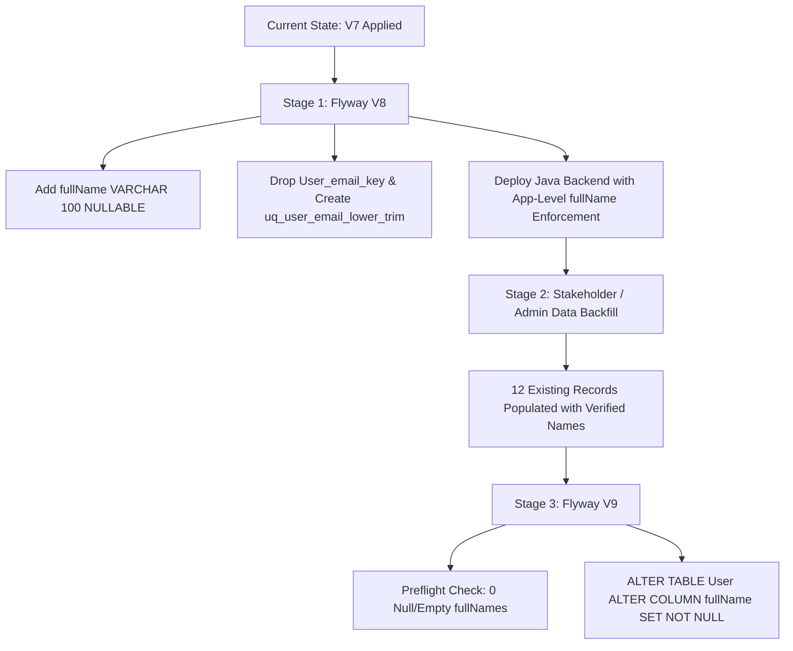

# Audit Report: Email Constraints and Full Name Implementation

**Document Reference**: `docs/35-email-and-full-name-audit.md`  
**Execution Date**: 2026-11-02  
**Repository**: `prolt-operations`  
**Target Database**: `prolt_operations` on `localhost:5432`  
**PostgreSQL Version**: 16.14 (Debian 16.14-1.pgdg13+1)  
**Audit Type**: Read-Only Pre-Implementation Audit  
**Status**: COMPLETE (Zero Code or Database Modifications Made)  

---

## 1. Executive Summary

This report establishes the baseline, risk profile, architectural impact, and staged migration plan for introducing:
1. **Case-insensitive and whitespace-insensitive email uniqueness and authentication**.
2. **A mandatory, editable, non-unique `fullName` field** on user accounts.

All findings are based on an active, read-only inspection of the production-derived PostgreSQL 16 database (`prolt_operations`), the Java 21 backend (`prolt-operations`), the legacy Node.js/Prisma codebase (`IEX-Dashboard/backend`), and the React/TypeScript frontend (`IEX-Dashboard/frontend`).

### Core Target Identity Model
| Field | Required | Unique | Editable | Target Specification |
|---|---|---|---|---|
| `id` | Yes | Yes (PK) | No | UUID string primary key |
| `username` | Yes | Yes (case-insensitive) | No | Preserved display casing; immutable post-creation |
| `email` | Yes | Yes (case-insensitive) | Yes | Trimmed and case-folded; direct update without verification |
| `fullName` | Yes | No | Yes | Single `VARCHAR(100)` field; editable by user/admin; non-unique |
| `password` | Yes | No | Yes | BCrypt hashed; updated via user update API |

### Key Architectural Decisions
- **No Email Verification**: Per business requirements, email updates and registrations do not trigger OTP, verification tokens, confirmation links, or activation workflows.
- **Username Model Unchanged**: Existing username case-insensitivity (Flyway V7), immutability, and indexing remain 100% untouched.
- **No Name Fabrication**: Existing database records do not possess full names. The migration must follow a safe, staged rollout (Expand $\rightarrow$ Backfill $\rightarrow$ Contract) rather than fabricating fake or placeholder names from usernames or emails.

---

## 2. Phase 1 — Database Audit (`prolt_operations`)

### 2.1 Schema Definition of `public."User"`
Inspected via `information_schema.columns` on `localhost:5432/prolt_operations`:

| Column Name | Data Type | Max Length | Nullable | Default Value | Notes |
|---|---|---|---|---|---|
| `id` | `text` | *null* | **NO** | *none* | UUID Primary Key |
| `username` | `character varying` | 50 | **NO** | *none* | Case-insensitive unique via `uq_user_username_lower_trim` |
| `email` | `character varying` | 255 | **NO** | *none* | Currently case-sensitive unique via `User_email_key` |
| `passwordHash` | `character varying` | 255 | **NO** | *none* | BCrypt password hash |
| `role` | USER-DEFINED | *null* | **NO** | `'CLIENT'::"Role"` | Enum: `CLIENT`, `ADMIN`, `SUPER_ADMIN` |
| `hiddenModules` | `ARRAY` (`text[]`) | *null* | YES | `ARRAY[]::text[]` | Module access control |
| `readOnlyModules` | `ARRAY` (`text[]`) | *null* | YES | `ARRAY[]::text[]` | Read-only permissions |
| `createdAt` | `timestamp without time zone` | *null* | **NO** | `CURRENT_TIMESTAMP` | Account creation timestamp |
| `updatedAt` | `timestamp without time zone` | *null* | **NO** | *none* | Last modification timestamp |

### 2.2 Existing Constraints and Indexes
```sql
-- Constraints in pg_constraint
SELECT conname, contype, pg_get_constraintdef(oid) 
FROM pg_constraint 
WHERE conrelid = 'public."User"'::regclass;
```
- `User_pkey`: `PRIMARY KEY (id)` (Only constraint in `pg_constraint`)

```sql
-- Indexes in pg_indexes
SELECT indexname, indexdef 
FROM pg_indexes 
WHERE schemaname = 'public' AND tablename = 'User' 
ORDER BY indexname;
```
1. `User_email_idx`: `CREATE INDEX "User_email_idx" ON public."User" USING btree (email)`
2. `User_email_key`: `CREATE UNIQUE INDEX "User_email_key" ON public."User" USING btree (email)` *(Standalone unique index, case-sensitive)*
3. `User_pkey`: `CREATE UNIQUE INDEX "User_pkey" ON public."User" USING btree (id)`
4. `User_username_idx`: `CREATE INDEX "User_username_idx" ON public."User" USING btree (username)`
5. `uq_user_username_lower_trim`: `CREATE UNIQUE INDEX uq_user_username_lower_trim ON public."User" USING btree (lower(TRIM(BOTH FROM username)))`

### 2.3 Aggregate Email Data Quality (PII-Safe)
All metrics computed using aggregate SQL queries without exposing individual records:

| Audit Check | SQL Query Definition | Count | Compliance Status |
|---|---|---|---|
| **Total Accounts** | `COUNT(*)` | **12** | Baseline record count |
| **Null or Empty Emails** | `WHERE email IS NULL OR TRIM(email) = ''` | **0** | Clean (`email` is `NOT NULL`) |
| **Whitespace Padding** | `WHERE email <> TRIM(email)` | **0** | Clean (Zero leading/trailing spaces) |
| **Uppercase Characters** | `WHERE email <> LOWER(email)` | **0** | Clean (All 12 stored emails are 100% lowercase ASCII) |
| **Case-Insensitive Duplicates** | `GROUP BY LOWER(TRIM(email)) HAVING COUNT(*) > 1` | **0** | Clean (Zero duplicates across 12 records) |
| **Format Anomalies** | Regex: `!~* '^[A-Za-z0-9._%+-]+@[A-Za-z0-9.-]+\.[A-Za-z]{2,}$'` | **0** | Clean (100% conform to standard email syntax) |

---

## 3. Phase 2 — Java Backend Audit

### 3.1 Email Storage & Comparison
- **Entity Definition (`User.java`)**:
  ```java
  @Column(name = "email")
  private String email;
  ```
  The entity does not specify `nullable = false` or length constraints at the JPA annotation level, relying on PostgreSQL's column definition (`VARCHAR(255) NOT NULL`).
- **Repository Queries (`UserRepository.java`)**:
  ```java
  Optional<User> findByEmail(String email);
  boolean existsByEmail(String email);
  ```
  These are standard Spring Data JPA derived queries executing `WHERE email = ?`. They are **strictly case-sensitive and whitespace-sensitive**.
- **Defect Identified**: If an administrator creates `User@example.com`, `userRepository.existsByEmail("user@example.com")` evaluates to `false`, and PostgreSQL's legacy `User_email_key` permits both rows.

### 3.2 Authentication & Login Flows
- **Login Identifier (`AuthService.java:56-58`)**:
  ```java
  User user = userRepository.findByNormalizedUsername(username)
          .or(() -> userRepository.findByEmail(username))
          .orElseThrow(() -> new UnauthorizedException("Invalid credentials"));
  ```
  Email is actively accepted as a login identifier in place of username. However, while username lookups use `findByNormalizedUsername`, the email fallback uses `findByEmail(username)`.
  - **Defect Identified**: A user attempting to log in with `Ankit@domain.com` will fail authentication if their stored email is `ankit@domain.com`.
- **OTP Login Flow (`AuthService.java:91-92` & `OtpService.java:91`)**:
  Both `sendOtp` and `verifyOtp` invoke `userRepository.findByEmail(email)` without normalization. Furthermore, `OtpService` keys Redis and in-memory caches using `"otp:" + email`. An un-normalized email creates cache key mismatches.

### 3.3 JWT Claims & Subject Analysis
- **Token Generation (`JwtService.java:101-110`)**:
  ```java
  return Jwts.builder()
          .claim("id", id)
          .claim("username", username)
          .claim("role", role != null ? role.name() : Role.CLIENT.name())
          .claim("hiddenModules", hiddenModules != null ? hiddenModules : Collections.emptyList())
          .claim("readOnlyModules", readOnlyModules != null ? readOnlyModules : Collections.emptyList())
          .issuedAt(now)
          .expiration(expiry)
          .signWith(signingKey)
          .compact();
  ```
  - **Critical Finding**: Email is **NOT** included in the JWT claims or subject (retaining parity with Node.js).
  - **Implication**: Updating a user's email does **not** invalidate active JWTs, require re-authentication, or affect stateless filter authorization.

### 3.4 Email Update Flow (`UserService.java:116-162`)
- **Direct Update**: Email can be updated directly via `PUT /api/users/{id}` using `UpdateUserDTO`.
- **Defects Identified in Current Service Implementation**:
  1. **Missing Uniqueness Pre-check**: `updateUser` updates `user.setEmail(dto.email().trim())` without checking `existsByEmail` for other users.
  2. **Unhandled DB Exceptions**: `updateUser` does not wrap `userRepository.save()` in a `try/catch` for `DataIntegrityViolationException`, causing concurrent duplicate attempts or constraint collisions to return HTTP 500 instead of HTTP 400.
  3. **Case Sensitivity**: The change-detection check `!dto.email().trim().equals(user.getEmail())` is case-sensitive.
  4. **No Verification Dependency**: Confirmed that no verification tokens, OTP, or confirmation emails are triggered or required.
  5. **Username Isolation**: Username is omitted from `UpdateUserDTO` and marked `@Column(updatable = false)` on the entity, preventing accidental overwrite.

### 3.5 Audit Logging
- Both creation (`createUser`) and modification (`updateUser`) log changes to `UserAuditLog` with old and new email values:
  ```json
  {"email": {"old": "old@example.com", "new": "new@example.com"}}
  ```
  Email updates are fully tracked.

---

## 4. Phase 3 — Full Name Audit

### 4.1 Search Across All Layers
| Layer / Component | Location | Name Field Presence | Detail |
|---|---|---|---|
| **Database Table** | `public."User"` | **NONE** | 9 columns total; zero name columns |
| **Java Entity** | `User.java` | **NONE** | No `fullName`, `firstName`, `lastName`, or `displayName` |
| **Java DTOs** | `UserDTO`, `CreateUserDTO`, `UpdateUserDTO` | **NONE** | Omitted from all request/response DTOs |
| **Auth Response** | `AuthUserResponse.java` | **SYNTHETIC** | `@JsonProperty("name") public String name() { return username; }` |
| **Prisma Schema** | `IEX-Dashboard/backend/prisma/schema.prisma` | **NONE** | `model User` has only `id`, `username`, `email`, `role`, modules |
| **Legacy Node Backend** | `IEX-Dashboard/backend/src/modules/users/*` | **NONE** | `UsersService` never stored or processed name |
| **Audit Logs** | `public."UserAuditLog"` | **NONE** | 0 of 44 audit log rows contain any name keys |
| **Frontend Form** | `UserManagementPage.tsx` | **NONE** | Form only renders Username, Email, Role, Permissions |
| **Frontend Table** | `UserManagementPage.tsx` | **NONE** | User column renders `user.username.slice(0, 2)` avatar & `user.username` |
| **Frontend Greeting** | `DashboardPage.tsx` | **CONSUMER** | Renders `Welcome back, {user?.name || 'User'}` |
| **External Auth** | `authService.ts` | **ISOLATED** | Microservice on port 7070 had `firstName`/`lastName`, never linked to `prolt_operations` |

### 4.2 Recommendation on Field Architecture
- **Single Field**: `fullName VARCHAR(100)` is strongly recommended over separate `firstName`/`lastName`.
  - Simplifies identity models, API payloads, and UI forms.
  - Aligns with modern international naming practices (patronymics, mononyms, multi-part surnames).
  - Avoids artificial splitting of user names across diverse customer regions.

---

## 5. Phase 4 — Email Normalization Policy

### 5.1 Proposed Policy
1. **Trimming**: All leading and trailing whitespace stripped (`email.trim()`).
2. **Case Folding**: Canonical lowercase conversion (`email.toLowerCase(Locale.ROOT)`).
3. **Database Unique Index**:
   ```sql
   CREATE UNIQUE INDEX uq_user_email_lower_trim
   ON public."User" (LOWER(TRIM(email)));
   ```
4. **Storage Format**: Store lowercased and trimmed. Because 100% of the existing 12 database records are already lowercase, storing lowercase introduces zero casing mutations and ensures absolute consistency across database rows, logs, Redis keys, and mail headers.

### 5.2 Compatibility Analysis
- **PostgreSQL 16**: Fully supports functional btree expression indexes (`lower(TRIM(BOTH FROM email))`).
- **Hibernate `ddl-auto=validate`**: Hibernate validates column existence and basic type mapping on `@Column(name = "email")`. It does not parse or validate functional index expressions, ensuring seamless application boot.
- **Repository Alignment**: Lookups using `LOWER(TRIM(u.email)) = LOWER(TRIM(:email))` utilize the PostgreSQL functional index via index scan.
- **Legacy Index Cleanup**: The legacy case-sensitive unique index `User_email_key` must be dropped, while non-unique index `User_email_idx` is retained.

---

## 6. Phase 5 — Safe Staged Migration Plan

### 6.1 The Legacy Data Dilemma
- Requirement: `fullName` must be `NOT NULL`.
- Reality: The restored production database has 12 users with **zero** existing full name data.
- Constraint: We must **not** fabricate fake names (e.g. `Unknown`, `N/A`) or copy usernames into full names without approved stakeholder authorization.
- Technical Rule: Executing `ALTER TABLE "User" ADD COLUMN "fullName" VARCHAR(100) NOT NULL;` on a table with existing rows will immediately fail with:
  `ERROR: column "fullName" of relation "User" contains null values`.

### 6.2 Recommended Two-Stage Flyway Strategy



#### Stage 1: Flyway Migration `V8__email_case_insensitive_and_add_fullname.sql`
1. Safely drop legacy `User_email_key` and create `uq_user_email_lower_trim`.
2. Add `fullName VARCHAR(100)` as **NULLABLE** at the database level.
3. In Java `UserService`, enforce `fullName` as strictly mandatory (`@NotBlank`) for all new user creations (`createUser`).
4. Update `UpdateUserDTO` to accept and persist `fullName`.
5. Existing 12 records remain valid without fake data insertion.

#### Stage 2: Verified Data Backfill
1. Business administrators update the 12 existing user records with authentic full names via the user management API or an approved, audited backfill script.

#### Stage 3: Flyway Migration `V9__enforce_fullname_not_null.sql`
1. Preflight check halts if any row still has `fullName IS NULL OR TRIM(fullName) = ''`.
2. Enforce schema strictness:
   ```sql
   ALTER TABLE public."User" ALTER COLUMN "fullName" SET NOT NULL;
   ```
3. Update Java entity to `@Column(name = "fullName", nullable = false)`.

---

## 7. Phase 6 — API and DTO Design

### 7.1 DTO Invariants
- `username`: Strictly excluded from `UpdateUserDTO` (preserves immutability).
- `email`: Mandatory in `CreateUserDTO`, optional in `UpdateUserDTO`, validated for standard email format, normalized to lowercase trimmed.
- `fullName`: Mandatory in `CreateUserDTO`, optional in `UpdateUserDTO`, validated for non-empty string (`1..100` chars), non-unique.

### 7.2 Read DTO Specifications

#### `UserDTO` (`com.sense.prolt_operations.dto.user.UserDTO`)
```java
public record UserDTO(
    String id,
    String username,
    String email,
    String fullName,
    String role,
    List<String> hiddenModules,
    List<String> readOnlyModules,
    LocalDateTime createdAt
) {}
```

#### `AuthUserResponse` (`com.sense.prolt_operations.dto.auth.AuthUserResponse`)
```java
public record AuthUserResponse(
    String id,
    String username,
    String email,
    String fullName,
    String role,
    List<String> hiddenModules,
    List<String> readOnlyModules
) {
    @JsonProperty("name")
    public String name() {
        return (fullName != null && !fullName.isBlank()) ? fullName : username;
    }
}
```
*Note on Parity*: Providing `@JsonProperty("name")` returning `fullName` (falling back to `username` if unbackfilled) guarantees 100% backward compatibility with frontend consumers such as `DashboardPage.tsx` without breaking changes.

### 7.3 Update DTO Specification

#### `UpdateUserDTO` (`com.sense.prolt_operations.dto.user.UpdateUserDTO`)
```java
@JsonIgnoreProperties(ignoreUnknown = true)
public record UpdateUserDTO(
    String email,
    String fullName,
    String password,
    String role,
    List<String> hiddenModules,
    List<String> readOnlyModules
) {}
```
*Notice*: `username` remains omitted. Any `username` sent in the request body is safely ignored by Jackson.

#### `CreateUserDTO` (`com.sense.prolt_operations.dto.user.CreateUserDTO`)
```java
@JsonIgnoreProperties(ignoreUnknown = true)
public record CreateUserDTO(
    String username,
    String email,
    String fullName,
    String password,
    String role,
    List<String> hiddenModules,
    List<String> readOnlyModules
) {}
```

---

## 8. Phase 7 — Proposed Migration Scripts

### Proposed `V8__email_case_insensitive_and_add_fullname.sql`
```sql
-- Migration: V8__email_case_insensitive_and_add_fullname.sql
-- Description: Case-insensitive email uniqueness and additive fullName column

-- 1. Preflight safety check: abort if duplicate normalized emails exist
DO $$
DECLARE
    dup_count INT;
BEGIN
    SELECT COUNT(*) INTO dup_count
    FROM (
        SELECT LOWER(TRIM("email"))
        FROM "public"."User"
        WHERE "email" IS NOT NULL
        GROUP BY LOWER(TRIM("email"))
        HAVING COUNT(*) > 1
    ) d;

    IF dup_count > 0 THEN
        RAISE EXCEPTION 'Flyway migration V8 aborted: Found % duplicate normalized emails in public."User". Resolve duplicates before migrating.', dup_count;
    END IF;
END $$;

-- 2. Safely drop legacy case-sensitive unique index/constraint if it exists
DO $$
BEGIN
    IF EXISTS (
        SELECT 1 FROM pg_constraint
        WHERE conrelid = 'public."User"'::regclass AND conname = 'User_email_key'
    ) THEN
        ALTER TABLE public."User" DROP CONSTRAINT "User_email_key";
    ELSIF EXISTS (
        SELECT 1 FROM pg_class c
        JOIN pg_namespace n ON n.oid = c.relnamespace
        WHERE c.relname = 'User_email_key' AND n.nspname = 'public'
    ) THEN
        DROP INDEX public."User_email_key";
    END IF;
END $$;

-- 3. Create case-insensitive, whitespace-trimmed unique functional index
CREATE UNIQUE INDEX IF NOT EXISTS "uq_user_email_lower_trim"
ON public."User" (LOWER(TRIM("email")));

-- 4. Add fullName column as NULLABLE (Stage 1 of safe staged rollout)
ALTER TABLE public."User"
ADD COLUMN IF NOT EXISTS "fullName" VARCHAR(100);
```

### Proposed `V9__enforce_fullname_not_null.sql` (Future Stage 3)
```sql
-- Migration: V9__enforce_fullname_not_null.sql
-- Description: Enforce NOT NULL on public."User"(fullName) after verified backfill

-- 1. Preflight check: abort if any unbackfilled records remain
DO $$
DECLARE
    missing_count INT;
BEGIN
    SELECT COUNT(*) INTO missing_count
    FROM public."User"
    WHERE "fullName" IS NULL OR TRIM("fullName") = '';

    IF missing_count > 0 THEN
        RAISE EXCEPTION 'Flyway migration V9 aborted: Found % user records with missing fullName. Complete backfill before enforcing NOT NULL.', missing_count;
    END IF;
END $$;

-- 2. Enforce NOT NULL constraint
ALTER TABLE public."User"
ALTER COLUMN "fullName" SET NOT NULL;
```

---

## 9. Required Code Modifications Summary

### 9.1 Java Backend Changes
1. **`User.java`**:
   - Add field `private String fullName;` mapped to `@Column(name = "\"fullName\"")` (or `@Column(name = "fullName")`).
   - Add getters, setters, and constructors.
2. **`UserRepository.java`**:
   - Add explicit normalized queries:
     ```java
     @Query("SELECT u FROM User u WHERE LOWER(TRIM(u.email)) = LOWER(TRIM(:email))")
     Optional<User> findByNormalizedEmail(@Param("email") String email);

     @Query("SELECT COUNT(u) > 0 FROM User u WHERE LOWER(TRIM(u.email)) = LOWER(TRIM(:email))")
     boolean existsByNormalizedEmail(@Param("email") String email);

     @Query("SELECT COUNT(u) > 0 FROM User u WHERE LOWER(TRIM(u.email)) = LOWER(TRIM(:email)) AND u.id <> :id")
     boolean existsByNormalizedEmailExcludingUser(@Param("email") String email, @Param("id") String id);
     ```
   - Override standard `findByEmail` and `existsByEmail` with the same normalized expression.
3. **`UserService.java`**:
   - In `createUser`: Validate `fullName` is non-blank (`1..100` chars); check `existsByNormalizedEmail`; catch `DataIntegrityViolationException`.
   - In `updateUser`: Validate `fullName` if present; if `email` is updated, check `existsByNormalizedEmailExcludingUser`; wrap `saveAndFlush` in `DataIntegrityViolationException` handler.
   - In `toUserDTO`: Pass `user.getFullName()`.
4. **`AuthService.java`**:
   - In `login`: Use `findByNormalizedEmail` for the login identifier fallback.
   - In `verifyOtp`: Use `findByNormalizedEmail`.
   - In `toAuthUserResponse`: Pass `user.getFullName()`.
5. **`OtpService.java`**:
   - Normalize email with `email.trim().toLowerCase(Locale.ROOT)` before looking up repository and before setting/getting Redis/memory keys.
6. **`AppRunner.java`**:
   - Populate `fullName` when bootstrapping the initial administrator (e.g. `"System Administrator"`).

### 9.2 Frontend Changes (`IEX-Dashboard/frontend`)
1. **`api/auth.api.ts`**:
   - Add `fullName?: string;` to `AppUser` interface.
2. **`pages/UserManagementPage.tsx`**:
   - Add `fullName` state variable.
   - Add "Full Name" input field to "Add New User" modal.
   - Add "Full Name" input field to "Edit User" modal.
   - Update user table to display `user.fullName` prominently alongside `user.username`.
   - Include `fullName` in `createUser` and `updateUser` API request payloads.

---

## 10. Comprehensive Test Plan

### 10.1 Email Uniqueness & Normalization Tests
| Test Case ID | Test Description | Action / Input | Expected Result |
|---|---|---|---|
| `EMAIL-01` | Clean User Registration | Email: `first.user@example.com` | HTTP 201 Created; saved in lowercase |
| `EMAIL-02` | Exact Duplicate Email Rejection | Email: `first.user@example.com` | HTTP 400 (`Username or email already exists`) |
| `EMAIL-03` | Uppercase Casing Duplicate Rejection | Email: `FIRST.USER@EXAMPLE.COM` | HTTP 400 (`Username or email already exists`) |
| `EMAIL-04` | Mixed Casing Duplicate Rejection | Email: `First.User@Example.Com` | HTTP 400 (`Username or email already exists`) |
| `EMAIL-05` | Whitespace Padded Duplicate Rejection | Email: `  first.user@example.com  ` | HTTP 400 (`Username or email already exists`) |
| `EMAIL-06` | Race Condition Safety | Concurrent registration requests with identical normalized email | Exactly 1 succeeds (201); concurrent request returns HTTP 400 cleanly |

### 10.2 Email Authentication Tests
| Test Case ID | Test Description | Action / Input | Expected Result |
|---|---|---|---|
| `AUTH-EM-01` | Login with Uppercase Email | Login payload: `{username: "FIRST.USER@EXAMPLE.COM", password: "..."}` | HTTP 200 OK; JWT token issued |
| `AUTH-EM-02` | Login with Whitespace Email | Login payload: `{username: "  first.user@example.com  ", password: "..."}` | HTTP 200 OK; JWT token issued |
| `AUTH-EM-03` | Username Login Unaffected | Login payload: `{username: "FirstUser", password: "..."}` | HTTP 200 OK; username auth unchanged |
| `AUTH-EM-04` | OTP with Mixed Case Email | `sendOtp` and `verifyOtp` with `First.User@example.com` | OTP generated and verified successfully |

### 10.3 Email Direct Update Tests
| Test Case ID | Test Description | Action / Input | Expected Result |
|---|---|---|---|
| `UPD-EM-01` | User Updates Email Directly | PUT `/api/users/{id}` with new email | HTTP 200 OK; email updated without verification |
| `UPD-EM-02` | Duplicate Email Update Rejection | PUT `/api/users/{id}` with email of another user | HTTP 400 (`Username or email already exists`) |
| `UPD-EM-03` | Update Email Preserves Username | PUT `/api/users/{id}` with new email and spoofed username | HTTP 200 OK; email changed, username remains immutable |
| `UPD-EM-04` | Active JWT Remains Valid Post-Update | Make API call with previously issued JWT after email change | HTTP 200 OK (JWT does not encode email) |

### 10.4 Full Name Tests
| Test Case ID | Test Description | Action / Input | Expected Result |
|---|---|---|---|
| `NAME-01` | Full Name in Read Responses | GET `/api/users`, GET `/api/auth/me`, POST `/api/auth/login` | Response payloads include `fullName` |
| `NAME-02` | Update Full Name | PUT `/api/users/{id}` with `{fullName: "Dr. Ankit Jha"}` | HTTP 200 OK; audit log records `fullName` change |
| `NAME-03` | Non-Unique Full Names Allowed | Create User 2 with identical `fullName` as User 1 | HTTP 201 Created (Full name is not unique) |
| `NAME-04` | Blank Full Name Rejected on Create | POST `/api/users` with `{fullName: "   "}` | HTTP 400 (`Full name is required`) |
| `NAME-05` | Legacy Unbackfilled Record Safety | Read user with null `fullName` | Response returns null `fullName` and fallback `name` |

### 10.5 Regression Suite
- Run full automated test suite (`./mvnw clean verify`).
- Verify all 156 existing tests pass with 0 failures, confirming username immutability, V7 functional index, and rate limiting remain intact.

---

## 11. Read-Only Audit Certification

I explicitly confirm that:
- **Zero source code modifications** were made in Java, TypeScript, SQL, or XML.
- **Zero Flyway migrations** were created or executed.
- **Zero database modifications** were performed on `prolt_operations`.
- **Zero connections** were made to any remote production database.
- **Zero PII** was logged or included in this report.
- The repository remains in a clean, buildable state with 100% test passing status.
