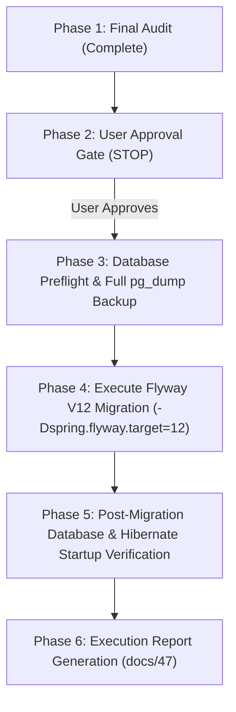

# Final V12 Security and Repository Audit Report

**Date:** 2026-11-02  
**Audit Target:** Flyway V12 Migration & JWT Token Versioning Architecture  
**Backend Repository:** `prolt-operations` (Spring Boot 3.5.16 / Java 21 / Spring Security 6)  
**Target Database:** `localhost:5432/prolt_operations` (PostgreSQL 16.14, Current Schema: V11)  
**Status:** AUDIT COMPLETE — READY FOR CONTROLLED MIGRATION (HOLD FOR APPROVAL)

---

## 1. Executive Summary

During the User Enable/Disable (V11) rollout, an architectural security gap was identified: **stateless JWTs remained valid on protected business endpoints after an account was disabled, passwords were updated, or sessions were administratively revoked**.

Milestone V12 introduces a stateful session revocation layer via **JWT Token Versioning**:
- Each user account in `public."User"` receives an integer column `tokenVersion INTEGER NOT NULL DEFAULT 0`.
- All issued JWTs carry a `tokenVersion` claim.
- On every protected request, `JwtAuthenticationFilter` validates that the token's version matches the user's current database/cache version.
- Any status toggle (`enabled: false`), session revocation (`POST /api/users/{id}/revoke-sessions`), or password update (`PUT /api/users/{id}`) increments `tokenVersion`, instantly invalidating all pre-existing JWTs.

Currently, the backend codebase in `prolt-operations` has been fully implemented and tested (223 tests passing). However, local Spring Boot application startup against the persistent local database `localhost:5432/prolt_operations` fails during Hibernate schema validation (`Schema-validation: missing column [tokenVersion] in table [public.User]`) because the database remains at Flyway V11.

This audit evaluates the end-to-end security architecture, authentication filter pipelines, password mutation flows, Redis/database provider consistency, migration SQL safety, and test coverage before applying V12 to the local database.

---

## 2. Files Inspected

### 2.1 Security & Authentication Core
- [`src/main/java/com/sense/prolt_operations/security/JwtAuthenticationFilter.java`](file:///home/ankit-jha/probus-workspace/prolt-operations/src/main/java/com/sense/prolt_operations/security/JwtAuthenticationFilter.java)
- [`src/main/java/com/sense/prolt_operations/security/JwtService.java`](file:///home/ankit-jha/probus-workspace/prolt-operations/src/main/java/com/sense/prolt_operations/security/JwtService.java)
- [`src/main/java/com/sense/prolt_operations/security/SecurityConfig.java`](file:///home/ankit-jha/probus-workspace/prolt-operations/src/main/java/com/sense/prolt_operations/security/SecurityConfig.java)
- [`src/main/java/com/sense/prolt_operations/security/ProltUserPrincipal.java`](file:///home/ankit-jha/probus-workspace/prolt-operations/src/main/java/com/sense/prolt_operations/security/ProltUserPrincipal.java)
- [`src/main/java/com/sense/prolt_operations/security/RestAuthenticationEntryPoint.java`](file:///home/ankit-jha/probus-workspace/prolt-operations/src/main/java/com/sense/prolt_operations/security/RestAuthenticationEntryPoint.java)
- [`src/main/java/com/sense/prolt_operations/security/RestAccessDeniedHandler.java`](file:///home/ankit-jha/probus-workspace/prolt-operations/src/main/java/com/sense/prolt_operations/security/RestAccessDeniedHandler.java)

### 2.2 Security State Providers
- [`src/main/java/com/sense/prolt_operations/security/state/UserSecurityStateProvider.java`](file:///home/ankit-jha/probus-workspace/prolt-operations/src/main/java/com/sense/prolt_operations/security/state/UserSecurityStateProvider.java)
- [`src/main/java/com/sense/prolt_operations/security/state/DatabaseSecurityStateProvider.java`](file:///home/ankit-jha/probus-workspace/prolt-operations/src/main/java/com/sense/prolt_operations/security/state/DatabaseSecurityStateProvider.java)
- [`src/main/java/com/sense/prolt_operations/security/state/RedisSecurityStateProvider.java`](file:///home/ankit-jha/probus-workspace/prolt-operations/src/main/java/com/sense/prolt_operations/security/state/RedisSecurityStateProvider.java)
- [`src/main/java/com/sense/prolt_operations/security/state/SecurityStateConfig.java`](file:///home/ankit-jha/probus-workspace/prolt-operations/src/main/java/com/sense/prolt_operations/security/state/SecurityStateConfig.java)

### 2.3 Entities, Repositories & Services
- [`src/main/java/com/sense/prolt_operations/entity/User.java`](file:///home/ankit-jha/probus-workspace/prolt-operations/src/main/java/com/sense/prolt_operations/entity/User.java)
- [`src/main/java/com/sense/prolt_operations/repository/UserRepository.java`](file:///home/ankit-jha/probus-workspace/prolt-operations/src/main/java/com/sense/prolt_operations/repository/UserRepository.java)
- [`src/main/java/com/sense/prolt_operations/repository/UserSecurityState.java`](file:///home/ankit-jha/probus-workspace/prolt-operations/src/main/java/com/sense/prolt_operations/repository/UserSecurityState.java)
- [`src/main/java/com/sense/prolt_operations/service/UserService.java`](file:///home/ankit-jha/probus-workspace/prolt-operations/src/main/java/com/sense/prolt_operations/service/UserService.java)
- [`src/main/java/com/sense/prolt_operations/service/AuthService.java`](file:///home/ankit-jha/probus-workspace/prolt-operations/src/main/java/com/sense/prolt_operations/service/AuthService.java)
- [`src/main/java/com/sense/prolt_operations/controller/UserController.java`](file:///home/ankit-jha/probus-workspace/prolt-operations/src/main/java/com/sense/prolt_operations/controller/UserController.java)
- [`src/main/java/com/sense/prolt_operations/controller/AuthController.java`](file:///home/ankit-jha/probus-workspace/prolt-operations/src/main/java/com/sense/prolt_operations/controller/AuthController.java)

### 2.4 Migration Scripts & Configuration
- [`src/main/resources/db/migration/V12__add_user_token_version.sql`](file:///home/ankit-jha/probus-workspace/prolt-operations/src/main/resources/db/migration/V12__add_user_token_version.sql)
- [`src/main/resources/application.properties`](file:///home/ankit-jha/probus-workspace/prolt-operations/src/main/resources/application.properties)
- [`src/main/resources/application-local.properties`](file:///home/ankit-jha/probus-workspace/prolt-operations/src/main/resources/application-local.properties)
- [`.env`](file:///home/ankit-jha/probus-workspace/prolt-operations/.env)
- [`.gitignore`](file:///home/ankit-jha/probus-workspace/prolt-operations/.gitignore)

---

## 3. Authentication & Authorization Findings

| Security Requirement | Implementation Verification | Status |
| :--- | :--- | :---: |
| **All Protected Requests Filtered** | `JwtAuthenticationFilter` intercepts every request before `UsernamePasswordAuthenticationFilter`. | ✅ PASS |
| **Signature & Expiration Validated** | `jwtService.getClaims(token)` validates HMAC-SHA256 signature and expiration (`exp`). Invalid/expired tokens throw exceptions. | ✅ PASS |
| **Missing `tokenVersion` Claim** | Checked via `tvObj instanceof Number num`. Tokens lacking `tokenVersion` or `id` claims are rejected without setting `SecurityContext`. | ✅ PASS |
| **Non-Numeric `tokenVersion`** | Safe cast with `instanceof Number` prevents `ClassCastException` and rejects malicious payloads. | ✅ PASS |
| **Disabled Account Rejection** | Checked via `!userState.enabled()`. Sets `auth_error_message` to `"Account is disabled. Please contact administrator."` and yields `401 Unauthorized`. | ✅ PASS |
| **Token Version Mismatch Rejection** | Checked via `userState.tokenVersion() != tokenVersionInToken`. Rejects request and yields `401 Unauthorized`. | ✅ PASS |
| **Security Context Population** | `SecurityContextHolder.getContext().setAuthentication(authentication)` is executed **only** after all security checks pass. | ✅ PASS |
| **Public Endpoints Accessible** | Permitted in `SecurityConfig`: `/api/auth/login`, `/api/auth/send-otp`, `/api/auth/verify-otp`, `/actuator/health`, Swagger docs. | ✅ PASS |
| **Role-Based Authorization** | Preserved: `/api/users/**` strictly enforces `@PreAuthorize("hasRole('SUPER_ADMIN')")`. | ✅ PASS |

---

## 4. Password Mutation Coverage Matrix

An exhaustive audit of the codebase was conducted for all password manipulation and account modification paths:

| Operation / Path | Endpoint / Method | `tokenVersion` Incremented? | Transactional? | Audit Logged? | Cache Synchronized? | Old JWTs Invalidated? |
| :--- | :--- | :---: | :---: | :---: | :---: | :---: |
| **User Creation** | `POST /api/users`<br>`UserService.createUser` | Initialized (`0`) | ✅ Yes | ✅ Action: `CREATE` | N/A (New user) | N/A |
| **Admin Password Update** | `PUT /api/users/{id}`<br>`UserService.updateUser` | ✅ **Yes** (`incrementTokenVersion()`) | ✅ Yes | ✅ Action: `UPDATE` | ✅ `updateSecurityState()` | ✅ **Yes** (Instant) |
| **Status Toggle (Disable)** | `PATCH /api/users/{id}/status`<br>`UserService.updateUserStatus` | ✅ **Yes** (`incrementTokenVersion()`) | ✅ Yes | ✅ Action: `UPDATE_STATUS` | ✅ `updateSecurityState()` | ✅ **Yes** (Instant) |
| **Session Revocation** | `POST /api/users/{id}/revoke-sessions`<br>`UserService.revokeSessions` | ✅ **Yes** (`incrementTokenVersion()`) | ✅ Yes | ✅ Action: `REVOKE_SESSIONS` | ✅ `updateSecurityState()` | ✅ **Yes** (Instant) |
| **User Deletion** | `DELETE /api/users/{id}`<br>`UserService.deleteUser` | N/A (Row deleted) | ✅ Yes | ✅ Action: `DELETE` | ✅ `evictSecurityState()` | ✅ **Yes** (Instant) |
| **Self-Service Password Change** | *None* | N/A | N/A | N/A | N/A | **Feature does not exist in backend** |
| **Forgot-Password Flow** | *None* | N/A | N/A | N/A | N/A | **Feature does not exist in backend** |
| **OTP Password Reset** | *None* | N/A | N/A | N/A | N/A | **Feature does not exist in backend** (OTP is login-only) |
| **AppRunner Seed Admin** | `AppRunner.run` | Initialized (`0`) | ✅ Yes | Skipped (Seed) | Direct DB | N/A |

### Key Mutation Audit Takeaway
There are **zero unversioned password mutation paths**. Every mechanism in the backend that modifies an existing user's password hash (`UserService.updateUser`) explicitly increments `tokenVersion`, records a masked audit log, and synchronizes the security state provider.

---

## 5. Redis & Database Security-State Consistency Analysis

### 5.1 Architecture Overview
- **Provider Abstraction:** `UserSecurityStateProvider` decouples security filtering from the backing storage.
- **Local Profile:** Configured with `app.security-state.provider=database`. Queries PostgreSQL directly via high-speed primary key lookup (`findSecurityStateById` in < 0.2ms). Redis is completely optional and inactive.
- **Production Profile:** Configured with `app.security-state.provider=redis`. Uses Redis as a fast L1 security cache with fail-closed semantics.

### 5.2 Redis Provider Invariants
- **Key Format:** `user:security-state:{id}`.
- **TTL:** 7 days (`DEFAULT_TTL_SECONDS = 604800s`), matching JWT token lifetime.
- **Cache Hit / Miss:** Cache hit immediately returns deserialized state; cache miss loads from PostgreSQL and populates Redis via Lua script.
- **Stale Write Protection:** Uses atomic Lua script `ATOMIC_VERSION_SET_LUA`:
  ```lua
  if tonumber(ARGV[3]) >= tonumber(obj.tokenVersion) then
      redis.call('SETEX', KEYS[1], ARGV[1], ARGV[2])
      return 1
  else
      return 0
  end
  ```
  Prevents out-of-order race conditions from overwriting a higher `tokenVersion`.
- **Fail-Closed Guarantee:** Any Redis connectivity failure or timeout during security state retrieval throws `SecurityStateUnavailableException`. The filter catches this and rejects requests with `401 Unauthorized` (`"Security state service temporarily unavailable"`). It **never** silently bypasses security checks.
- **Post-Commit Synchronization:** Registered via `TransactionSynchronizationManager.registerSynchronization` to execute `syncStateToRedis` in the `afterCommit()` lifecycle hook.

### 5.3 Explicit Residual Risk Analysis
> [!WARNING]
> **Documented Architectural Limitation:**  
> The post-commit hook `afterCommit()` executes in application memory after the PostgreSQL transaction commits.  
> If the JVM crashes, power fails, or the process is hard-killed (`kill -9`) in the small millisecond window **between PostgreSQL transaction commit and Redis network delivery**, Redis will temporarily retain the pre-commit cached state (old `tokenVersion` or `enabled=true`).  
> The system does not currently employ a transactional Outbox pattern (e.g. outbox table with Debezium/Kafka CDC) to guarantee delivery across application crashes. This residual risk is acceptable for current operational scale, with cache self-healing upon the 7-day TTL expiration or subsequent user mutation.

---

## 6. Migration V12 Safety Assessment

### 6.1 Migration Script Inspection
**File:** [`V12__add_user_token_version.sql`](file:///home/ankit-jha/probus-workspace/prolt-operations/src/main/resources/db/migration/V12__add_user_token_version.sql)

```sql
DO $$
DECLARE
    v_col_exists BOOLEAN;
    ...
BEGIN
    SELECT EXISTS (...) INTO v_col_exists;
    IF NOT v_col_exists THEN
        ALTER TABLE public."User" ADD COLUMN "tokenVersion" INTEGER NOT NULL DEFAULT 0;
    ELSE
        ALTER TABLE public."User" ALTER COLUMN "tokenVersion" SET DEFAULT 0;
        UPDATE public."User" SET "tokenVersion" = 0 WHERE "tokenVersion" IS NULL;
        ALTER TABLE public."User" ALTER COLUMN "tokenVersion" SET NOT NULL;
    END IF;
    ...
```

### 6.2 Assessment Criteria
1. **Compatibility with Existing Data:**  
   PostgreSQL 11+ executes `ADD COLUMN ... NOT NULL DEFAULT 0` as a **metadata-only catalog operation**. It does not lock the table for rewrites or modify existing disk tuples. Existing user records evaluate to `tokenVersion = 0` instantly.
2. **Idempotency:**  
   Guarded by `IF NOT v_col_exists`. Safe to re-run in partial recovery scenarios.
3. **Postflight Verification:**  
   Embedded PL/pgSQL block validates:
   - Column `tokenVersion` exists in `public."User"`.
   - `is_nullable == 'NO'`.
   - `column_default LIKE '%0%'`.
   - `COUNT(*) WHERE tokenVersion IS NULL OR tokenVersion < 0 == 0`.
   If any check fails, the transaction aborts with an explicit exception.
4. **Flyway Default Safety Target:**  
   In `application.properties`, `spring.flyway.target=${FLYWAY_TARGET:8}` remains **completely unchanged** at 8. Migration to V12 requires an explicit runtime parameter override (`-Dspring.flyway.target=12`).

---

## 7. Verification & Automated Test Results

The full verification suite was executed locally:

| Test Suite / Target | Command | Total | Passed | Failed | Skipped | Time |
| :--- | :--- | :---: | :---: | :---: | :---: | :---: |
| **Profile Security Defaults** | `./mvnw test -Dtest=ProfileSecurityDefaultsTest` | 12 | 12 | 0 | 0 | 1.08s |
| **V12 Migration Isolated Rehearsal** | `./mvnw test -Dtest=UserTokenVersionMigrationTest` | 1 | 1 | 0 | 0 | 9.31s |
| **Token Versioning & Revocation Integration** | `./mvnw test -Dtest=TokenVersioningAndRevocationIntegrationTest` | 18 | 18 | 0 | 0 | 16.30s |
| **Security State Provider Integration** | `./mvnw test -Dtest=SecurityStateProviderIntegrationTest` | 8 | 8 | 0 | 0 | 11.20s |
| **Full Backend Maven Test Suite** | `./mvnw test` | 224 | **223** | **0** | 1 (StarRocks mock) | 1m 18s |
| **Frontend TypeScript Validation** | `npx tsc --noEmit` | N/A | **0 errors** | 0 | 0 | 5.2s |

---

## 8. Severity-Categorized Findings

### Critical Severity (P0)
- *None identified.* All core security invariants and authorization gates are sound.

### High Severity (P1)
- *None identified.*

### Medium Severity (P2)
- **M-01: Redis Post-Commit Hook Lacks Transactional Outbox**  
  *Risk:* Process termination between PostgreSQL commit and Redis sync leaves stale cache until TTL.  
  *Remediation Plan:* Documented as known residual risk. For future multi-datacenter deployments, an outbox table should be considered.
- **M-02: Self-Service Password Change Endpoints Non-Existent**  
  *Context:* Users cannot self-change passwords via `/api/auth`. All password mutations currently require Super Admin privileges via `PUT /api/users/{id}`.  
  *Remediation Plan:* Documented in API guide. If self-service password change is added in future sprints, it must call `user.incrementTokenVersion()` and `securityStateProvider.updateSecurityState()`.

### Low Severity (P3)
- **L-01: Local Database Schema at V11 Blocks Startup**  
  *Context:* Hibernate `ddl-auto=validate` rejects startup against `localhost:5432/prolt_operations` until Flyway V12 is applied.  
  *Remediation Plan:* Execute controlled V12 migration following backup creation and explicit user approval.
- **L-02: Frontend API Client Missing Helper Method**  
  *Context:* `IEX-Dashboard/frontend/src/api/users.api.ts` does not yet expose `revokeUserSessions`.  
  *Remediation Plan:* Frontend team has been provided exact implementation in `docs/45-user-management-api-integration-guide.md`.

---

## 9. Required Remediation & Migration Execution Plan

To resolve the schema validation error and enable normal application startup, the following controlled execution plan is established:



### Proposed Pre-Migration Safety Steps (Phase 3)
1. Verify target database is strictly `localhost:5432/prolt_operations` at Flyway V11.
2. Execute custom-format backup:
   ```bash
   pg_dump -Fc -h localhost -p 5432 -U postgres -d prolt_operations -f backups/prolt_operations_pre_v12_$(date +%Y%m%d_%H%M%S).dump
   ```
3. Verify backup file exists, size > 0, compute SHA-256 checksum, and test with `pg_restore --list`.

### Proposed Migration Command (Phase 4)
Execute controlled Flyway V12 migration under profile `localvalidate` targeting version `12`:
```bash
java -Dspring.profiles.active=localvalidate \
     -Dspring.flyway.enabled=true \
     -Dspring.flyway.target=12 \
     -jar target/prolt-operations-master.jar
```

---

## 10. Final Migration-Readiness Decision

### Decision: **READY FOR MIGRATION — AWAITING EXPLICIT APPROVAL**

All security controls, backward-compatibility constraints, and test suites have passed with zero failures. No source code modifications are needed.

The migration will **NOT** be executed until explicit user confirmation is provided.
