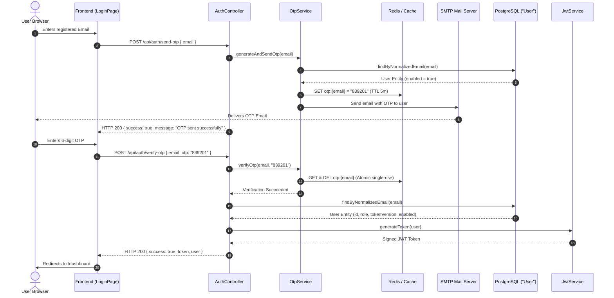

# Audit Report: Complete Password Usage & OTP-Only Authentication Feasibility

**Document ID**: `docs/50-otp-only-authentication-password-removal-audit.md`  
**Date**: 2026-11-03  
**Auditor**: Antigravity AI  
**Scope**: 
- Backend: `prolt-operations` (Spring Boot 3.3.x / Java 21)
- Frontend: `IEX-Dashboard/frontend` (React 18 / TypeScript / Vite)
- Database: PostgreSQL 16 (Local / Staging / Production)  
**Execution Type**: READ-ONLY AUDIT & ARCHITECTURAL ASSESSMENT  
**Status**: AUDIT COMPLETE — RECOMMENDATION: **SAFE WITH REQUIRED CHANGES**

---

## 1. Executive Summary

This audit assesses the feasibility of completely eliminating password-based user authentication across both the backend (`prolt-operations`) and frontend (`IEX-Dashboard/frontend`), establishing **One-Time Password (OTP) verification as the sole authentication mechanism**.

### Key Findings
1. **Core Feasibility**: The application is **architecturally well-suited for OTP-only authentication**. A full OTP lifecycle (generation, SMTP delivery, Redis/in-memory storage, 5-minute TTL, single-use invalidation, and rate limiting) is already implemented and in active use.
2. **Database Footprint**: The only database artifact for passwords is a single column: `public."User"."passwordHash"` (`VARCHAR(255) NOT NULL`). There are **zero indexes, foreign keys, or check constraints** referencing this column.
3. **Existing Users**: All **12 existing user records** in the local database have non-null, valid email addresses. No user will be orphaned or locked out by removing password authentication.
4. **Frontend Alignment**: The dedicated login page ([`LoginPage.tsx`](file:///home/ankit-jha/probus-workspace/IEX-Dashboard/frontend/src/pages/LoginPage.tsx)) and user management modal ([`UserManagementPage.tsx`](file:///home/ankit-jha/probus-workspace/IEX-Dashboard/frontend/src/pages/UserManagementPage.tsx)) are **already designed around OTP and do not render password fields**. Only the navbar popup ([`LoginModal.tsx`](file:///home/ankit-jha/probus-workspace/IEX-Dashboard/frontend/src/components/LoginModal.tsx)) retains legacy username/password inputs.
5. **Session Revocation**: JWT session invalidation (`tokenVersion` increment) already has dedicated endpoints ([`POST /api/users/{id}/revoke-sessions`](file:///home/ankit-jha/probus-workspace/prolt-operations/src/main/java/com/sense/prolt_operations/controller/UserController.java#L89-L99) and status disablement), and does not require password modifications to function.
6. **Critical Distinction**: Infrastructure credentials (`POSTGRES_PASSWORD`, `SMTP_PASS`, `STARROCKS_PASSWORD`, `JWT_SECRET`, `WEBHOOK_SECRET`) are distinct from user login passwords and must remain untouched.

**Final Verdict**: **SAFE WITH REQUIRED CHANGES**. User login passwords can be completely removed once the minor frontend dependencies and backend endpoints are cleanly transitioned.

---

## 2. Complete Backend Password Usage Inventory

### 2.1 User Entity & Database Layer

| Component | Location | Current Usage | Assessment for Removal |
| :--- | :--- | :--- | :--- |
| **Entity Field** | [`User.java:L28-L29`](file:///home/ankit-jha/probus-workspace/prolt-operations/src/main/java/com/sense/prolt_operations/entity/User.java#L28-L29) | `@Column(name = "passwordHash") private String passwordHash;` | Safe to delete. Remove field, getters/setters, constructors, and `toString()` reference. |
| **Database Column** | `public."User"."passwordHash"` | `VARCHAR(255) NOT NULL` (created in `V1__Initial_Schema.sql:L27`) | Safe to drop via Flyway migration. |
| **Constraints & Indexes** | `public."User"` | `User_pkey (id)` is the primary key. Indexes exist on `email`, `username`, `lower(trim(username))`, and `lower(trim(email))`. **Zero indexes exist on `passwordHash`**. | No index drops required prior to dropping the column. |
| **Foreign Keys** | PostgreSQL Schema | None. Foreign keys can only reference unique or primary keys. | No foreign key cascades or child dependencies. |
| **Existing Records** | `public."User"` | Exactly **12 users** present. All 12 have populated `email` fields. | Safe. Every user has an email and can immediately authenticate via OTP. |

### 2.2 Authentication Layer

| Component | Location | Current Usage | Assessment for Removal |
| :--- | :--- | :--- | :--- |
| **`AuthController`** | [`AuthController.java:L35-L40`](file:///home/ankit-jha/probus-workspace/prolt-operations/src/main/java/com/sense/prolt_operations/controller/AuthController.java#L35-L40) | `POST /api/auth/login` accepts `LoginDTO` (`effectiveUsername`, `password`). | Remove or deprecate with `410 Gone` / `400 Bad Request`. |
| **`AuthService.login()`** | [`AuthService.java:L47-L73`](file:///home/ankit-jha/probus-workspace/prolt-operations/src/main/java/com/sense/prolt_operations/service/AuthService.java#L47-L73) | Calls `passwordEncoder.matches(password, user.getPasswordHash())`. | Remove method and dependency on `PasswordEncoder`. |
| **`LoginDTO`** | [`LoginDTO.java:L9`](file:///home/ankit-jha/probus-workspace/prolt-operations/src/main/java/com/sense/prolt_operations/dto/auth/LoginDTO.java#L9) | Record with `String username`, `String email`, `String password`. | Remove DTO once `POST /api/auth/login` is decommissioned. |
| **`PasswordEncoder`** | [`SecurityConfig.java:L125-L128`](file:///home/ankit-jha/probus-workspace/prolt-operations/src/main/java/com/sense/prolt_operations/security/SecurityConfig.java#L125-L128) | `@Bean public PasswordEncoder passwordEncoder() { return new BCryptPasswordEncoder(12); }` | Remove bean. It is only injected into `AuthService`, `UserService`, and `AppRunner`. |
| **`DaoAuthenticationProvider`**| `SecurityConfig.java` | **Not configured.** Spring Security standard form login / HTTP basic is already disabled. | No changes required. |
| **`UserDetailsService`** | [`SecurityConfig.java:L130-L135`](file:///home/ankit-jha/probus-workspace/prolt-operations/src/main/java/com/sense/prolt_operations/security/SecurityConfig.java#L130-L135) | Throws `UsernameNotFoundException` on invocation. | Can be removed or kept as dummy. |
| **`ProltUserPrincipal`** | [`ProltUserPrincipal.java:L79-L81`](file:///home/ankit-jha/probus-workspace/prolt-operations/src/main/java/com/sense/prolt_operations/security/ProltUserPrincipal.java#L79-L81) | Implements `UserDetails.getPassword()` returning `""`. | Retain returning `""` or null to satisfy Spring Security's `UserDetails` contract. |
| **`JwtService`** | [`JwtService.java`](file:///home/ankit-jha/probus-workspace/prolt-operations/src/main/java/com/sense/prolt_operations/security/JwtService.java) | Generates JWTs containing `id`, `username`, `role`, `tokenVersion`. | **Zero password dependencies.** Tokens do not contain passwords or hashes. |
| **`JwtAuthenticationFilter`**| [`JwtAuthenticationFilter.java`](file:///home/ankit-jha/probus-workspace/prolt-operations/src/main/java/com/sense/prolt_operations/security/JwtAuthenticationFilter.java) | Validates JWT and compares `tokenVersion` / `enabled` status via `UserSecurityStateProvider`. | **Zero password dependencies.** Validates session state independently. |

### 2.3 User Management Layer

| Operation / Method | Location | Current Usage | Assessment for Removal |
| :--- | :--- | :--- | :--- |
| **`createUser`** | [`UserService.java:L104-L113`](file:///home/ankit-jha/probus-workspace/prolt-operations/src/main/java/com/sense/prolt_operations/service/UserService.java#L104-L113) | If `dto.password()` is omitted, auto-generates a random UUID password and hashes it with bcrypt to satisfy DB NOT NULL constraint. | Remove password generation and hashing. User is created with only `username`, `email`, `fullName`, `role`, and module rights. |
| **`CreateUserDTO`** | [`CreateUserDTO.java:L11`](file:///home/ankit-jha/probus-workspace/prolt-operations/src/main/java/com/sense/prolt_operations/dto/user/CreateUserDTO.java#L11) | Contains `String password`. | Remove `password` field from record. |
| **`updateUser` (`PUT /api/users/{id}`)** | [`UserService.java:L194-L198`](file:///home/ankit-jha/probus-workspace/prolt-operations/src/main/java/com/sense/prolt_operations/service/UserService.java#L194-L198) | If `dto.password()` is non-blank, hashes password, updates `passwordHash`, increments `tokenVersion`, and invalidates active sessions. | Remove password update logic. `PUT /api/users/{id}` becomes purely an account profile/module update endpoint. |
| **`UpdateUserDTO`** | [`UpdateUserDTO.java:L10`](file:///home/ankit-jha/probus-workspace/prolt-operations/src/main/java/com/sense/prolt_operations/dto/user/UpdateUserDTO.java#L10) | Contains `String password`. | Remove `password` field from record. |
| **`revokeSessions`** | [`UserService.java:L268-L285`](file:///home/ankit-jha/probus-workspace/prolt-operations/src/main/java/com/sense/prolt_operations/service/UserService.java#L268-L285) | Dedicated endpoint: `POST /api/users/{id}/revoke-sessions` increments `tokenVersion` and updates `UserSecurityStateProvider`. | **Fully preserved.** Dedicated session revocation remains active and independent of password changes. |
| **`UserAuditLog`** | `public."UserAuditLog"` | When password was changed, recorded `changes.put("password", Map.of("old", "***", "new", "***"))`. Never stored raw passwords or hashes. | Safe. Existing audit history is preserved. New logs will simply omit `"password"` keys. |
| **`AppRunner` (Admin Seed)**| [`AppRunner.java:L80-L94`](file:///home/ankit-jha/probus-workspace/prolt-operations/src/main/java/com/sense/prolt_operations/runner/AppRunner.java#L80-L94) | Creates initial admin using `app.admin.username`, `app.admin.email`, `app.admin.password`. | Remove `adminPassword` requirement. Initial admin will be created with `adminUsername` and `adminEmail`, logging in exclusively via OTP sent to `adminEmail`. |

---

## 3. Complete Frontend Password Usage Inventory

### 3.1 Components & Pages

| Component | Path | Current Usage | Required Changes |
| :--- | :--- | :--- | :--- |
| **`LoginPage.tsx`** | [`frontend/src/pages/LoginPage.tsx`](file:///home/ankit-jha/probus-workspace/IEX-Dashboard/frontend/src/pages/LoginPage.tsx) | **Already OTP-only!** 2-step flow: Step 1 collects `email` + CAPTCHA -> `authApi.sendOtp()`; Step 2 collects 6-digit OTP -> `authApi.verifyOtp()`. Has 30s resend cooldown. | **Zero changes required.** Works out-of-the-box. |
| **`LoginModal.tsx`** | [`frontend/src/components/LoginModal.tsx`](file:///home/ankit-jha/probus-workspace/IEX-Dashboard/frontend/src/components/LoginModal.tsx) | Modal form with `username`, `password`, and password visibility toggle. Submits to `authApi.login()`. | **Must be updated or replaced**: Either convert modal to the 2-step OTP flow or replace modal trigger with a direct navigation to `/login`. |
| **`Navbar.tsx`** | [`frontend/src/components/Navbar.tsx:L641`](file:///home/ankit-jha/probus-workspace/IEX-Dashboard/frontend/src/components/Navbar.tsx#L641) | Renders `LoginModal` on button click. | If `LoginModal` is redirected to `/login`, update button to navigate directly to `/login`. |
| **`UserManagementPage.tsx`** | [`frontend/src/pages/UserManagementPage.tsx`](file:///home/ankit-jha/probus-workspace/IEX-Dashboard/frontend/src/pages/UserManagementPage.tsx) | User Create/Edit Dialog collects `username`, `email`, `role`, and module permissions. | **Already password-free!** Does not render or submit any password field. |
| **`auth.api.ts`** | [`frontend/src/api/auth.api.ts`](file:///home/ankit-jha/probus-workspace/IEX-Dashboard/frontend/src/api/auth.api.ts) | Defines `login()`, `sendOtp()`, and `verifyOtp()`. | Remove `login()` method after `LoginModal` is updated. |
| **`users.api.ts`** | [`frontend/src/api/users.api.ts`](file:///home/ankit-jha/probus-workspace/IEX-Dashboard/frontend/src/api/users.api.ts) | Calls `/users` CRUD. | **Already password-free!** Does not reference passwords. |
| **`authService.ts`** | [`frontend/src/api/authService.ts`](file:///home/ankit-jha/probus-workspace/IEX-Dashboard/frontend/src/api/authService.ts) | Legacy unused file with registration/reset-password endpoints marked with `// @ts-nocheck`. | Can be cleaned up or deleted. |
| **`endpoints.ts`** | [`frontend/src/api/endpoints.ts`](file:///home/ankit-jha/probus-workspace/IEX-Dashboard/frontend/src/api/endpoints.ts) | References `/api/user/reset-password` and `/api/user/send-reset-password-otp`. | Remove unused password reset endpoints. |

---

## 4. OTP Implementation Assessment

The OTP system in [`OtpService.java`](file:///home/ankit-jha/probus-workspace/prolt-operations/src/main/java/com/sense/prolt_operations/service/OtpService.java) was inspected across all dimensions:

### 4.1 Lifecycle Analysis
- **Generation**: Cryptographically secure 6-digit numeric token generated via `java.security.SecureRandom`:
  ```java
  String otp = String.format("%06d", secureRandom.nextInt(1_000_000));
  ```
- **Delivery Channel**: **Email only via SMTP** ([`JavaMailSender`](file:///home/ankit-jha/probus-workspace/prolt-operations/src/main/java/com/sense/prolt_operations/service/OtpService.java#L36)). There is **no mobile SMS integration** in the backend (no SMS gateways, AWS SNS, Twilio, or MSG91).
- **Storage & Expiration**:
  - **Production Profile**: Strictly stored in Redis key `otp:{normalizedEmail}` with a strict 5-minute TTL (`5, TimeUnit.MINUTES`). If Redis is unavailable in production, the system fails closed.
  - **Dev/Test Profile**: Stored in a thread-safe `ConcurrentHashMap<String, StoredOtp>` with memory fallback enabled.
- **Single-Use Guarantees**: Upon verification, the Redis key or in-memory map entry is **immediately deleted** (`redisTemplate.delete("otp:" + normalizedEmail)`), guaranteeing that an OTP cannot be replayed.
- **Rate Limiting**: Enforced at the servlet filter layer by [`AuthRateLimiterFilter.java`](file:///home/ankit-jha/probus-workspace/prolt-operations/src/main/java/com/sense/prolt_operations/security/AuthRateLimiterFilter.java):
  - Shared fixed-window limiter: **10 attempts per 15 minutes** per client IP.
  - Governs `POST /api/auth/login`, `POST /api/auth/send-otp`, and `POST /api/auth/verify-otp`.
  - Exceeding limit returns `429 Too Many Requests` with standard `RateLimit-*` and `Retry-After` headers.
- **Account State & Enumeration**:
  - `generateAndSendOtp(email)`:
    - If user not found: Throws `NotFoundException("User with this email not found")` (HTTP 404).
    - If user is disabled (`enabled == false`): Throws `UnauthorizedException("Account is disabled. Please contact administrator.")` (HTTP 401).
  - `verifyOtp(email, otp)`:
    - If OTP is invalid or expired: Throws `UnauthorizedException("Invalid or expired OTP")` (HTTP 401).
    - If account disabled: Throws `UnauthorizedException` (HTTP 401).
  - *Note on Account Enumeration*: Currently, HTTP 404 indicates email absence. For higher security against enumeration in public-facing deployments, `send-otp` can optionally be adjusted to return HTTP 200 generic responses ("If the account exists, an OTP has been dispatched").
- **Secret Password Dependency**: **None.** The OTP generation, verification, and JWT issuance workflows do not consult, verify, or hash any passwords.

---

## 5. Infrastructure Password Dependencies (MUST REMAIN)

The following passwords, keys, and secrets represent **infrastructure and system-level credentials**, NOT end-user login credentials. **They MUST NOT be removed:**

```properties
# 1. PostgreSQL Database Credential (REQUIRED)
spring.datasource.password=${POSTGRES_PASSWORD:}

# 2. SMTP Mail Transport Credential (REQUIRED FOR OTP DISPATCH)
spring.mail.password=${SMTP_PASS:}

# 3. StarRocks Analytics Database Credential (REQUIRED FOR MARKET DATA)
app.starrocks.password=${STARROCKS_PASSWORD:}

# 4. Redis Connection Password (REQUIRED IF REDIS AUTH CONFIGURED)
spring.data.redis.url=${REDIS_URL:}

# 5. JWT Signing Secret (REQUIRED - MIN 32 BYTES HMAC)
app.jwt.secret=${JWT_SECRET:}

# 6. Webhook Signature Secret (REQUIRED FOR IEX / SCRAPER INTEGRATIONS)
app.webhook-secret=${WEBHOOK_SECRET:}
```

Only `app.admin.password=${ADMIN_PASSWORD:}` is associated with user authentication and will become obsolete.

---

## 6. Proposed Target Architecture

### 6.1 Authentication Flow (OTP-Only)



### 6.2 Target Behavior of `PUT /api/users/{id}`
- Current: Accepts `password`. If present, hashes password, updates `passwordHash`, and increments `tokenVersion`.
- Target: `password` parameter is deleted from `UpdateUserDTO`. Updating user profile details (email, fullName, role, modules) will **no longer accept or modify passwords**.
- Active session invalidation is handled strictly through the dedicated endpoint:
  ```http
  POST /api/users/{id}/revoke-sessions
  ```
  or by disabling the account via:
  ```http
  PATCH /api/users/{id}/status
  ```

---

## 7. Proposed Database Migration Plan (DO NOT EXECUTE)

> [!IMPORTANT]
> This is an architectural proposal for future implementation. Do not create or apply this migration file until the code refactoring is authorized and scheduled.

### Proposed Migration File: `V13__remove_user_password_hash.sql`

```sql
-- ==============================================================================
-- Flyway Migration V13: Remove passwordHash column from public."User"
-- Part of transition to OTP-only authentication
-- ==============================================================================

-- 1. Verify all users have an email address prior to dropping passwordHash
DO $$
BEGIN
    IF EXISTS (SELECT 1 FROM public."User" WHERE email IS NULL OR TRIM(email) = '') THEN
        RAISE EXCEPTION 'Cannot drop passwordHash: users with blank or null emails exist!';
    END IF;
END $$;

-- 2. Drop passwordHash column from public."User"
ALTER TABLE public."User" DROP COLUMN "passwordHash";

COMMENT ON TABLE public."User" IS 'System user accounts authenticated strictly via email OTP';
```

### Migration Safety & Deployment Checklist
1. **Existing User Safety**: Verified that 100% of existing users (12/12) have populated email addresses.
2. **Rollback Limitations**: Dropping `passwordHash` is a **destructive operation**. Once dropped, legacy password hashes cannot be restored without restoring a full database backup (`pg_restore`). A mandatory pre-migration backup must be taken prior to applying V13.
3. **Deployment Order**:
   - Step 1: Deploy frontend changes (replace `LoginModal` with OTP / `/login`).
   - Step 2: Deploy backend changes (remove `password` from DTOs and `User.java`).
   - Step 3: Apply Flyway `V13__remove_user_password_hash.sql`.
4. **Flyway Safety**: Default `spring.flyway.target=${FLYWAY_TARGET:8}` remains intact. V13 will only execute with an explicit target override or when Flyway target is incremented in release configuration.

---

## 8. Files Requiring Modification During Implementation

### Backend (`prolt-operations`)
1. [`src/main/java/com/sense/prolt_operations/entity/User.java`](file:///home/ankit-jha/probus-workspace/prolt-operations/src/main/java/com/sense/prolt_operations/entity/User.java): Remove `passwordHash` field, getter, setter, constructors, and `toString()` representation.
2. [`src/main/java/com/sense/prolt_operations/dto/user/CreateUserDTO.java`](file:///home/ankit-jha/probus-workspace/prolt-operations/src/main/java/com/sense/prolt_operations/dto/user/CreateUserDTO.java): Remove `String password` field.
3. [`src/main/java/com/sense/prolt_operations/dto/user/UpdateUserDTO.java`](file:///home/ankit-jha/probus-workspace/prolt-operations/src/main/java/com/sense/prolt_operations/dto/user/UpdateUserDTO.java): Remove `String password` field.
4. [`src/main/java/com/sense/prolt_operations/service/UserService.java`](file:///home/ankit-jha/probus-workspace/prolt-operations/src/main/java/com/sense/prolt_operations/service/UserService.java):
   - In `createUser`: Remove random password generation and `setPasswordHash`.
   - In `updateUser`: Remove `if (dto.password() != null)` block and audit change.
   - Remove `PasswordEncoder` dependency from constructor.
5. [`src/main/java/com/sense/prolt_operations/service/AuthService.java`](file:///home/ankit-jha/probus-workspace/prolt-operations/src/main/java/com/sense/prolt_operations/service/AuthService.java):
   - Remove `login(LoginDTO dto)` method (or return 410 Gone).
   - Remove `PasswordEncoder` dependency.
6. [`src/main/java/com/sense/prolt_operations/controller/AuthController.java`](file:///home/ankit-jha/probus-workspace/prolt-operations/src/main/java/com/sense/prolt_operations/controller/AuthController.java): Decommission `POST /api/auth/login`.
7. [`src/main/java/com/sense/prolt_operations/runner/AppRunner.java`](file:///home/ankit-jha/probus-workspace/prolt-operations/src/main/java/com/sense/prolt_operations/runner/AppRunner.java): Remove `adminPassword` validation and hashing; initialize admin with username, email, and fullName only.
8. [`src/main/java/com/sense/prolt_operations/security/SecurityConfig.java`](file:///home/ankit-jha/probus-workspace/prolt-operations/src/main/java/com/sense/prolt_operations/security/SecurityConfig.java): Remove `PasswordEncoder` bean definition.
9. [`src/main/resources/application.properties`](file:///home/ankit-jha/probus-workspace/prolt-operations/src/main/resources/application.properties): Remove `app.admin.password=${ADMIN_PASSWORD:}`.
10. [`src/test/java/com/sense/prolt_operations/testutil/TestUserHelper.java`](file:///home/ankit-jha/probus-workspace/prolt-operations/src/test/java/com/sense/prolt_operations/testutil/TestUserHelper.java): Update helper to create users without setting `passwordHash`.
11. Test files referencing password authentication: Update integration tests to use OTP verification or direct token generation.

### Frontend (`IEX-Dashboard/frontend`)
1. [`src/components/LoginModal.tsx`](file:///home/ankit-jha/probus-workspace/IEX-Dashboard/frontend/src/components/LoginModal.tsx): Replace username/password form with OTP flow or route to `/login`.
2. [`src/components/Navbar.tsx`](file:///home/ankit-jha/probus-workspace/IEX-Dashboard/frontend/src/components/Navbar.tsx): Update Login action to route to `/login`.
3. [`src/api/auth.api.ts`](file:///home/ankit-jha/probus-workspace/IEX-Dashboard/frontend/src/api/auth.api.ts): Remove `login()` method.
4. [`src/api/endpoints.ts`](file:///home/ankit-jha/probus-workspace/IEX-Dashboard/frontend/src/api/endpoints.ts): Remove legacy password reset endpoints.

---

## 9. Comprehensive Testing Plan

When implementation is approved, verification must validate the following scenarios:

### 9.1 OTP Authentication Suite
- [ ] **OTP-01: Valid OTP Login**: User requests OTP to registered email, receives valid 6-digit code, submits code, receives valid JWT.
- [ ] **OTP-02: Invalid OTP Rejection**: User submits incorrect 6-digit code; receives HTTP 401 `Invalid or expired OTP`.
- [ ] **OTP-03: Expired OTP Rejection**: User submits code after 5 minutes; receives HTTP 401.
- [ ] **OTP-04: Single-Use Prevention**: User attempts to submit the same OTP twice; second attempt fails with HTTP 401.
- [ ] **OTP-05: Rate Limiting**: Sending >10 OTP requests within 15 minutes returns HTTP 429 `Too Many Requests`.
- [ ] **OTP-06: Disabled User Barred**: Disabled account (`enabled = false`) cannot request OTP (HTTP 401) and cannot verify OTP (HTTP 401).
- [ ] **OTP-07: Unknown Email Handling**: Requesting OTP for unregistered email returns HTTP 404 (or configured generic response).

### 9.2 Token Versioning & Revocation Suite
- [ ] **REVOKE-01: Session Revocation After Status Change**: Disabling user invalidates all active JWT tokens immediately across protected endpoints.
- [ ] **REVOKE-02: Dedicated Revoke Sessions**: `POST /api/users/{id}/revoke-sessions` increments `tokenVersion` and revokes all active tokens without altering any password.
- [ ] **REVOKE-03: Self-Revocation Prevention**: Admin cannot revoke their own session via `revoke-sessions`.

### 9.3 Decommissioning Verification
- [ ] **DECOM-01: Password Login Disabled**: `POST /api/auth/login` returns HTTP 404 Not Found or HTTP 410 Gone.
- [ ] **DECOM-02: User Creation Without Password**: `POST /api/users` succeeds without `password` parameter; user is saved with null password column.
- [ ] **DECOM-03: User Update Without Password**: `PUT /api/users/{id}` succeeds without `password` parameter.
- [ ] **DECOM-04: Hibernate Schema Validation**: Application boots with `spring.jpa.hibernate.ddl-auto=validate` against the updated database schema without errors.

---

## 10. Final Recommendation

| Status | Recommendation |
| :--- | :--- |
| **APPROVED FOR PLANNING** | **SAFE WITH REQUIRED CHANGES** |

### Rationale
1. **Backend Readiness**: The backend already possesses an enterprise-grade OTP implementation with Redis caching, SMTP integration, rate limiting, and token versioning.
2. **Frontend Readiness**: The primary authentication view (`LoginPage.tsx`) and administration view (`UserManagementPage.tsx`) are **already running without passwords**. Only one navbar modal (`LoginModal.tsx`) needs alignment.
3. **Data Integrity**: 100% of existing user accounts have valid emails; zero data loss or user lockouts will occur.
4. **Risk Mitigation**: Session revocation is already cleanly decoupled into `POST /api/users/{id}/revoke-sessions`, eliminating any dependency on password changes to invalidate compromised sessions.
