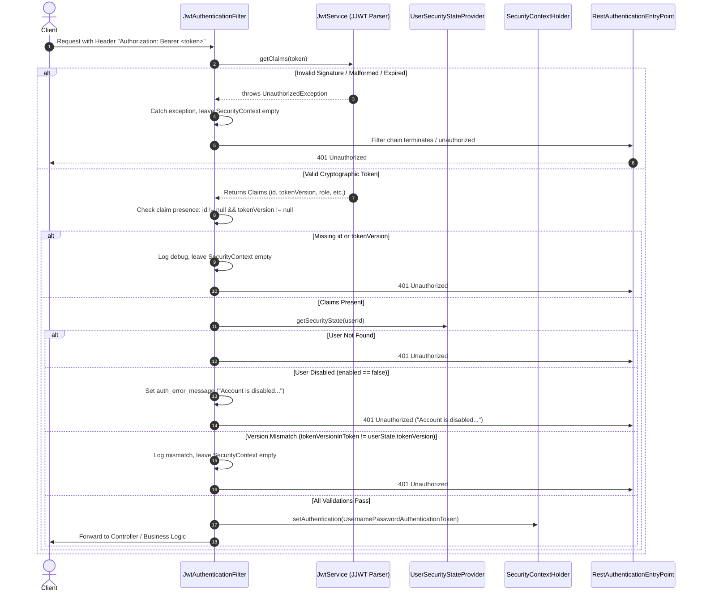

# Comprehensive Audit Report: Complete JWT Lifecycle & Expiration Architecture

**Document ID**: `docs/52-jwt-lifecycle-and-expiration-audit.md`  
**Date**: 2026-11-03  
**Auditor**: Antigravity AI  
**Scope**: 
- Backend: `prolt-operations` (Spring Boot 3.3.x / Java 21)
- Frontend: `IEX-Dashboard/frontend` (React 18 / TypeScript / Vite)
- Security Layer: JJWT (io.jsonwebtoken 0.12.x), Spring Security 6.x, Redis, PostgreSQL
**Execution Type**: READ-ONLY AUDIT & ARCHITECTURAL VERIFICATION  
**Status**: AUDIT COMPLETE — ZERO SOURCE MODIFICATIONS, ZERO DATABASE CHANGES

---

## 1. Executive Summary

This audit delivers an end-to-end inspection of the JSON Web Token (JWT) lifecycle across the `prolt-operations` backend and `IEX-Dashboard/frontend` client application. 

### Key Findings
1. **Generation & Cryptography**: JWTs are generated via JJWT (`io.jsonwebtoken:jjwt-api:0.12.x`) using HMAC-SHA signing with an enforced minimum 256-bit (32-byte) secret key. The token payload encodes the user's `id`, `username`, `role`, `tokenVersion`, `hiddenModules`, and `readOnlyModules`. Notably, the standard `sub` (Subject) claim is omitted, with `id` serving as the primary identifier.
2. **Expiration Enforcement**: Expiration defaults to exactly **7 days (168 hours / 604,800 seconds)** via `app.jwt.expires-in=${JWT_EXPIRES_IN:7d}`. JJWT parses and validates expiration automatically on every incoming request; expired tokens throw `ExpiredJwtException` and return `401 Unauthorized`.
3. **Session Revocation via `tokenVersion`**: Stateless JWTs are coupled to stateful scalar revocation. Any account disablement (`PATCH /api/users/{id}/status`) or admin session termination (`POST /api/users/{id}/revoke-sessions`) increments `tokenVersion` in PostgreSQL (and Redis). Even if a JWT is cryptographically valid and unexpired, a `tokenVersion` mismatch results in immediate `401 Unauthorized` rejection.
4. **Redis TTL & Dynamic Configuration Mismatch**: In the production profile, `RedisSecurityStateProvider` uses a **hardcoded TTL of 7 days** (`DEFAULT_TTL_SECONDS = 7L * 24 * 60 * 60`). If `JWT_EXPIRES_IN` is changed via environment variable to anything other than `7d`, Redis TTL does not adapt automatically, causing either benign cache misses or stale cache retention.
5. **Client Authentication & Single-Use Tokens**: The frontend stores JWTs in `localStorage` under `iex_admin_token` and attaches them via Axios request interceptors. Any HTTP 401 response triggers an immediate event-driven logout and redirects to `/login`. **There is no refresh token mechanism**; users must re-authenticate via the 2-step OTP flow.

---

## 2. JWT Generation

### 2.1 Generating Classes and Methods

| Component | File & Location | Method / Signature | Description |
| :--- | :--- | :--- | :--- |
| **Token Generator** | [`JwtService.java:L90-L94`](file:///home/ankit-jha/probus-workspace/prolt-operations/src/main/java/com/sense/prolt_operations/security/JwtService.java#L90-L94) | `public String generateToken(User user)` | Extracts module lists and invokes overloaded `generateToken`. |
| **Builder Pipeline**| [`JwtService.java:L96-L112`](file:///home/ankit-jha/probus-workspace/prolt-operations/src/main/java/com/sense/prolt_operations/security/JwtService.java#L96-L112) | `public String generateToken(String id, String username, Role role, int tokenVersion, List<String> hiddenModules, List<String> readOnlyModules)` | Constructs, claims, signs, and compacts the JWT using `Jwts.builder()`. |
| **Service Trigger** | [`AuthService.java:L51-L74`](file:///home/ankit-jha/probus-workspace/prolt-operations/src/main/java/com/sense/prolt_operations/service/AuthService.java#L51-L74) | `public AuthResponse verifyOtp(VerifyOtpDTO dto)` | Invoked upon successful OTP verification. Line 71: `String token = jwtService.generateToken(user);`. |
| **REST Controller** | [`AuthController.java:L41-L46`](file:///home/ankit-jha/probus-workspace/prolt-operations/src/main/java/com/sense/prolt_operations/controller/AuthController.java#L41-L46) | `public ResponseEntity<AuthResponse> verifyOtp(@RequestBody VerifyOtpDTO dto)` | Endpoint `POST /api/auth/verify-otp` returns `AuthResponse` containing token. |
| **User Principal**  | [`ProltUserPrincipal.java:L22-L37`](file:///home/ankit-jha/probus-workspace/prolt-operations/src/main/java/com/sense/prolt_operations/security/ProltUserPrincipal.java#L22-L37) | `public ProltUserPrincipal(...)` | Reconstructed from validated claims for the Spring Security context. |

### 2.2 Cryptographic Signing Details

- **Signing Algorithm**: HMAC using SHA-2 (JJWT `Keys.hmacShaKeyFor(byte[])`). Depending on key bit-length, JJWT automatically selects:
  - 256 bits (32 bytes): `HS256`
  - 384 bits (48 bytes): `HS384`
  - 512 bits (64 bytes): `HS512`
  - In development, `application-dev.properties` configures a 58-byte secret (`super_secret_jwt_key_for_development_environment_32_bytes!`), which binds to **HS384**.
- **Signing Key Source**:
  - Injected via `@Value("${app.jwt.secret:}") private String secret;` ([`JwtService.java:L32-L33`](file:///home/ankit-jha/probus-workspace/prolt-operations/src/main/java/com/sense/prolt_operations/security/JwtService.java#L32-L33)).
  - Initialized in `@PostConstruct public void init()`:
    ```java
    byte[] bytes = (secret != null) ? secret.getBytes(StandardCharsets.UTF_8) : new byte[0];
    if (bytes.length < 32) {
        throw new IllegalStateException("FATAL: app.jwt.secret must be at least 32 bytes long...");
    }
    this.signingKey = Keys.hmacShaKeyFor(bytes);
    ```
- **Subject (`sub`) Claim**:
  - **Omitted / Null**. `Jwts.builder()` does not set `.subject(...)`. The user identifier is stored explicitly in the custom `"id"` claim.
- **Custom Claims Payload**:
  ```json
  {
    "id": "27447bb3-ec5c-461a-b8c5-5fbb0960d1c1",
    "username": "admin",
    "role": "SUPER_ADMIN",
    "tokenVersion": 0,
    "hiddenModules": [],
    "readOnlyModules": [],
    "iat": 1782111442,
    "exp": 1782716242
  }
  ```
  - `"id"`: User UUID (String).
  - `"username"`: Normalized username (String).
  - `"role"`: User role name (String: `"SUPER_ADMIN"`, `"ADMIN"`, `"CLIENT"`).
  - `"tokenVersion"`: Session epoch tracking integer (`int`).
  - `"hiddenModules"`: List of frontend modules hidden from user (`List<String>`).
  - `"readOnlyModules"`: List of frontend modules restricted to view-only (`List<String>`).
- **Timestamp Claims**:
  - `iat` (Issued-At): Serialized via `.issuedAt(now)` where `now = new Date()`.
  - `exp` (Expiration): Serialized via `.expiration(expiry)` where `expiry = new Date(now.getTime() + expirationMillis)`.
- **Configurability**: Expiration is fully configurable via `app.jwt.expires-in` / `JWT_EXPIRES_IN`.

---

## 3. Expiration Configuration

### 3.1 Configuration Matrix

| Parameter | Value / Behavior | Source Reference |
| :--- | :--- | :--- |
| **Property Name** | `app.jwt.expires-in` | [`application.properties:L80`](file:///home/ankit-jha/probus-workspace/prolt-operations/src/main/resources/application.properties#L80) |
| **Environment Variable** | `JWT_EXPIRES_IN` | `app.jwt.expires-in=${JWT_EXPIRES_IN:7d}` |
| **Default Value** | `"7d"` | [`JwtService.java:L35`](file:///home/ankit-jha/probus-workspace/prolt-operations/src/main/java/com/sense/prolt_operations/security/JwtService.java#L35) |
| **Supported Units** | `d` (days), `h` (hours), `m` (minutes), `s` (seconds), or plain number (milliseconds) | [`JwtService.java:L63-L88`](file:///home/ankit-jha/probus-workspace/prolt-operations/src/main/java/com/sense/prolt_operations/security/JwtService.java#L63-L88) |
| **Effective Value (Local/Dev)** | `"7d"` (inherits default) | `application-dev.properties` does not override |
| **Effective Value (Production)** | `"7d"` (unless `JWT_EXPIRES_IN` is set) | `application-prod.properties` does not override |
| **Missing Configuration Failure** | **No startup failure.** Defaults to 7 days (`604800000 ms`). | [`JwtService.java:L64-L66`](file:///home/ankit-jha/probus-workspace/prolt-operations/src/main/java/com/sense/prolt_operations/security/JwtService.java#L64-L66) |
| **Missing Secret Failure** | **FATAL startup failure.** Throws `IllegalStateException` if `< 32 bytes`. | [`JwtService.java:L55-L57`](file:///home/ankit-jha/probus-workspace/prolt-operations/src/main/java/com/sense/prolt_operations/security/JwtService.java#L55-L57) |
| **Parsing Enforcement** | Enforced by JJWT parser during `parseSignedClaims(token)`. | [`JwtService.java:L130-L138`](file:///home/ankit-jha/probus-workspace/prolt-operations/src/main/java/com/sense/prolt_operations/security/JwtService.java#L130-L138) |

### 3.2 Exact Validity Calculation

With the effective default expiration `7d`:
$$\text{Days} = 7 \text{ days}$$
$$\text{Hours} = 7 \times 24 = 168 \text{ hours}$$
$$\text{Minutes} = 168 \times 60 = 10,080 \text{ minutes}$$
$$\text{Seconds} = 10,080 \times 60 = 604,800 \text{ seconds}$$
$$\text{Milliseconds} = 604,800 \times 1000 = 604,800,000 \text{ milliseconds}$$

---

## 4. JWT Validation Pipeline

Every protected request passes through [`JwtAuthenticationFilter.java`](file:///home/ankit-jha/probus-workspace/prolt-operations/src/main/java/com/sense/prolt_operations/security/JwtAuthenticationFilter.java#L38-L107):



### Validation Checkpoints Breakdown

1. **Signature Validation**:
   - `Jwts.parser().verifyWith(signingKey).build().parseSignedClaims(token)` validates HMAC integrity. Tampered tokens throw `SecurityException` / `SignatureException`.
2. **Expiration Validation**:
   - JJWT validates `exp` against the current server epoch. Expired tokens throw `ExpiredJwtException`.
3. **Malformed Token Rejection**:
   - Tokens with illegal base64 encoding, incomplete segments, or corrupt JSON throw `MalformedJwtException`.
4. **Missing `tokenVersion` Rejection**:
   - `if (userId != null && tvObj instanceof Number num)` checks that `tokenVersion` claim is present and numeric. Tokens without `tokenVersion` are immediately rejected ([`JwtAuthenticationFilter.java:L93`](file:///home/ankit-jha/probus-workspace/prolt-operations/src/main/java/com/sense/prolt_operations/security/JwtAuthenticationFilter.java#L93)).
5. **Token Version Mismatch Rejection**:
   - If `userState.tokenVersion() != tokenVersionInToken`, authentication is rejected ([`JwtAuthenticationFilter.java:L60-L62`](file:///home/ankit-jha/probus-workspace/prolt-operations/src/main/java/com/sense/prolt_operations/security/JwtAuthenticationFilter.java#L60-L62)).
6. **Disabled User Rejection**:
   - If `!userState.enabled()`, the filter sets `auth_error_message = "Account is disabled. Please contact administrator."` and rejects authentication ([`JwtAuthenticationFilter.java:L57-L59`](file:///home/ankit-jha/probus-workspace/prolt-operations/src/main/java/com/sense/prolt_operations/security/JwtAuthenticationFilter.java#L57-L59)).
7. **SecurityContext Population**:
   - Populated **strictly** at [`JwtAuthenticationFilter.java:L87`](file:///home/ankit-jha/probus-workspace/prolt-operations/src/main/java/com/sense/prolt_operations/security/JwtAuthenticationFilter.java#L87) inside the verified branch. If any check fails, `SecurityContextHolder` remains unauthenticated.

---

## 5. Session Revocation Mechanism

### 5.1 Revocation Triggers

There are two primary operations that trigger session revocation:

1. **Account Disablement (`PATCH /api/users/{id}/status`)**:
   - In [`UserService.java:L227-L244`](file:///home/ankit-jha/probus-workspace/prolt-operations/src/main/java/com/sense/prolt_operations/service/UserService.java#L227-L244):
     ```java
     if (user.isEnabled() != dto.enabled()) {
         user.setEnabled(dto.enabled());
         if (!dto.enabled()) {
             user.incrementTokenVersion(); // Invalidate all active sessions immediately
         }
         user = userRepository.saveAndFlush(user);
         securityStateProvider.updateSecurityState(user.getId(), user.isEnabled(), user.getTokenVersion());
     }
     ```
2. **Explicit Admin Revocation (`POST /api/users/{id}/revoke-sessions`)**:
   - In [`UserService.java:L249-L271`](file:///home/ankit-jha/probus-workspace/prolt-operations/src/main/java/com/sense/prolt_operations/service/UserService.java#L249-L271):
     - Prevents admin self-revocation (`400 Bad Request: "You cannot revoke your own active session"`).
     - Calls `user.incrementTokenVersion()`.
     - Flushes entity to database.
     - Logs audit record `REVOKE_SESSIONS`.
     - Calls `securityStateProvider.updateSecurityState(user.getId(), user.isEnabled(), user.getTokenVersion())`.

### 5.2 Provider Synchronizations

- **Database Provider (`DatabaseSecurityStateProvider`)**:
  - `updateSecurityState` is a no-op because the database commit is already the synchronous source of truth.
  - On the next request, `findSecurityStateById(userId)` directly reads the new `tokenVersion` from PostgreSQL.
- **Redis Provider (`RedisSecurityStateProvider`)**:
  - Registers a post-commit transaction hook via `TransactionSynchronizationManager.registerSynchronization`.
  - Upon transaction commit, reads the updated `UserSecurityState` from the database and executes an atomic Lua script:
    ```lua
    local current = redis.call('GET', KEYS[1])
    if not current then
        redis.call('SETEX', KEYS[1], ARGV[1], ARGV[2])
        return 1
    end
    local ok, obj = pcall(cjson.decode, current)
    if ok and obj and obj.tokenVersion then
        if tonumber(ARGV[3]) >= tonumber(obj.tokenVersion) then
            redis.call('SETEX', KEYS[1], ARGV[1], ARGV[2])
            return 1
        else
            return 0
        end
    else
        redis.call('SETEX', KEYS[1], ARGV[1], ARGV[2])
        return 1
    end
    ```
  - This ensures that out-of-order writes or concurrent requests cannot revert a newer `tokenVersion` to an older one.

### 5.3 How an Unexpired Token Gets Rejected

Even if a token has valid cryptographic signatures and 6 days of remaining validity (`exp > now`):
1. The token holds claim `tokenVersion = 0`.
2. Following revocation, PostgreSQL and Redis hold `tokenVersion = 1`.
3. When the token is presented, `JwtAuthenticationFilter` checks:
   $$\text{tokenVersionInToken (0)} \ne \text{userState.tokenVersion (1)}$$
4. The filter skips authentication.
5. The request is denied with **HTTP 401 Unauthorized**.

---

## 6. Frontend Usage & Lifecycle

### 6.1 Token Storage

- **Storage Location**: Browser `localStorage`.
- **Key Name**: `AUTH_TOKEN_KEY = 'iex_admin_token'` (defined in [`frontend/src/constants/auth.ts:L1`](file:///home/ankit-jha/probus-workspace/IEX-Dashboard/frontend/src/constants/auth.ts#L1)).
- **User Metadata**: Stored alongside the token under key `'iex_user'` as a serialized JSON object.

### 6.2 Request Authorization Attachment

Axios request interceptors in [`frontend/src/api/client.ts:L32-L45`](file:///home/ankit-jha/probus-workspace/IEX-Dashboard/frontend/src/api/client.ts#L32-L45) attach the token to every outgoing request:
```typescript
apiClient.interceptors.request.use(
  (config) => {
    const token = localStorage.getItem(AUTH_TOKEN_KEY);
    if (token && config.headers) {
      if (typeof (config.headers as any).set === 'function') {
        (config.headers as any).set('Authorization', `Bearer ${token}`);
      } else {
        config.headers.Authorization = `Bearer ${token}`;
      }
    }
    return config;
  },
  (error) => Promise.reject(error)
);
```

### 6.3 HTTP 401 Handling & Reactive Logout

- In [`frontend/src/api/client.ts:L64-L67`](file:///home/ankit-jha/probus-workspace/IEX-Dashboard/frontend/src/api/client.ts#L64-L67):
  ```typescript
  if (error.response.status === 401) {
    triggerGlobalLogout();
  }
  ```
- `triggerGlobalLogout()` dispatches a DOM event `'logout'` on `authEventEmitter` ([`frontend/src/utils/events.ts:L3-L5`](file:///home/ankit-jha/probus-workspace/IEX-Dashboard/frontend/src/utils/events.ts#L3-L5)).
- [`frontend/src/contexts/AuthContext.tsx:L51-L55`](file:///home/ankit-jha/probus-workspace/IEX-Dashboard/frontend/src/contexts/AuthContext.tsx#L51-L55) listens for `'logout'` and triggers `logout()`:
  - Sets `isAuthenticated = false`.
  - Clears React auth state (`token = null`, `user = null`).
  - Removes `iex_admin_token` and `iex_user` from `localStorage`.
- **Automatic Redirection**:
  - In [`frontend/src/components/ProtectedRoute.tsx:L23-L25`](file:///home/ankit-jha/probus-workspace/IEX-Dashboard/frontend/src/components/ProtectedRoute.tsx#L23-L25):
    ```typescript
    if (!isAuthenticated) {
      return <Navigate to="/login" replace />;
    }
    ```
  - As soon as `isAuthenticated` transitions to `false`, React Router immediately redirects the user to `/login`.
- **Token Refresh vs. Re-Authentication**:
  - **No refresh token exists.** Neither the backend nor the frontend implements token refresh or sliding sessions.
  - When a token expires or is revoked, the session terminates completely. The user is redirected to `/login` and must perform a full 2-step OTP authentication (`sendOtp` -> `verifyOtp`).

---

## 7. Redis TTL vs. JWT Expiration Mismatch Analysis

### 7.1 Code Inspection

In [`RedisSecurityStateProvider.java:L23`](file:///home/ankit-jha/probus-workspace/prolt-operations/src/main/java/com/sense/prolt_operations/security/state/RedisSecurityStateProvider.java#L23):
```java
private static final long DEFAULT_TTL_SECONDS = 7L * 24 * 60 * 60; // 7 days matching JWT expiration
```
And in line 143:
```java
redisTemplate.execute(
        atomicSetScript,
        Collections.singletonList(key),
        String.valueOf(DEFAULT_TTL_SECONDS),
        json,
        String.valueOf(state.tokenVersion())
);
```

### 7.2 Findings & Verification

1. **Default State**:
   - When `app.jwt.expires-in` is at its default (`7d`), the Redis TTL (`604,800 seconds`) **exactly matches** the JWT expiration (`7 days`).
2. **Hardcoded Limitation**:
   - `DEFAULT_TTL_SECONDS` is declared as a hardcoded `private static final long`.
   - `app.jwt.expires-in` is dynamically configurable via property or `JWT_EXPIRES_IN` environment variable.
   - **There is no dynamic binding between `app.jwt.expires-in` and `DEFAULT_TTL_SECONDS`.**

### 7.3 Consequences of Mismatch

| Scenario | Architectural Consequence | Security & Operational Impact |
| :--- | :--- | :--- |
| **JWT Expiration > Redis TTL**<br>*(e.g., `JWT_EXPIRES_IN=30d`, Redis TTL = 7d)* | After 7 days, Redis cache entry expires. The subsequent incoming request results in a Redis cache miss. | **Safe & Self-Healing**: On cache miss, `getSecurityState()` queries PostgreSQL, verifies `tokenVersion`, and writes the state back to Redis for another 7 days. Mild database read spike every 7 days. |
| **JWT Expiration < Redis TTL**<br>*(e.g., `JWT_EXPIRES_IN=1h`, Redis TTL = 7d)* | JWT expires on the client after 1 hour, but Redis retains the cached security state for 7 days. | **Memory Overhead**: Stale entries occupy Redis memory for 7 days.<br>**Out-of-Band Desync Risk**: If a user is modified or disabled directly via direct SQL in PostgreSQL (bypassing `UserService`), Redis continues serving the stale enabled/tokenVersion data for up to 7 days. |

---

## 8. Summary Table of Key References

| Audit Item | Backend Location | Frontend Location | Value / Configuration |
| :--- | :--- | :--- | :--- |
| **JWT Generation** | `JwtService.java:L96-L112` | N/A | `Jwts.builder()` |
| **Signing Secret** | `JwtService.java:L32-L33` | N/A | `app.jwt.secret=${JWT_SECRET:}` |
| **Signing Algorithm** | `JwtService.java:L59` | N/A | `Keys.hmacShaKeyFor` (HS256/HS384/HS512) |
| **JWT Expiration** | `JwtService.java:L35-L36` | N/A | `app.jwt.expires-in=${JWT_EXPIRES_IN:7d}` |
| **Authentication Filter** | `JwtAuthenticationFilter.java:L38-L107` | N/A | `OncePerRequestFilter` |
| **Revocation Logic** | `UserService.java:L249-L271` | N/A | `user.incrementTokenVersion()` |
| **Redis TTL** | `RedisSecurityStateProvider.java:L23` | N/A | Hardcoded `7L * 24 * 60 * 60` (7 days) |
| **Client Storage** | N/A | `constants/auth.ts:L1` | `localStorage.getItem('iex_admin_token')` |
| **Client Header** | N/A | `client.ts:L34-L41` | `Authorization: Bearer <token>` |
| **401 Interception** | N/A | `client.ts:L64-L67` | `triggerGlobalLogout()` -> `/login` |
| **Token Refresh** | **None** | **None** | Re-authentication via OTP required |
