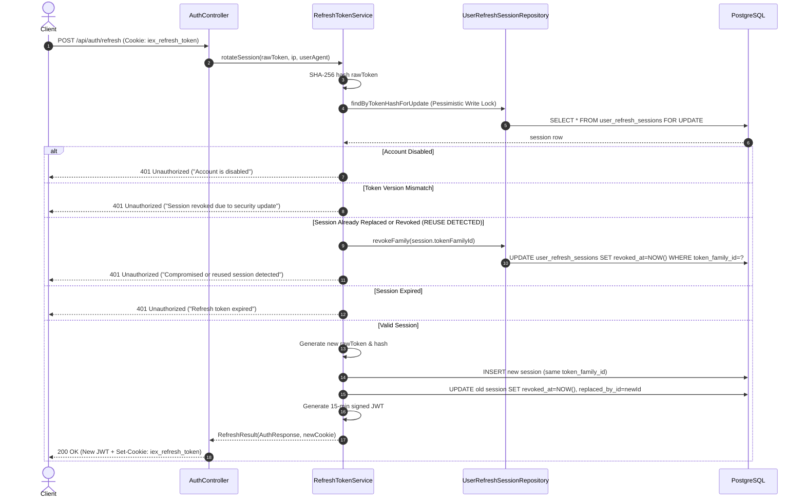

# Milestone V14: Secure JWT Access Token & Refresh Token Architecture

**Project**: `prolt-operations`  
**Date**: November 2026  
**Status**: Implemented & Verified (All 255 Backend Tests Passing; 0 Frontend Errors)  

---

## 1. Executive Summary

Milestone V14 transitions the `prolt-operations` authentication system from a monolithic 7-day JWT session to an enterprise-grade, high-security **Dual-Token Architecture**:

1. **Short-Lived Access Token**:
   - Format: Signed JWT (HMAC-SHA256).
   - Validity: **15 minutes** (configurable via `app.jwt.expires-in=15m`).
   - Claims: Standard `sub` (user UUID), `username`, `email`, `role`, `tokenVersion`, `hiddenModules`, `readOnlyModules`, `iat`, and `exp`.
   - Transport: Client memory / Authorization Header (`Bearer <token>`).
2. **Long-Lived Refresh Token**:
   - Format: Cryptographically secure random opaque token (256-bit entropy, URL-safe Base64).
   - Validity: **7 days** (configurable via `app.auth.refresh-token.validity-days=7`).
   - Storage: **SHA-256 hash only** in PostgreSQL table `public."user_refresh_sessions"`. Plaintext tokens are NEVER persisted.
   - Transport: Dedicated `HttpOnly`, `SameSite=Strict`, `Secure` (in prod) cookie named `iex_refresh_token` mapped to `/api/auth`.
3. **Core Security Guarantees**:
   - **OTP-Only Authentication**: Zero passwords reintroduced; inherits V13 credentials removal.
   - **Atomic Token Rotation**: Every refresh consumes the existing token and generates a new token within the same cryptographic token family.
   - **Reuse Detection**: Presenting a previously rotated, revoked, or compromised refresh token immediately revokes the **entire token family** and logs a critical security alert.
   - **Immediate Session Revocation**: Disabling an account or calling administrative session revocation immediately increments `tokenVersion` and revokes all active refresh sessions in PostgreSQL.
   - **Self-Service Session Auditing**: Users can inspect active device sessions (`GET /api/auth/sessions`) and selectively revoke remote sessions (`POST /api/auth/sessions/{id}/revoke`).

---

## 2. Token Lifecycle & Architecture Comparison

| Dimension | Previous Architecture | Milestone V14 Architecture |
|---|---|---|
| **Access Token Lifetime** | 7 days (604,800 seconds) | **15 minutes** (900 seconds) |
| **Refresh Mechanism** | None (user forced to re-authenticate with OTP after 7 days) | **Silent Refresh Token Rotation** (7-day rolling window) |
| **Refresh Token Storage** | None | SHA-256 hashed in PostgreSQL `user_refresh_sessions` |
| **Cookie Transport** | None | `HttpOnly`, `SameSite=Strict`, `Path=/api/auth` |
| **Theft Mitigation** | Access token theft valid for up to 7 days | Access token theft expires in $\le 15$ minutes; refresh token theft triggers automatic family revocation upon reuse |
| **Remote Invalidation** | Relied solely on JWT `tokenVersion` checks | Multi-layered: `tokenVersion` check in memory/DB + DB session revocation |

---

## 3. Database Schema & Flyway Migration (V14)

### 3.1 Migration: `V14__create_user_refresh_sessions.sql`

The table `public."user_refresh_sessions"` stores refresh session state.

```sql
CREATE TABLE IF NOT EXISTS public."user_refresh_sessions" (
    "id" VARCHAR(36) PRIMARY KEY,
    "user_id" VARCHAR(36) NOT NULL,
    "token_hash" VARCHAR(64) NOT NULL UNIQUE,
    "token_family_id" VARCHAR(36) NOT NULL,
    "token_version" INTEGER NOT NULL DEFAULT 0,
    "expires_at" TIMESTAMP WITHOUT TIME ZONE NOT NULL,
    "created_at" TIMESTAMP WITHOUT TIME ZONE NOT NULL DEFAULT NOW(),
    "last_used_at" TIMESTAMP WITHOUT TIME ZONE,
    "revoked_at" TIMESTAMP WITHOUT TIME ZONE,
    "replaced_by_id" VARCHAR(36),
    "ip_address" VARCHAR(45),
    "user_agent" TEXT,
    CONSTRAINT "fk_refresh_sessions_user"
        FOREIGN KEY ("user_id")
        REFERENCES public."User"("id")
        ON DELETE CASCADE
);

CREATE INDEX IF NOT EXISTS "idx_refresh_sessions_user_active"
    ON public."user_refresh_sessions" ("user_id", "expires_at")
    WHERE "revoked_at" IS NULL;

CREATE INDEX IF NOT EXISTS "idx_refresh_sessions_family"
    ON public."user_refresh_sessions" ("token_family_id");

CREATE INDEX IF NOT EXISTS "idx_refresh_sessions_cleanup"
    ON public."user_refresh_sessions" ("expires_at");
```

### 3.2 Preflight & Postflight Assertions

- Preflight asserts table `public."User"` exists with column `"tokenVersion"`.
- Postflight verifies `user_refresh_sessions` table creation and index existence (`idx_refresh_sessions_user_active`, `idx_refresh_sessions_family`, `idx_refresh_sessions_cleanup`).

---

## 4. API Endpoints

### 4.1 Authentication & Session Management

| Endpoint | Method | Security | Description |
|---|---|---|---|
| `/api/auth/verify-otp` | `POST` | Public / Rate-limited | Verifies OTP; returns 15-min JWT in body and attaches `iex_refresh_token` cookie. |
| `/api/auth/refresh` | `POST` | Public (Requires Cookie) | Rotates refresh token, issues fresh 15-min JWT, and updates `iex_refresh_token` cookie. |
| `/api/auth/logout` | `POST` | Public (Optional Cookie) | Revokes active refresh session and clears `iex_refresh_token` cookie (`Max-Age=0`). |
| `/api/auth/sessions` | `GET` | Authenticated | Lists all active sessions for the calling user with `isCurrent` indicator. |
| `/api/auth/sessions/{sessionId}/revoke` | `POST` | Authenticated | Revokes a specific session belonging to the calling user. |
| `/api/users/{id}/status` | `PATCH` | Super Admin | When `enabled=false`, increments `tokenVersion` and revokes all user sessions. |
| `/api/users/{id}/revoke-sessions` | `POST` | Super Admin | Increments `tokenVersion` and revokes all user sessions. |

### 4.2 Endpoint Payloads & Headers

#### Refresh Request: `POST /api/auth/refresh`
- Request:
  ```http
  POST /api/auth/refresh HTTP/1.1
  Host: localhost:8080
  Cookie: iex_refresh_token=OpaqueTokenString...
  ```
- Response (200 OK):
  ```json
  {
    "success": true,
    "token": "eyJhbGciOiJIUzI1NiJ9.newAccessToken...",
    "user": {
      "id": "2cd62741-3439-4c88-ae60-6a492cb31a5d",
      "username": "client_demo",
      "email": "client@example.com",
      "role": "CLIENT"
    }
  }
  ```
  Set-Cookie Header:
  `Set-Cookie: iex_refresh_token=RotatedOpaqueTokenString; Path=/api/auth; Max-Age=604800; HttpOnly; SameSite=Strict`

#### Session List: `GET /api/auth/sessions`
- Response (200 OK):
  ```json
  {
    "success": true,
    "data": [
      {
        "id": "e45b0a31-92a0-4061-9c17-48f02fef972a",
        "deviceInfo": "Mozilla/5.0 (Windows NT 10.0; Win64; x64)...",
        "ipAddress": "192.168.1.5",
        "createdAt": "2026-11-03T12:00:00",
        "lastUsedAt": "2026-11-03T12:30:00",
        "isCurrent": true
      }
    ]
  }
  ```

---

## 5. Security & Rotation Deep-Dive

### 5.1 Refresh Token Rotation Flow



### 5.2 Concurrency & Double-Spend Protection
`findByTokenHashForUpdate` acquires a PostgreSQL pessimistic row write-lock (`SELECT ... FOR UPDATE`). If two concurrent requests arrive with the same refresh token, the second request waits for the lock. Upon acquiring the lock, it discovers `session.isReplaced() == true` or `session.isRevoked() == true`, detecting the race/reuse and revoking the family.

### 5.3 Automated Cleanup Task
`RefreshTokenService.cleanupExpiredAndRevokedSessions()` runs daily via `@Scheduled(cron = "${app.auth.refresh-token.cleanup-cron:0 0 3 * * *}")`. It purges sessions whose expiration or revocation timestamp is older than `retention-days` (default: 30 days).

---

## 6. Verification Results

### 6.1 Backend Test Suite
- Total Tests: **255**
- Failures: **0**
- Errors: **0**
- Skipped: **1** (Intentionally disabled sample test)
- Status: **BUILD SUCCESS**

### 6.2 Milestone V14 Integration Suite (`RefreshTokenIntegrationTest`)
All 18 targeted test cases passed:
1. `LOGIN-01`: Successful OTP verification returns 15-min JWT and sets HttpOnly cookie.
2. `LOGIN-02`: OTP verification response body maintains contract.
3. `COOKIE-01`: Refresh token cookie has correct security flags (HttpOnly, SameSite, Path).
4. `REFRESH-01`: Valid refresh cookie returns fresh 15-min JWT.
5. `REFRESH-02`: Refresh endpoint updates refresh token cookie with new token (Rotation).
6. `REFRESH-03`: Rotated token retains family ID and invalidates old session.
7. `REFRESH-04`: Reuse of rotated refresh token revokes entire token family (Reuse Detection).
8. `REFRESH-05`: Missing refresh cookie returns 401 Unauthorized.
9. `REFRESH-06`: Invalid or tampered refresh cookie returns 401 Unauthorized.
10. `REFRESH-07`: Expired refresh token returns 401 Unauthorized.
11. `REVOKE-01`: Account disablement immediately invalidates active refresh session.
12. `REVOKE-02`: Admin revoke-sessions revokes all active refresh sessions.
13. `REVOKE-03`: Super Admin password update/token version bump revokes refresh session.
14. `LOGOUT-01`: Calling logout revokes refresh session and clears cookie.
15. `LOGOUT-02`: Reusing refresh token after logout is rejected.
16. `LOGOUT-03`: Logout without cookie is idempotent and returns 200 OK.
17. `MULTI-01`: User can have multiple active sessions from different devices.
18. `MULTI-02`: User can inspect active sessions and revoke a specific remote session.

### 6.3 Database Migration Rehearsals
- `FlywayBaselineIntegrationTest`: Passed (14 migrations, 59 tables verified).
- `IsolatedMigrationRehearsalTest`: Passed across all 6 isolated lifecycle scenarios.

### 6.4 Frontend Compatibility
- `npx tsc --noEmit`: Exited with code 0 (0 compilation errors).
