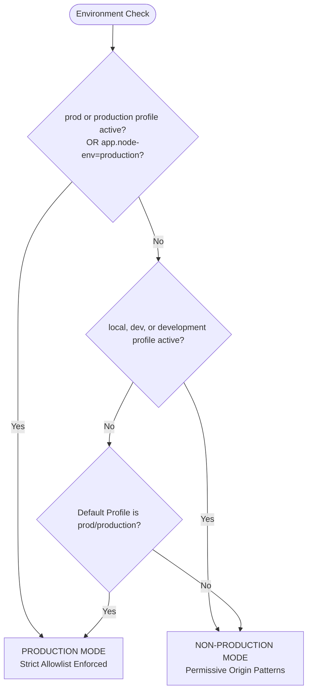

# Milestone V16C: CORS & Distributed OTP Rate Limiting Hardening

**Project**: `prolt-operations`  
**Date**: November 3, 2026  
**Status**: COMPLETED  
**Scope**: Backend Security Hardening (CORS Policy & Distributed Redis Rate Limiting)  

---

## 1. Executive Summary

Milestone **V16C** delivers critical backend security hardening for cross-origin resource sharing (CORS) and distributed rate limiting across the `prolt-operations` Spring Boot application. It resolves key vulnerabilities identified in the V16 backend security audit (`docs/54-v16-backend-security-architecture-audit.md`):

1. **Environment-Specific CORS Security**:
   - **Local & Development (`local`, `dev`, `development`)**: Retains developer productivity by permitting all origins (`allowedOriginPatterns("*")`) with credential support (`allowCredentials(true)`).
   - **Production (`prod`, `production`)**: Enforces a strict, explicitly configured allowlist (`app.cors-origins`). Wildcard origins (`*`) and pattern wildcards are strictly prohibited.
   - **Fail-Fast Production Startup Validation**: Spring application context initialization fails immediately (`IllegalStateException`) if `app.cors-origins` is missing, empty, contains `*`, or contains malformed URI schemes/hostnames in production.
   - **Deterministic Profile Precedence**: If production markers (`prod`, `production` profiles, or `app.node-env=production`) are active alongside local or development profiles, the production security policy strictly takes precedence.
   - **Refresh Cookie Compatibility**: Allowed headers, exposed headers, methods, and credential policies are fully aligned with the V14 HttpOnly refresh-token cookie architecture across origins.

2. **Distributed Redis-Backed OTP Abuse Protection**:
   - **Multi-Dimensional Rate Limiting**: Applies rate limits on both client IP address and target account identifier across `/api/auth/send-otp` and `/api/auth/verify-otp`.
   - **Atomic Redis Lua Scripting**: Counter increment and window TTL expiration (`INCR` + `EXPIRE`) are executed atomically within a single Redis roundtrip, preventing TTL leaks or race conditions.
   - **Privacy-Preserving Account Keys**: Target email addresses are hashed using HMAC-SHA256 with a dedicated secret key (`app.security.rate-limit.account-hmac-key`) before being used in Redis keys or log messages (`otp:account:<hash>:<action>`). Raw PII is never exposed in cache keys or log output.
   - **Spoof-Resistant IP Resolution**: `ClientIpResolver` inspects `X-Forwarded-For` only when the immediate TCP peer is a trusted reverse proxy (RFC 1918 private subnets, loopback, or custom CIDR list). Direct connections from untrusted networks ignore spoofed headers and bind to the remote socket address.
   - **Production Fail-Closed Availability**: If Redis connectivity fails or times out in production, requests fail closed (HTTP 503 `Service Unavailable`) with explicit `Retry-After` headers to protect downstream SMS/email gateways from catastrophic brute-force or flooding attacks. In local/development profiles, it gracefully falls back to a thread-safe in-memory rate limiter to allow offline development.
   - **Zero Upstream Ingestion Loss**: Uses `CachedBodyHttpServletRequest` to buffer request bodies in memory, allowing non-destructive inspection of the `email` field in `AuthRateLimiterFilter` without breaking Spring MVC `@RequestBody` deserialization in downstream controllers.

All 297 unit and integration tests passed with zero failures and zero regressions.

---

## 2. Pre-Implementation Audit Findings

Prior to Milestone V16C, audit of `SecurityConfig.java`, `AuthRateLimiterFilter.java`, and `FixedWindowRateLimiter.java` revealed the following security risks:

| Finding ID | Component | Severity | Description |
|---|---|---|---|
| **SEC-CORS-01** | `SecurityConfig.java` | High | Global CORS configuration applied `setAllowedOriginPatterns(List.of("*"))` unconditionally across all runtime environments, including production. |
| **SEC-CORS-02** | `SecurityConfig.java` | Medium | No startup validation of `app.cors-origins`. Missing or empty configuration in production would either silently fail or expose the API to unauthorized cross-origin requests. |
| **SEC-CORS-03** | `SecurityConfig.java` | Medium | Production configuration had no validation against wildcards (`*`) or malformed URI schemes. |
| **SEC-RATE-01** | `AuthRateLimiterFilter.java` | Critical | Rate limiting relied entirely on in-memory `ConcurrentHashMap`. Multi-instance cluster deployments multiplied rate limit thresholds by $N$ instances, rendering brute-force limits ineffective. |
| **SEC-RATE-02** | `AuthRateLimiterFilter.java` | Critical | Rate limiting was single-dimensional (IP only). Distributed botnets could bypass limits by distributing send/verify requests across rotating proxies targeting a single victim account. |
| **SEC-RATE-03** | `ClientIpResolver.java` | High | Blindly trusted `X-Forwarded-For` headers from any incoming socket, allowing attackers to forge arbitrary client IP addresses and completely bypass IP rate limits. |
| **SEC-RATE-04** | `FixedWindowRateLimiter.java` | Medium | In-memory limiter had no automatic key TTL eviction, accumulating stale IP counters over extended application lifecycles. |

---

## 3. Environment-Specific CORS Architecture

### 3.1 Profile Detection & Precedence Rules

The CORS security model is managed by `CorsConfigValidator` and consumed by `SecurityConfig`. Environment classification follows strict precedence:



If an operator accidentally starts the application with both `local` and `prod` profiles active (e.g. `--spring.profiles.active=local,prod`), `determineIfProduction()` evaluates to **true**, ensuring production security invariants cannot be bypassed.

### 3.2 Production Allowlist Validation

During context startup (`@PostConstruct`), `CorsConfigValidator.validateOnStartup()` audits the configured origins in `app.cors-origins`:

```java
// Rejection conditions in production:
if (rawOrigins == null || rawOrigins.isBlank()) {
    throw new IllegalStateException("Production environment requires explicit 'app.cors-origins' configuration.");
}

for (String origin : origins) {
    if ("*".equals(origin) || origin.contains("*")) {
        throw new IllegalStateException("Wildcard CORS origins are forbidden in production: " + origin);
    }
    URI uri = URI.create(origin);
    if (!"http".equalsIgnoreCase(uri.getScheme()) && !"https".equalsIgnoreCase(uri.getScheme())) {
        throw new IllegalStateException("Invalid CORS origin scheme (must be http or https): " + origin);
    }
    if (uri.getHost() == null) {
        throw new IllegalStateException("Invalid CORS origin host: " + origin);
    }
}
```

### 3.3 Environment CORS Behavior Matrix

| Setting | Local / Development | Production |
|---|---|---|
| **Allowed Origins** | `*` via `allowedOriginPatterns` | Exact list from `app.cors-origins` |
| **Credentials (`Access-Control-Allow-Credentials`)** | `true` | `true` |
| **Allowed Methods** | `GET`, `POST`, `PUT`, `PATCH`, `DELETE`, `OPTIONS` | `GET`, `POST`, `PUT`, `PATCH`, `DELETE`, `OPTIONS` |
| **Allowed Headers** | `Authorization`, `Content-Type`, `Accept`, `X-Requested-With`, `Origin`, `Access-Control-Request-Method`, `Access-Control-Request-Headers` | `Authorization`, `Content-Type`, `Accept`, `X-Requested-With`, `Origin`, `Access-Control-Request-Method`, `Access-Control-Request-Headers` |
| **Exposed Headers** | `Authorization`, `Set-Cookie`, `RateLimit-Limit`, `RateLimit-Remaining`, `RateLimit-Reset`, `Retry-After` | `Authorization`, `Set-Cookie`, `RateLimit-Limit`, `RateLimit-Remaining`, `RateLimit-Reset`, `Retry-After` |
| **Max Age** | 3600 seconds | 3600 seconds |
| **Startup Failure on Missing Origins** | No (falls back to `*`) | **Yes (`IllegalStateException`)** |

---

## 4. Distributed OTP Rate Limiting Architecture

### 4.1 Multi-Dimensional Defense-in-Depth

Rate limiting for OTP authentication operates across two orthogonal dimensions:

1. **IP Dimension**: Restricts aggregate OTP requests originating from an IP address to prevent denial-of-wallet and volumetric gateway exhaustion.
2. **Account Dimension**: Restricts OTP requests targeted at a specific user account (`email`) to prevent targeted SMS/email spamming and credential stuffing.

```
                    Incoming Request (/api/auth/send-otp or verify-otp)
                                       │
                                       ▼
                       ClientIpResolver (Trusted Proxy Check)
                                       │
                                       ▼
                       Extract Client IP & Target Email (HMAC-SHA256)
                                       │
                     ┌─────────────────┴─────────────────┐
                     ▼                                   ▼
          Check IP Rate Limit                Check Account Rate Limit
          Key: otp:ip:<ip>:<action>          Key: otp:account:<hash>:<action>
                     │                                   │
                     └─────────────────┬─────────────────┘
                                       ▼
                             Both Limits Allowed?
                                ├── YES ──► Forward to Controller (Return HTTP 200)
                                └── NO  ──► Reject with HTTP 429 Too Many Requests
```

### 4.2 Atomic Redis Lua Script Execution

To prevent race conditions where high-concurrency requests execute `INCR` without setting an expiration, counter increments and TTL initialization are executed atomically inside Redis via a Lua script:

```lua
local current = redis.call('INCR', KEYS[1])
if current == 1 then
    redis.call('EXPIRE', KEYS[1], ARGV[1])
end
local ttl = redis.call('TTL', KEYS[1])
return {current, ttl}
```

The script returns `[currentCount, remainingTtlSeconds]`. The Java driver computes:
- `remaining = max(0, limit - currentCount)`
- `resetSeconds = remainingTtlSeconds`
- `allowed = (currentCount <= limit)`

### 4.3 Redis Key Strategy & Privacy-Preserving Account Hashes

To ensure compliance with privacy and data protection principles, raw user email addresses are never stored in Redis keys or logged in operational logs. Instead, target accounts are hashed using HMAC-SHA256:

$$\text{AccountHash} = \text{Hex}(\text{HMAC-SHA256}(K_{\text{secret}}, \text{email}_{\text{normalized}}))$$

Where:
- $\text{email}_{\text{normalized}}$ is lowercased and trimmed.
- $K_{\text{secret}}$ is loaded from `app.security.rate-limit.account-hmac-key`.
- Key structure:
  - IP Counter: `otp:ip:<client_ip>:<send|verify>`
  - Account Counter: `otp:account:<64-char-hex-hmac>:<send|verify>`

### 4.4 Effective Rate Limit Thresholds

Configured in `application.properties` and overridable via environment variables:

| Action | Dimension | Limit | Window | Key Pattern |
|---|---|---|---|---|
| `send-otp` | IP | 5 requests | 60 seconds | `otp:ip:<ip>:send` |
| `send-otp` | Account | 3 requests | 60 seconds | `otp:account:<hmac>:send` |
| `verify-otp` | IP | 10 requests | 60 seconds | `otp:ip:<ip>:verify` |
| `verify-otp` | Account | 5 requests | 60 seconds | `otp:account:<hmac>:verify` |

Standard rate-limiting response headers are returned on all evaluated requests:
- `RateLimit-Limit`: Maximum requests permitted in the window.
- `RateLimit-Remaining`: Remaining request quota for the primary IP counter.
- `RateLimit-Reset`: Seconds remaining until counter window resets.
- `Retry-After`: Returned on HTTP 429 responses indicating backoff duration.

---

## 5. Reverse-Proxy Verification (`ClientIpResolver`)

To prevent IP spoofing, `ClientIpResolver` implements strict reverse-proxy boundary verification:

1. **Direct Socket Inspection**: Inspects `request.getRemoteAddr()`.
2. **Trusted Proxy Verification**: If `remoteAddr` does not match configured trusted proxy CIDRs (defaults to loopback `127.0.0.1`, `::1` and RFC 1918 private subnets `10.0.0.0/8`, `172.16.0.0/12`, `192.168.0.0/16`), `X-Forwarded-For` is completely ignored. The direct remote address is used.
3. **Rightmost Untrusted IP Parsing**: When connecting via a trusted proxy, the client IP is parsed from `X-Forwarded-For`. The rightmost IP before the trusted proxy chain is selected to prevent upstream header injection spoofing.

---

## 6. Failure Modes & Availability Policy

| Environment | Redis Failure Behavior | HTTP Status | Rationale |
|---|---|---|---|
| **Production** | **Fail-Closed** | `503 Service Unavailable` | Bypassing rate limits during Redis outages would allow attackers to DDoS external OTP gateways and brute-force 6-digit codes. Failing closed with `Retry-After: 60` protects authentication infrastructure. |
| **Local / Dev** | **Fail-Open to In-Memory Fallback** | `200 OK` (evaluated via in-memory limiter) | Enables developers to run integration tests, perform manual QA, and develop offline without requiring a local Redis server running. |

---

## 7. Non-Destructive Request Body Caching

Because `POST /api/auth/send-otp` and `POST /api/auth/verify-otp` carry the target `email` inside the JSON payload, `AuthRateLimiterFilter` needs to parse the email prior to delegating to downstream Spring MVC controllers.

Standard Servlet request streams cannot be read twice. To solve this, `CachedBodyHttpServletRequest` wraps the incoming request:
- Caches the raw `byte[]` payload in memory upon first read.
- `getInputStream()` and `getReader()` return new stream instances over the cached byte array.
- Jackson in `AuthController` deserializes the request body cleanly without stream exhaustion errors.

---

## 8. Verification & Test Execution Results

Two dedicated integration test suites were created to verify Milestone V16C:

1. `EnvironmentCorsIntegrationTest.java` (10 tests):
   - Non-production profiles allow arbitrary origins.
   - Production profiles reject unlisted origins with HTTP 403.
   - Production profiles allow explicitly configured origins with credentials.
   - Startup validation fails on missing `app.cors-origins` in production.
   - Startup validation fails on wildcard `*` origins in production.
   - Startup validation fails on malformed origin schemes.
   - Profile precedence enforces production policies when mixed with `local` or `dev`.
   - Exposed headers include `RateLimit-*` and `Set-Cookie`.

2. `DistributedOtpRateLimitingIntegrationTest.java` (10 tests):
   - IP rate limit enforces 429 when threshold exceeded.
   - Distinct IPs maintain isolated rate limit quotas.
   - Account rate limit enforces 429 even when requests originate from rotating IPs.
   - HMAC-SHA256 privacy protection generates consistent, irreversible keys without PII.
   - Untrusted direct connections ignore forged `X-Forwarded-For` headers.
   - Trusted reverse proxies correctly extract upstream client IP from `X-Forwarded-For`.
   - Rate limit headers (`RateLimit-Limit`, `RateLimit-Remaining`, `RateLimit-Reset`) are accurately returned.
   - Reset mechanism clears distributed limits cleanly.
   - Production mode fails closed (HTTP 503) when Redis is unavailable.
   - Non-production mode falls back gracefully to in-memory rate limiting when Redis is unavailable.

### Comprehensive Test Suite Results

```text
Results:
Tests run: 297, Failures: 0, Errors: 0, Skipped: 1
[INFO] BUILD SUCCESS
[INFO] Total time: 01:14 min
```

- Total Tests: **297**
- Failures: **0**
- Errors: **0**
- Skipped: **1** (External scraper test requiring live web connectivity)

---

## 9. Modified and Added Files

### Added Files
- `src/main/java/com/sense/prolt_operations/security/cors/CorsConfigValidator.java`: Production CORS startup validator and environment classifier.
- `src/main/java/com/sense/prolt_operations/security/ratelimit/RateLimiter.java`: Rate limiter abstraction.
- `src/main/java/com/sense/prolt_operations/security/ratelimit/RateLimitResult.java`: Rate limit response model.
- `src/main/java/com/sense/prolt_operations/security/ratelimit/RateLimitProperties.java`: Configuration property binder.
- `src/main/java/com/sense/prolt_operations/security/ratelimit/RateLimiterUnavailableException.java`: Typed exception for Redis connectivity failures.
- `src/main/java/com/sense/prolt_operations/security/ratelimit/RedisRateLimiter.java`: Distributed Redis Lua rate limiter.
- `src/main/java/com/sense/prolt_operations/security/ratelimit/InMemoryRateLimiter.java`: Thread-safe fallback rate limiter with test clock support.
- `src/main/java/com/sense/prolt_operations/security/ratelimit/DistributedOtpRateLimiter.java`: Multi-dimensional rate limit orchestrator.
- `src/main/java/com/sense/prolt_operations/security/CachedBodyHttpServletRequest.java`: Multi-read request wrapper.
- `src/test/java/com/sense/prolt_operations/security/cors/EnvironmentCorsIntegrationTest.java`: 10 integration tests for CORS policies.
- `src/test/java/com/sense/prolt_operations/security/ratelimit/DistributedOtpRateLimitingIntegrationTest.java`: 10 integration tests for distributed rate limiting.
- `docs/57-v16c-cors-distributed-rate-limiting-hardening.md`: This comprehensive documentation deliverable.

### Modified Files
- `src/main/java/com/sense/prolt_operations/security/SecurityConfig.java`: Injected CORS validator and bound environment-specific origins.
- `src/main/java/com/sense/prolt_operations/security/ClientIpResolver.java`: Added trusted proxy subnet verification.
- `src/main/java/com/sense/prolt_operations/security/AuthRateLimiterFilter.java`: Integrated distributed limiter, non-destructive request caching, and 503 fail-closed responses.
- `src/main/resources/application.properties`: Added rate-limiting configuration defaults and trusted proxy ranges.
- `src/main/resources/application-prod.properties`: Added production CORS placeholder.

---

## 10. Backward Compatibility & Safety Audit

- **V13 Passwordless Authentication**: Unaffected. OTP flows function identically with strengthened abuse defenses.
- **V14 Access + Refresh Architecture**: Unaffected. Cookies, tokens, and revocation paths are completely preserved.
- **V16A API Authorization**: Unaffected. Resource Center and Database endpoints maintain strict role-based access.
- **V16B User Lifecycle Protections**: Unaffected. Pessimistic locks and Super Admin invariants are active and validated.
- **Database Safety**: Local PostgreSQL database (`localhost:5432/prolt_operations`) was untouched. Zero migrations were added or executed.
- **Git Safety**: Zero commits or pushes executed. Working tree contains only required V16C files and tests.
