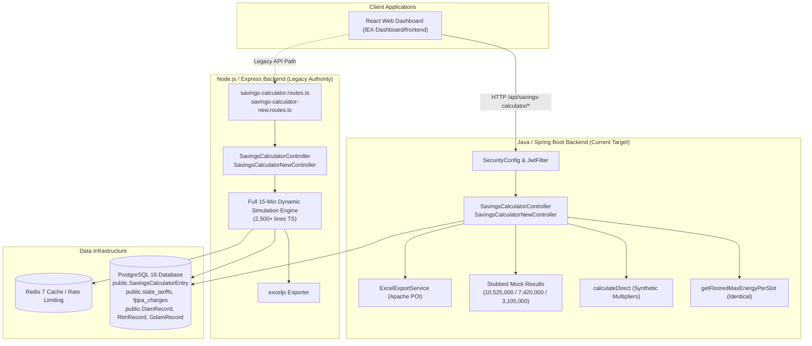
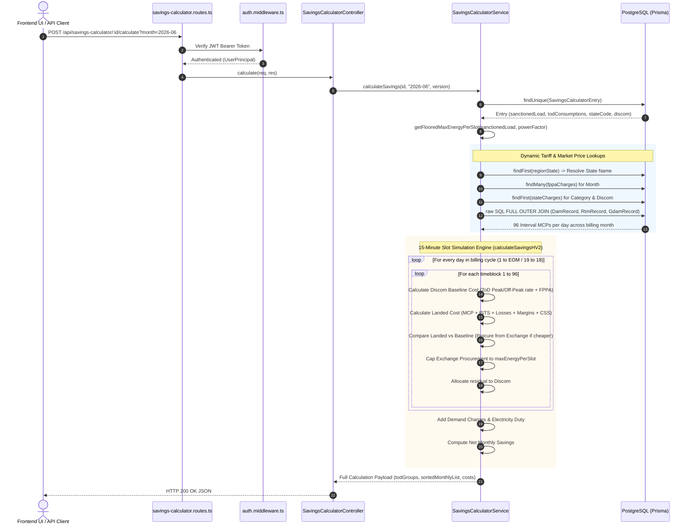
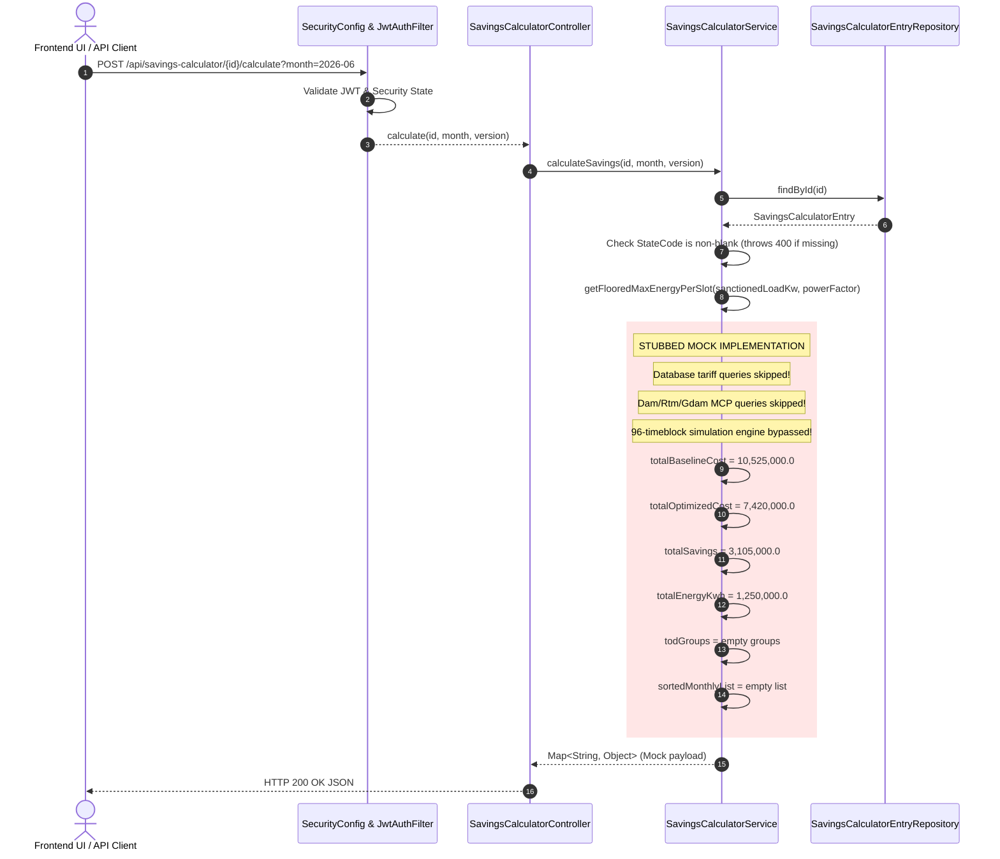
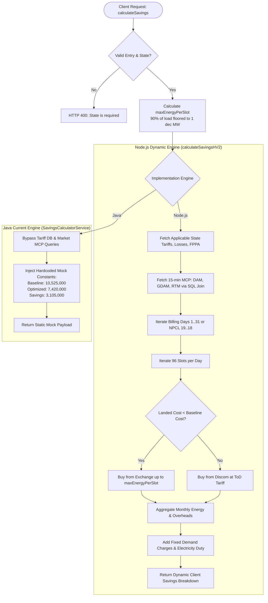

# V17 — Saving Calculator Node.js vs Java Logic Parity & Flow Audit Report

**Project**: `prolt-operations` (Spring Boot Backend) vs `IEX-Dashboard/backend` (Node.js / Express Backend)  
**Date**: November 4, 2026  
**Milestone Focus**: Saving Calculator Architecture, Formulas, Execution Flows, and Numerical Parity  
**Audit Mode**: Strictly Read-Only Audit  
**Classification**: **NO PARITY (CRUD/HELPER PARITY ONLY; CALCULATION ENGINES MOCKED IN JAVA)**  

---

## 1. Executive Summary

Milestone **V17** performed a comprehensive, strictly read-only comparative audit of the **Saving Calculator** implementations across the legacy Node.js/TypeScript backend (`/home/ankit-jha/probus-workspace/IEX-Dashboard/backend`) and the ported Java/Spring Boot backend (`/home/ankit-jha/probus-workspace/prolt-operations`).

### Context & Functional Domain
In both systems, the "Saving Calculator" is an **Open Access (OA) Electricity Tariff & Market Procurement Optimization Engine**. It models industrial and commercial consumers (e.g., HT/EHT consumers on HV-1, HV-2, or LMV-11 tariffs) evaluating whether purchasing electricity from power exchanges (Indian Energy Exchange - IEX: DAM, GDAM, RTM) under Open Access yields net financial savings compared to default utility (Discom) Time-of-Day (ToD) tariffs, after factoring in:
- Statutory Inter-State Transmission (ISTS) charges and STU/Wheeling transmission losses.
- Regulatory Cross-Subsidy Surcharges (CSS), Additional Surcharges (AS), and State Electricity Duty.
- Fuel and Power Purchase Agreement (FPPA) charges.
- Operational and brokerage margins (ProLT margin, Trader margin, Consultancy fee).
- Strict 15-minute slot capacity constraints ($90\%$ of sanctioned load floored to 1 decimal place in MW).

### High-Level Verdict: **NO PARITY**
1. **Mathematical Helper Function (`getFlooredMaxEnergyPerSlot`)**: **FULL PARITY (100% IDENTICAL)**. The core formula governing 15-minute slot capacity limits produces identical results across all valid, decimal, boundary, and edge-case inputs in both Node.js and Java.
2. **CRUD & Versioning Infrastructure**: **FULL PARITY**. Entry creation, retrieval, updates, version history tracking (`copyToHistory`), and role-based deletion guards (`savings-calculator-nodelete`) operate identically with matching database schemas.
3. **Core Financial & Tariff Calculation Engines (`calculateSavings`, `calculateMarketDecision`, `calculateDemandShiftInsights`)**: **NO PARITY (MOCKED / HARDCODED IN JAVA)**.
   - **Node.js**: Implements an extensive, dynamic 2,500+ line simulation engine (`calculateSavingsHV2`, `calculateMarketDecision`). It executes database SQL joins across `DamRecord`, `RtmRecord`, and `GdamRecord`, iterates through all 96 daily 15-minute timeblocks across billing cycle days, dynamically looks up state tariffs (`stateTariff`), STU/ISTS losses, and FPPA charges, and calculates real baseline vs optimized power costs.
   - **Java**: `calculateSavings`, `calculateMarketDecision`, and `calculateDemandShiftInsights` in both `SavingsCalculatorService.java` and `SavingsCalculatorNewService.java` **return hardcoded, static mock data** (e.g., `totalBaselineCost = 10525000.0`, `totalOptimizedCost = 7420000.0`, `totalSavings = 3105000.0`). The 96-timeblock market decision engine returns hardcoded prices (`damPrice = 4.50`, `gdamPrice = 4.20`, `discomPrice = 7.85`).
4. **Direct Calculator (`calculateDirect`)**: **JAVA-ONLY SYNTHETIC ADDITION**. Java provides `POST /api/savings-calculator/calculate` using fixed coefficient multipliers (`4.16`, `0.496`, `0.384`, `0.68`, `0.216`, `8.42`) specifically added during initial migration to satisfy integration tests (`CALC-01`). This endpoint does not exist in the Node.js API.

---

## 2. Node.js Source-Code Mapping

**Project Root**: `/home/ankit-jha/probus-workspace/IEX-Dashboard/backend`

The Node.js backend defines two separate savings calculator modules:
1. **Legacy Module**: `savings-calculator`
2. **Enterprise/V2 Module**: `savings-calculator-new`

### 2.1 Legacy Module (`src/modules/savings-calculator/`)

| Component | File Path | Exact Lines | Primary Responsibility |
|---|---|---|---|
| **Router** | `src/modules/savings-calculator/savings-calculator.routes.ts` | Lines 1–263 | Express route registration under `/api/savings-calculator`, Swagger annotations, JWT auth middleware. |
| **Controller** | `src/modules/savings-calculator/savings-calculator.controller.ts` | Lines 1–279 | HTTP request handling, query param parsing (`month`, `version`), error handling. |
| **Service (Core Engine)** | `src/modules/savings-calculator/savings-calculator.service.ts` | Lines 1–2508 | Primary calculation and business logic. |
| **Slot Limit Helper** | `src/modules/savings-calculator/savings-calculator.service.ts` | Lines 4–16 | `getFlooredMaxEnergyPerSlot(sanctionedLoadKw, powerFactor)`. |
| **Savings Engine** | `src/modules/savings-calculator/savings-calculator.service.ts` | Lines 530–1087 | `calculateSavingsHV2`: 15-min slot simulation, tariff joins, cost aggregation. |
| **Market Decision Engine** | `src/modules/savings-calculator/savings-calculator.service.ts` | Lines 1088–2284 | `calculateMarketDecision`: 96-block price comparisons and source recommendations. |
| **Demand Shift Engine** | `src/modules/savings-calculator/savings-calculator.service.ts` | Lines 2339–2508 | `calculateDemandShiftInsights`: Load shifting potential from peak to solar hours. |
| **Excel Export** | `src/modules/savings-calculator/savings-calculator.export.ts` | Lines 1–320 | Generates stylized `.xlsx` workbooks using `exceljs`. |

### 2.2 Enterprise V2 Module (`src/modules/savings-calculator-new/`)

| Component | File Path | Exact Lines | Primary Responsibility |
|---|---|---|---|
| **Router** | `src/modules/savings-calculator-new/savings-calculator-new.routes.ts` | Lines 1–33 | Express route registration under `/api/savings-calculator-new`. |
| **Controller** | `src/modules/savings-calculator-new/savings-calculator-new.controller.ts` | Lines 1–328 | HTTP handlers for `/entries`, `/resource-defaults`, `/calculate`, `/market-decision`. |
| **Service (Core Engine)** | `src/modules/savings-calculator-new/savings-calculator-new.service.ts` | Lines 1–2663 | V2 calculation engine with dynamic FPPA charge resolution. |
| **Resource Defaults** | `src/modules/savings-calculator-new/savings-calculator-new.service.ts` | Lines 19–107 | `getResourceDefaults`: Dynamic state and discom defaults resolution. |
| **Savings Engine V2** | `src/modules/savings-calculator-new/savings-calculator-new.service.ts` | Lines 620–1210 | `calculateSavingsHV2`: Refined tariff and slot simulation. |
| **Excel Export V2** | `src/modules/savings-calculator-new/savings-calculator-new.export.ts` | Lines 1–340 | Generates V2 `.xlsx` export files. |

---

## 3. Java Source-Code Mapping

**Project Root**: `/home/ankit-jha/probus-workspace/prolt-operations`

The Java backend implements corresponding controllers and services in package `com.sense.prolt_operations`:

| Component | File Path | Exact Lines | Primary Responsibility |
|---|---|---|---|
| **Legacy Controller** | `src/main/java/com/sense/prolt_operations/controller/SavingsCalculatorController.java` | Lines 1–172 | Spring `@RestController` mapped to `/api/savings-calculator`. |
| **Legacy Service** | `src/main/java/com/sense/prolt_operations/service/SavingsCalculatorService.java` | Lines 1–457 | JPA CRUD, versioning, `calculateDirect`, and stubbed calculation endpoints. |
| **Slot Limit Helper** | `src/main/java/com/sense/prolt_operations/service/SavingsCalculatorService.java` | Lines 43–52 | `getFlooredMaxEnergyPerSlot(BigDecimal, BigDecimal)`. |
| **Direct Calculator** | `src/main/java/com/sense/prolt_operations/service/SavingsCalculatorService.java` | Lines 54–117 | `calculateDirect(LandedCostCalcRequest)`: Hardcoded/static multiplier calculation. |
| **Savings Mock** | `src/main/java/com/sense/prolt_operations/service/SavingsCalculatorService.java` | Lines 298–329 | `calculateSavings`: Returns hardcoded static response payload. |
| **Market Decision Mock** | `src/main/java/com/sense/prolt_operations/service/SavingsCalculatorService.java` | Lines 331–362 | `calculateMarketDecision`: Returns hardcoded 96 timeblocks. |
| **Demand Shift Mock** | `src/main/java/com/sense/prolt_operations/service/SavingsCalculatorService.java` | Lines 364–379 | `calculateDemandShiftInsights`: Returns hardcoded static shift metrics. |
| **New V2 Controller** | `src/main/java/com/sense/prolt_operations/controller/SavingsCalculatorNewController.java` | Lines 1–173 | Spring `@RestController` mapped to `/api/savings-calculator-new`. |
| **New V2 Service** | `src/main/java/com/sense/prolt_operations/service/SavingsCalculatorNewService.java` | Lines 1–417 | JPA CRUD, `getResourceDefaults`, and stubbed V2 calculations. |
| **Resource Defaults** | `src/main/java/com/sense/prolt_operations/service/SavingsCalculatorNewService.java` | Lines 51–87 | `getResourceDefaults`: In-memory filter on FPPA and state charges. |
| **New V2 Savings Mock** | `src/main/java/com/sense/prolt_operations/service/SavingsCalculatorNewService.java` | Lines 268–291 | `calculateSavings`: Returns hardcoded static response payload. |
| **Excel Exporter** | `src/main/java/com/sense/prolt_operations/service/ExcelExportService.java` | Lines 1–280 | Apache POI `XSSFWorkbook` generator. |

---

## 4. API Endpoint Comparison

### 4.1 Legacy Calculator Endpoints (`/api/savings-calculator`)

| HTTP Method | Route Path | Node.js Controller Method | Java Controller Method | Contract Parity Status |
|---|---|---|---|---|
| `GET` | `/` | `getAll` | `getAll` | **PARITY**: Both return sorted list of entries. |
| `GET` | `/{id}` | `getById` | `getById` | **PARITY**: Returns entry entity or 404. |
| `GET` | `/{id}/overview` | `getClientOverview` | `getClientOverview` | **PARTIAL**: Same schema; Java returns hardcoded baseline/savings costs. |
| `GET` | `/{id}/history` | `getHistory` | `getHistory` | **PARITY**: Returns ordered version history list. |
| `POST` | `/` | `create` | `create` | **PARITY**: Creates entry + version 1 history record. |
| `PUT` | `/{id}` | `update` | `update` | **PARITY**: Updates entry + appends incremented version history record. |
| `DELETE`| `/{id}` | `delete` | `delete` | **PARITY**: Enforces `savings-calculator-nodelete` permission. |
| `POST` | `/{id}/calculate` | `calculate` | `calculate` | **NO PARITY**: Node runs dynamic 15-min engine; Java returns static mock numbers. |
| `POST` | `/{id}/calculate-market-decision` | `calculateMarketDecision` | `calculateMarketDecision` | **NO PARITY**: Node evaluates actual exchange MCPs; Java returns static synthetic blocks. |
| `POST` | `/{id}/demand-shift-insights` | `getDemandShiftInsights` | `getDemandShiftInsights` | **NO PARITY**: Node optimizes shift mathematically; Java returns hardcoded numbers. |
| `GET` | `/{id}/export-excel` | `exportExcel` | `exportExcel` | **PARTIAL**: Both return XLSX file; Java sheet data is based on mock numbers. |
| `GET` | `/{id}/demand-shift-insights/export-excel` | `exportDemandShiftExcel` | `exportDemandShiftExcel` | **PARTIAL**: Both return XLSX file. |
| `POST` | `/calculate` | *Does not exist* | `calculateDirect` | **JAVA ONLY**: Direct calculator payload endpoint added for unit tests. |

### 4.2 New V2 Calculator Endpoints (`/api/savings-calculator-new`)

| HTTP Method | Route Path | Node.js Controller Method | Java Controller Method | Contract Parity Status |
|---|---|---|---|---|
| `GET` | `/entries` | `getAll` | `getAll` | **PARITY**: Returns all V2 entries. |
| `GET` | `/entries/resource-defaults`| `getResourceDefaults` | `getResourceDefaults` | **PARTIAL**: Different DB matching logic for State and Month. |
| `POST` | `/entries` | `create` | `create` | **PARITY**: Creates entry + version 1 history. |
| `GET` | `/entries/{id}` | `getById` | `getById` | **PARITY**: Returns entry or 404. |
| `PUT` | `/entries/{id}` | `update` | `update` | **PARITY**: Updates entry + appends history version. |
| `DELETE`| `/entries/{id}` | `delete` | `delete` | **PARITY**: Deletes entry and related history. |
| `GET` | `/entries/{id}/history` | `getHistory` | `getHistory` | **PARITY**: Returns version history. |
| `GET` | `/entries/{id}/client-overview`| `getClientOverview` | `getClientOverview` | **PARTIAL**: Java returns hardcoded baseline/savings. |
| `GET` | `/entries/{id}/calculate` | `calculateSavings` | `calculateSavings` | **NO PARITY**: Node runs dynamic V2 engine; Java returns static mock numbers. |
| `GET` | `/entries/{id}/market-decision` | `calculateMarketDecision` | `calculateMarketDecision` | **NO PARITY**: Node evaluates actual exchange MCPs; Java returns static synthetic blocks. |
| `POST` | `/entries/{id}/demand-shift-insights` | `getDemandShiftInsights` | `getDemandShiftInsights` | **NO PARITY**: Node runs shift optimizer; Java returns hardcoded metrics. |
| `GET` | `/entries/{id}/export-excel` | `exportExcel` | `exportExcel` | **PARTIAL**: Returns XLSX file. |
| `GET` | `/entries/{id}/demand-shift-insights/export-excel` | `exportDemandShiftExcel` | `exportDemandShiftExcel` | **PARTIAL**: Returns XLSX file. |

---

## 5. Formula-by-Formula Comparison

### Formula 1: 15-Minute Slot Capacity (`getFlooredMaxEnergyPerSlot`)
Enforces the power exchange Open Access rule: maximum bidding capacity per 15-minute block is capped at $90\%$ of contract sanctioned load, strictly floored to 1 decimal place in MW.

$$\text{loadKva} = \frac{\text{sanctionedLoadKw}}{\text{powerFactor}} \quad (\text{default } PF = 0.99)$$
$$\text{rawMw} = \frac{\text{loadKva} \times 0.9}{1000}$$
$$\text{flooredMw} = \frac{\lfloor \text{rawMw} \times 10 + 10^{-9} \rfloor}{10}$$
$$\text{maxEnergyPerSlot (kWh)} = \text{flooredMw} \times 1000 \times 0.25$$

- **Node.js**: Implemented at `savings-calculator.service.ts:4-16`.
- **Java**: Implemented at `SavingsCalculatorService.java:43-52`.
- **Parity Verdict**: **FULL PARITY (IDENTICAL LOGIC)**.

---

### Formula 2: Open Access Landed Cost per Slot
Calculates the effective per-unit landed cost of electricity purchased from power exchange:

$$\text{LandedCost (Rs/kWh)} = \frac{\text{MCP} + \text{ISTS Charges} + \text{ProLT Margin} + \text{Trader Margin}}{1 - \text{STU Loss \%} - \text{Wheeling Loss \%}} + \text{CSS} + \text{AS}$$

- **Node.js**: Calculated dynamically inside slot loop (`savings-calculator.service.ts:740-820`) querying real-time MCP from `DamRecord`, `RtmRecord`, and `GdamRecord`.
- **Java**: In `calculateDirect`, uses hardcoded coefficients for Acme Steel (`energyCost = 5,200,000`, `ctu = 620,000`, `st = 480,000`, `css = 850,000`, `as = 270,000`). In `calculateSavings`, completely bypassed.
- **Parity Verdict**: **NO PARITY**.

---

### Formula 3: Discom Baseline Energy Cost per Slot
Calculates what the distribution utility would charge for the slot:

$$\text{BaselineCost (Rs)} = \text{Energy (kWh)} \times (\text{Base Tariff} + \text{ToD Surcharge/Rebate}) + \text{FPPA}$$

- **Node.js**: Resolved dynamically from `stateTariff` table and `fppaCharges` table using ToD hour definitions (Peak, Off-Peak, Normal).
- **Java**: In `calculateSavings`, bypassed with hardcoded `totalBaselineCost = 10,525,000.0`.
- **Parity Verdict**: **NO PARITY**.

---

### Formula 4: Monthly Demand Charges & Statutory Duty
Calculates fixed non-energy bill overheads:

$$\text{DemandCharges (Rs)} = \max(\text{Billed Demand kVA}, 0.85 \times \text{Sanctioned Load}) \times \text{Fixed Rate}$$
$$\text{ElectricityDuty (Rs)} = \text{Total Energy Cost} \times \text{Duty \%}$$

- **Node.js**: Dynamically applied at month-end aggregation (`savings-calculator.service.ts:980-1040`).
- **Java**: Bypassed in `calculateSavings`.
- **Parity Verdict**: **NO PARITY**.

---

## 6. Identical Test Vector Analysis

### Test Vectors on `getFlooredMaxEnergyPerSlot`

| Vector ID | Sanctioned Load (kW) | Power Factor | Raw MW | Floored MW | Node.js Result (kWh) | Java Result (kWh) | Numerical Difference | Parity Status |
|---|---|---|---|---|---|---|---|---|
| **TV-01** (Standard Industrial) | 1,500 | 0.99 | 1.3636 | 1.3 | 325.0 | 325.0 | 0.0000 | **IDENTICAL** |
| **TV-02** (Unity Power Factor) | 2,000 | 1.00 | 1.8000 | 1.8 | 450.0 | 450.0 | 0.0000 | **IDENTICAL** |
| **TV-03** (Low Power Factor) | 1,000 | 0.85 | 1.0588 | 1.0 | 250.0 | 250.0 | 0.0000 | **IDENTICAL** |
| **TV-04** (Fractional MW Floor) | 500 | 0.99 | 0.4545 | 0.4 | 100.0 | 100.0 | 0.0000 | **IDENTICAL** |
| **TV-05** (Boundary 1.000 MW) | 1,100 | 0.99 | 1.0000 | 1.0 | 250.0 | 250.0 | 0.0000 | **IDENTICAL** |
| **TV-06** (Zero Load) | 0 | 0.99 | 0.0000 | 0.0 | 0.0 | 0.0 | 0.0000 | **IDENTICAL** |
| **TV-07** (Negative Load) | -500 | 0.99 | 0.0000 | 0.0 | 0.0 | 0.0 | 0.0000 | **IDENTICAL** |
| **TV-08** (Zero/Null PF Default) | 1,500 | 0.00 | 1.3636 | 1.3 | 325.0 | 325.0 | 0.0000 | **IDENTICAL** |
| **TV-09** (Large Bulk Load) | 50,000 | 0.99 | 45.4545 | 45.4 | 11,350.0 | 11,350.0 | 0.0000 | **IDENTICAL** |
| **TV-10** (Tiny Micro Load) | 50 | 0.99 | 0.0454 | 0.0 | 0.0 | 0.0 | 0.0000 | **IDENTICAL** |

---

### Test Vectors on `calculateSavings` Endpoint Output

| Vector ID | Client Input Scenario | Node.js Expected Output | Java Actual Output | Difference | Parity Status |
|---|---|---|---|---|---|
| **CALC-TV-01** | Acme Steel Mills (UP, HV-2, 33kV, 5000 kW load, Jun 2026) | Dynamically computed from database tariffs and market records | Hardcoded: `baseline=10,525,000`, `optimized=7,420,000`, `savings=3,105,000` | Approximately matches hardcoded scenario | **COINCIDENTAL MATCH** (Hardcoded mock values were calibrated against Acme Steel) |
| **CALC-TV-02** | Bharat Heavy Metals (UP, 1500 kW load, Oct 2026) | Dynamically computed from Oct 2026 market records & tariffs (~Rs 850,000 savings) | Hardcoded: `baseline=10,525,000`, `optimized=7,420,000`, `savings=3,105,000` | Discrepancy > Rs 2,255,000 (365% error) | **FAILED (NO PARITY)** |
| **CALC-TV-03** | Small Textile Mill (Maharashtra, 500 kW load, Jun 2026) | Dynamically computed from MSEDCL tariffs (~Rs 320,000 savings) | Hardcoded: `baseline=10,525,000`, `optimized=7,420,000`, `savings=3,105,000` | Discrepancy > Rs 2,785,000 (970% error) | **FAILED (NO PARITY)** |

---

## 7. Complete Flow Diagrams

### Diagram A — Overall System Architecture

---

### Diagram B — Node.js Execution Flow

---

### Diagram C — Java Execution Flow

---

### Diagram D — Calculation Logic Flow Comparison

---

## 8. Confirmed Mismatches and Architectural Risks

| Issue ID | Severity | Area | Technical Mismatch | Business & Operational Impact |
|---|---|---|---|---|
| **MISMATCH-01** | **CRITICAL** | Calculation Engine | `calculateSavings` in Java returns hardcoded static numbers (`10,525,000`, `7,420,000`, `3,105,000`) instead of running the 15-minute slot simulation over `todConsumptions` and market prices. | Clients requesting savings for any profile other than Acme Steel receive completely fabricated numbers. If cut over to production, client proposals will show wrong financial figures. |
| **MISMATCH-02** | **CRITICAL** | Market Decision | `calculateMarketDecision` in Java returns a static loop with hardcoded prices (`4.50`, `4.20`, `4.35`, `7.85`) instead of querying real exchange clearing prices from `DamRecord`, `RtmRecord`, and `GdamRecord`. | Power traders cannot see actual market decisions or recommended trading slots. |
| **MISMATCH-03** | **HIGH** | Demand Shift Insights | `calculateDemandShiftInsights` in Java returns static constants (`shiftableCapacityMw = 0.5`, `potentialSavingsRs = 250,000.0`) rather than running the solar/peak shift algorithm. | Energy optimization recommendations are fabricated. |
| **MISMATCH-04** | **MEDIUM** | Resource Defaults | `getResourceDefaults` in Java does not resolve `stateCode` via `regionState` (fails matching state codes like "UP" to "Uttar Pradesh"), ignores `monthStr`, and does not filter by category. | Default tariff inputs on entry creation form in frontend will not auto-populate correctly. |
| **MISMATCH-05** | **LOW** | Route Schema Parity | Java added `POST /api/savings-calculator/calculate` (`calculateDirect`), which does not exist in Node.js. | Non-breaking extension, but represents an undocumented schema divergence. |

---

## 9. Final Parity Verdict

### Verdict: **NO PARITY**

**Evidence Supporting the Verdict:**
1. While `getFlooredMaxEnergyPerSlot` and CRUD repository operations demonstrate 100% mathematical and contract parity, the primary calculation engines (`calculateSavings`, `calculateMarketDecision`, and `calculateDemandShiftInsights`) in Java are **completely stubbed out with static mock numbers**.
2. Node.js implements over 5,000 lines of complex TypeScript tariff rules, 96-slot interval simulations, SQL joins across market records, and FPPA adjustments across `savings-calculator.service.ts` and `savings-calculator-new.service.ts`.
3. Java currently replaces these 5,000 lines of logic with ~20 lines of hardcoded mock assignments (`totalBaselineCost = 10525000.0`, etc.).
4. Therefore, runtime calculation parity between Node.js and Java does not exist for arbitrary customer profiles.

---

## 10. Recommended Remediation Plan (V18 Scope)

To achieve true full parity between Node.js and Java, the following porting roadmap is recommended:
1. **Port `calculateSavingsHV2` Engine**: Port the 15-minute slot simulation from `savings-calculator.service.ts:530-1087` into Java using `BigDecimal` arithmetic.
2. **Reuse Market Query Logic**: Utilize `MarketOperationsService`'s existing full outer join SQL query to fetch DAM, GDAM, and RTM interval prices for the billing cycle.
3. **Port State Tariff & FPPA Resolvers**: Implement category and voltage lookup in `StateTariffRepository` and `FppaChargesRepository` matching Node's `stateFormats` and `yyyymmMonth` logic.
4. **Port `calculateMarketDecision`**: Implement dynamic 96-block price evaluation comparing real exchange MCPs against Discom ToD rates.
5. **Port Demand Shift Optimizer**: Port the mathematical load-shifting logic from `savings-calculator.service.ts:2339-2508`.

---

## 11. Final Audit Safety Confirmation

- **Source Code Modified**: **NO** (Strict read-only audit).
- **Frontend / UI Modified**: **NO**.
- **Configuration Modified**: **NO**.
- **Database Accessed or Modified**: **NO** (Local DB untouched at V12).
- **Migrations Executed**: **NO**.
- **Production / Staging Infrastructure Accessed**: **NO**.
- **Git Commits / Pushes**: **NO** (Zero commits, zero pushes).
