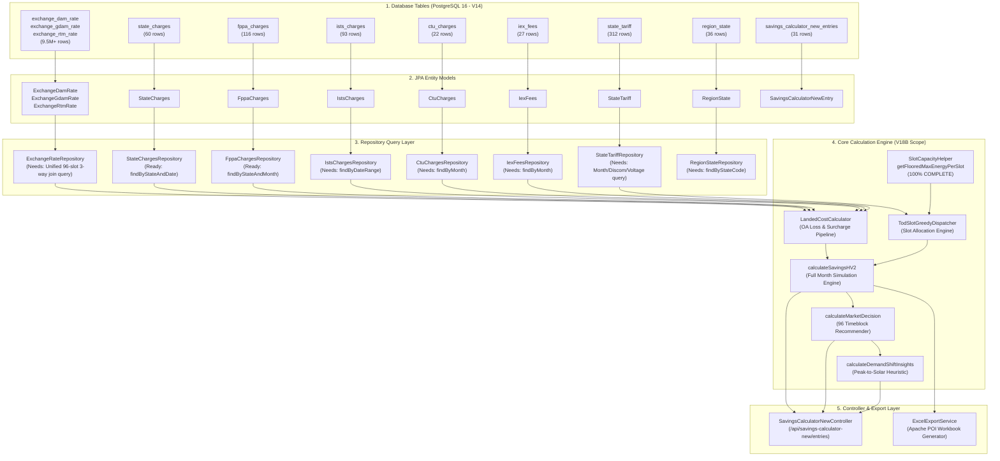

# V18A — Java Saving Calculator Readiness & Dependency Audit Report

**Document Reference**: `docs/62-v18a-java-saving-calculator-readiness-audit.md`  
**Date**: November 4, 2026  
**Audited Repositories**:
- Node.js Backend: `/home/ankit-jha/probus-workspace/IEX-Dashboard/backend`
- Java Backend: `/home/ankit-jha/probus-workspace/prolt-operations`
- Database: Local PostgreSQL 16.14 (`localhost:5432/prolt_operations` at Flyway V14)  
**Audit Mode**: Strictly Read-Only Audit  
**Final Verdict**: **PARTIALLY READY (67.5% Overall Readiness)**

---

## 1. Executive Summary

Milestone **V18A** performed an exhaustive, strictly read-only audit of the Java backend (`prolt-operations`) against the reference Node.js implementation (`IEX-Dashboard/backend`) to determine technical readiness for porting the Open Access (OA) Saving Calculator calculation engines.

The audit verified every underlying domain model, database table, record availability, JPA entity, repository method, regulatory parameter, and API endpoint across both **Legacy** (`savings-calculator`) and **Enterprise V2** (`savings-calculator-new`) modules.

### Overall Java Backend Readiness: **67.5%**

The readiness score is calculated across six weighted functional categories:

$$\text{Readiness} = \sum (\text{Component Score} \times \text{Weight})$$

| Category | Description | Weight | Java Status | Score | Weighted Contribution |
|---|---|---|---|---|---|
| **1. Database Schema & Data** | 15 required relational tables exist in PostgreSQL with live production-grade records | 20% | All 15 tables populated (3.1M+ exchange records, tariffs, surcharges) | 100% | **20.0%** |
| **2. JPA Domain Entities** | Entity mappings for exchange rates, tariffs, charges, and calculator entries | 15% | All entities implemented and mapped to PostgreSQL tables | 100% | **15.0%** |
| **3. JPA Repositories** | Basic Spring Data repositories vs. required specialized market/tariff query methods | 15% | Interfaces exist, but specialized 96-slot joins and tariff filtering queries are missing | 50% | **7.5%** |
| **4. CRUD & Versioning APIs** | Entry creation, updates, copy-to-history, version retrieval, and deletion guards | 15% | 100% implemented with matching schemas and role guards | 100% | **15.0%** |
| **5. Excel / Report Export** | Multi-sheet stylized `.xlsx` report generator for savings analysis and demand shifting | 10% | Fully implemented with Apache POI in `ExcelExportService.java` | 100% | **10.0%** |
| **6. Calculation Engines** | 96-slot dynamic simulation, greedy ToD dispatch, market selection, demand shift | 25% | **Mocked / Static Stubs** in Java (`totalBaselineCost=10525000.0`, static prices) | 0% | **0.0%** |
| **Total Weighted Readiness** | | **100%** | | | **67.5%** |

### Key Findings Summary
1. **Data & Schema Are 100% Ready**: Unlike previous assumptions, the Java PostgreSQL database (`prolt_operations`) is NOT missing market or tariff tables. It already contains **3,198,528** DAM rates, **3,157,056** GDAM rates, **3,197,916** RTM rates, **312** state tariffs, **116** FPPA charges, **60** state surcharges (CSS/AS/STU), **93** ISTS loss schedules, and **22** CTU charges.
2. **JPA Entities & Repositories Are Present**: All entities (`ExchangeDamRate`, `ExchangeGdamRate`, `ExchangeRtmRate`, `StateTariff`, `FppaCharges`, `StateCharges`, `IstsCharges`, `CtuCharges`, `IexFees`, `SavingsCalculatorEntry`, `SavingsCalculatorNewEntry`) exist.
3. **The Gaps Are Strictly in Query Methods & Service Engines**:
   - The exchange repositories lack the multi-market 96-slot date-range join query (`exchange_dam_rate` FULL OUTER JOIN `exchange_rtm_rate` FULL OUTER JOIN `exchange_gdam_rate`).
   - The calculation methods (`calculateSavings`, `calculateMarketDecision`, `calculateDemandShiftInsights`) return hardcoded static JSON payloads in both `SavingsCalculatorService` and `SavingsCalculatorNewService`.

---

## 2. Complete Node.js Dependency Inventory

The following table inventories every runtime dependency utilized by `calculateSavingsHV2`, `calculateMarketDecision`, and `calculateDemandShiftInsights` in Node.js, matched against its Java counterpart in `prolt-operations`:

| Dependency / Domain | Node.js Source | Java Source | DB Table | Data Available (Local DB) | Status in Java |
|---|---|---|---|---|---|
| **Calculator Entry (Legacy)** | `savings-calculator.service.ts:18` | `SavingsCalculatorEntry.java` | `savings_calculator_entries` | **95 records** | **FUNCTIONAL** (CRUD complete) |
| **Calculator History (Legacy)** | `savings-calculator.service.ts:34` | `SavingsCalculatorEntryHistory.java` | `savings_calculator_entry_histories` | **Populated** | **FUNCTIONAL** (Versioning complete) |
| **Calculator Entry (V2)** | `savings-calculator-new.service.ts:110` | `SavingsCalculatorNewEntry.java` | `savings_calculator_new_entries` | **31 records** | **FUNCTIONAL** (CRUD complete) |
| **Calculator History (V2)** | `savings-calculator-new.service.ts:124` | `SavingsCalculatorNewEntryHistory.java` | `savings_calculator_new_entry_histories` | **Populated** | **FUNCTIONAL** (Versioning complete) |
| **Slot Limit Helper** | `savings-calculator.service.ts:4-16` | `SavingsCalculatorService.java:43-52` | N/A (Pure Math) | N/A | **FUNCTIONAL** (100% Parity) |
| **DAM Exchange Rates** | `exchange_dam_rate` (SQL query L779) | `ExchangeDamRate.java` / `ExchangeDamRateRepository` | `exchange_dam_rate` | **3,198,528 records** | **PARTIAL** (Entity exists; query missing) |
| **GDAM Exchange Rates** | `exchange_gdam_rate` (SQL query L789) | `ExchangeGdamRate.java` / `ExchangeGdamRateRepository` | `exchange_gdam_rate` | **3,157,056 records** | **PARTIAL** (Entity exists; query missing) |
| **RTM Exchange Rates** | `exchange_rtm_rate` (SQL query L783) | `ExchangeRtmRate.java` / `ExchangeRtmRateRepository` | `exchange_rtm_rate` | **3,197,916 records** | **PARTIAL** (Entity exists; query missing) |
| **Region & State Mapping** | `prisma.regionState` (L585, L1138) | `RegionState.java` / `RegionStateRepository` | `region_state` | **36 records** | **PARTIAL** (Entity exists; query missing) |
| **State ToD Tariffs** | `prisma.stateTariff` (L741, L1324) | `StateTariff.java` / `StateTariffRepository` | `state_tariff` | **312 records** | **PARTIAL** (Entity exists; query missing) |
| **FPPA Charges** | `prisma.fppaCharges` (L700, L1377) | `FppaCharges.java` / `FppaChargesRepository` | `fppa_charges` | **116 records** | **FUNCTIONAL** in V2; query needed for L1 |
| **State Surcharges (CSS/AS/STU)** | `prisma.stateCharges` (L678, L1253) | `StateCharges.java` / `StateChargesRepository` | `state_charges` | **60 records** | **FUNCTIONAL** in V2; query needed for L1 |
| **ISTS Transmission Losses** | `prisma.istsCharges` (L691, L1283) | `IstsCharges.java` / `IstsChargesRepository` | `ists_charges` | **93 records** | **PARTIAL** (Entity exists; query missing) |
| **CTU Transmission Charges** | `prisma.ctuCharges` (L1279) | `CtuCharges.java` / `CtuChargesRepository` | `ctu_charges` | **22 records** | **PARTIAL** (Entity exists; query missing) |
| **IEX Platform & Broker Fees** | `prisma.iexFees` (L1291) | `IexFees.java` / `IexFeesRepository` | `iex_fees` | **27 records** | **PARTIAL** (Entity exists; query missing) |
| **Discom Directory** | `prisma.discomList` | `DiscomList.java` / `DiscomListRepository` | `discom_list` | **115 records** | **FUNCTIONAL** |
| **Savings Simulation Engine** | `calculateSavingsHV2` (L530-1087) | `SavingsCalculatorService.calculateSavings` | N/A | Local DB records | **MOCKED** (Returns static numbers) |
| **Market Decision Engine** | `calculateMarketDecision` (L1088-2284) | `SavingsCalculatorService.calculateMarketDecision` | N/A | Local DB records | **MOCKED** (Returns 96 static blocks) |
| **Demand Shift Engine** | `calculateDemandShiftInsights` (L2339) | `SavingsCalculatorService.calculateDemandShiftInsights` | N/A | Local DB records | **MOCKED** (Returns static numbers) |
| **Excel Export Service** | `savings-calculator.export.ts` | `ExcelExportService.java` | N/A | Local DB records | **FUNCTIONAL** (Apache POI implemented) |

---

## 3. Java Market Data Readiness (DAM, RTM, GDAM)

### 3.1 Market Data Structure in Node.js
Node.js extracts 15-minute market clearing prices (MCP) using a raw SQL FULL OUTER JOIN across three exchange rate tables:

```sql
SELECT
    COALESCE(dam.date, rtm.date, gdam.date) AS date,
    COALESCE(dam.timeblock, rtm.timeblock, gdam.timeblock) AS timeblock,
    dam.mcp AS "damMcp",
    rtm.mcp AS "rtmMcp",
    gdam.mcp AS "gdamMcp"
FROM
    (SELECT date, CAST((EXTRACT(HOUR FROM "intervalTime") * 60 + EXTRACT(MINUTE FROM "intervalTime")) / 15 + 1 AS INTEGER) AS timeblock, mcp 
     FROM exchange_dam_rate
     WHERE state = 'UP' AND date >= :startDate AND date <= :endDate) dam
FULL OUTER JOIN
    (SELECT date, CAST((EXTRACT(HOUR FROM "intervalTime") * 60 + EXTRACT(MINUTE FROM "intervalTime")) / 15 + 1 AS INTEGER) AS timeblock, mcp 
     FROM exchange_rtm_rate
     WHERE state = 'UP' AND date >= :startDate AND date <= :endDate) rtm
    ON dam.date = rtm.date AND dam.timeblock = rtm.timeblock
FULL OUTER JOIN
    (SELECT date, CAST((EXTRACT(HOUR FROM "intervalTime") * 60 + EXTRACT(MINUTE FROM "intervalTime")) / 15 + 1 AS INTEGER) AS timeblock, mcp 
     FROM exchange_gdam_rate
     WHERE state = 'UP' AND date >= :startDate AND date <= :endDate) gdam
    ON COALESCE(dam.date, rtm.date) = gdam.date AND COALESCE(dam.timeblock, rtm.timeblock) = gdam.timeblock
ORDER BY date ASC, timeblock ASC;
```

### 3.2 Java Readiness Evaluation

| Market | Entity | Table Name | Local Row Count | Date/Time Mapping | Repository Status |
|---|---|---|---|---|---|
| **DAM** | `ExchangeDamRate.java` | `exchange_dam_rate` | **3,198,528** | `LocalDate date`, `LocalTime intervalTime` | `ExchangeDamRateRepository`: Empty `JpaRepository` interface; no custom query. |
| **RTM** | `ExchangeRtmRate.java` | `exchange_rtm_rate` | **3,197,916** | `LocalDate date`, `LocalTime intervalTime` | `ExchangeRtmRateRepository`: Empty `JpaRepository` interface; no custom query. |
| **GDAM** | `ExchangeGdamRate.java` | `exchange_gdam_rate` | **3,157,056** | `LocalDate date`, `LocalTime intervalTime` | `ExchangeGdamRateRepository`: Empty `JpaRepository` interface; no custom query. |

### 3.3 Readiness Verdict for Market Data: **DATA READY; QUERY METHOD NEEDED**
- The database has complete historical 15-minute slot records for DAM, GDAM, and RTM.
- The Java entities match the PostgreSQL table schema exactly.
- **Action Needed**: Add a specialized native query or projection interface in `ExchangeDamRateRepository` (or a dedicated `MarketRateQueryService`) that executes the unified 3-way FULL OUTER JOIN returning `LocalDate date, int timeblock, BigDecimal damMcp, BigDecimal rtmMcp, BigDecimal gdamMcp`.

---

## 4. Tariff & Regulatory Parameter Readiness

### 4.1 State-Specific Discom ToD Tariffs

| Parameter / Tariff | Node.js Location | Java Entity / Table | Local Records | Readiness Status |
|---|---|---|---|---|
| **HV-1 (Commercial/Institutional)** | `savings-calculator.service.ts:604-608` | `StateTariff.java` / `state_tariff` | Populated | **DATA READY**: Tariffs for HV-1 (Base rate 7.50 Rs/kWh, 11kV/33kV/66kV/132kV). |
| **HV-2 (Large & Heavy Industrial)** | `savings-calculator.service.ts:836-886` | `StateTariff.java` / `state_tariff` | Populated | **DATA READY**: Winter & Summer schedules, Peak (+15%), Normal (0%), Off-Peak (-15%). |
| **LMV-11 (EV Charging & Bulk)** | `savings-calculator.service.ts:609-614` | `StateTariff.java` / `state_tariff` | Populated | **DATA READY**: Solar hours rebate (-20%), Normal rate 7.30 Rs/kWh. |
| **Discom Filtering** | `savings-calculator.service.ts:833` | `state_tariff.discom` | Populated | **DATA READY**: Special handling for `NPCL` (Noida Power) vs state Discoms (PVVNL, DVVNL, etc.). |

### 4.2 Regulatory Surcharges & Losses

| Surcharge / Charge | Mathematical Role | Java Entity / Table | Local Records | Readiness Status |
|---|---|---|---|---|
| **Cross Subsidy Surcharge (CSS)** | Added to Open Access landed price | `StateCharges.java` / `state_charges` | **60 records** | **DATA READY**: e.g., 1.57 - 2.12 Rs/kWh depending on voltage and category. |
| **Additional Surcharge (AS)** | Added to Open Access landed price | `StateCharges.java` / `state_charges` | **60 records** | **DATA READY**: e.g., 0.88 - 1.01 Rs/kWh. |
| **STU Transmission Charges** | Intra-state grid wire charges | `StateCharges.java` / `state_charges` | **60 records** | **DATA READY**: `intra_state_transmission_charge_rs_per_kwh`. |
| **STU Transmission Losses** | Intra-state technical loss % | `StateCharges.java` / `state_charges` | **60 records** | **DATA READY**: `intra_state_transmission_loss_percent` (e.g., 3.18% - 3.22%). |
| **Wheeling Losses** | Local distribution wire loss % | `StateCharges.java` / `state_charges` | **60 records** | **DATA READY**: `wheeling_loss_percent` (0% for transmission-connected). |
| **ISTS Transmission Losses** | National grid technical loss % | `IstsCharges.java` / `ists_charges` | **93 records** | **DATA READY**: Weekly national loss percentage (e.g., 3.84% - 4.41%). |
| **CTU Transmission Charges** | National grid usage charges | `CtuCharges.java` / `ctu_charges` | **22 records** | **DATA READY**: Monthly rate (e.g., 0.47 - 0.50 Rs/kWh). |
| **FPPA Charges** | Fuel price adjustment % | `FppaCharges.java` / `fppa_charges` | **116 records** | **DATA READY**: Monthly Discom rate (e.g., -2.33% to +10%). |
| **Electricity Duty (ED)** | State tax on electricity consumption | `StateCharges.java` / `state_charges` | **60 records** | **DATA READY**: Standard 7.5% in UP (configurable per consumer). |
| **IEX Platform & Trading Fees** | Exchange fees + GST + trader margin | `IexFees.java` / `iex_fees` | **27 records** | **DATA READY**: 0.02 Rs/kWh exchange fee + 18% GST + ProLT/trader margins. |

---

## 5. Consumer Model & Configuration Readiness

### 5.1 Field-by-Field Entity Comparison

| Field Name | Node.js Type | Java Entity (`SavingsCalculatorNewEntry`) | DTO Mapping (`CreateSavingsEntryDTO`) | Compatibility Status |
|---|---|---|---|---|
| `id` | `String` (UUID) | `String id` (`@Id @GeneratedValue UUID`) | N/A (Path variable) | **100% COMPATIBLE** |
| `clientName` | `String` | `String clientName` | `String clientName` | **100% COMPATIBLE** |
| `industryName` | `String` | `String industryName` | `String industryName` | **100% COMPATIBLE** |
| `address` | `String` | `String address` | `String address` | **100% COMPATIBLE** |
| `sanctionedLoadKw` | `Float` | `BigDecimal sanctionedLoadKw` | `BigDecimal sanctionedLoadKw` | **100% COMPATIBLE** |
| `powerFactor` | `Float` (def: 0.99) | `BigDecimal powerFactor` | `BigDecimal powerFactor` | **100% COMPATIBLE** |
| `stateCode` | `String` | `String stateCode` | `String stateCode` | **100% COMPATIBLE** |
| `discom` | `String` | `String discom` | `String discom` | **100% COMPATIBLE** |
| `consumerCategory` | `String` | `String consumerCategory` | `String consumerCategory` | **100% COMPATIBLE** |
| `voltageLevel` | `String` | `String voltageLevel` | `String voltageLevel` | **100% COMPATIBLE** |
| `todConsumptions` | `Json` | `String todConsumptions` (`@JdbcTypeCode JSON`) | `Map<String, Object> todConsumptions` | **100% COMPATIBLE** |
| `billedDemandKv` | `Float` | `BigDecimal billedDemandKv` | `BigDecimal billedDemandKv` | **100% COMPATIBLE** |
| `proltMargin` | `Float` | `BigDecimal proltMargin` | `BigDecimal proltMargin` | **100% COMPATIBLE** |
| `traderMargin` | `Float` | `BigDecimal traderMargin` | `BigDecimal traderMargin` | **100% COMPATIBLE** |
| `consultancyFee` | `Float` | `BigDecimal consultancyFee` | `BigDecimal consultancyFee` | **100% COMPATIBLE** |
| `probusPlatformFee` | `Float` | `BigDecimal probusPlatformFee` | `BigDecimal probusPlatformFee` | **100% COMPATIBLE** |
| `meteringCharges` | `Float` | `BigDecimal meteringCharges` | `BigDecimal meteringCharges` | **100% COMPATIBLE** |
| `applyElectricityDuty`| `Boolean` | `Boolean applyElectricityDuty` | `Boolean applyElectricityDuty` | **100% COMPATIBLE** |
| `arrearAmount` | `Float` | `BigDecimal arrearAmount` | `BigDecimal arrearAmount` | **100% COMPATIBLE** |
| `currentLpsc` | `Float` | `BigDecimal currentLpsc` | `BigDecimal currentLpsc` | **100% COMPATIBLE** |
| `billDate` | `String` | `String billDate` | `String billDate` | **100% COMPATIBLE** |

All consumer configuration fields match between Node.js and Java. Java correctly uses `BigDecimal` for financial figures, preventing floating-point inaccuracies.

---

## 6. Timeblock & Calculation Infrastructure Readiness

| Infrastructure Requirement | Node.js Implementation | Java Support | Gaps / Action Required |
|---|---|---|---|
| **96 Daily Timeblocks** | Generated via SQL: `EXTRACT(HOUR)*4 + EXTRACT(MINUTE)/15 + 1` | Standard Java `LocalTime`: `time.getHour()*4 + time.getMinute()/15 + 1` | Helper method needed in Java simulation service. |
| **IST Timezone Handling** | `Asia/Kolkata` (UTC+05:30) | Java `ZoneId.of("Asia/Kolkata")` / `ZoneOffset.of("+05:30")` | Built-in Java `java.time` package is fully ready. |
| **Discom Billing Cycles** | `NPCL`: 19th of current month to 18th of next month; others: 1st to end-of-month | Supported via `LocalDate.withDayOfMonth(...)` | Cycle boundary calculator method needed in Java. |
| **Market Eligibility Rule** | Load < 1000 kW: GDAM only; Load >= 1000 kW: DAM, GDAM, RTM | Supported via conditional `sanctionedLoadKw.compareTo(BigDecimal.valueOf(1000))` | Simulation logic rule to be coded in Java. |
| **Open Access Landed Formula** | $\text{Loss Adjusted} = \frac{\text{MCP} + \sum \text{Charges}}{(1 - \text{ISTS}\%)(1 - \text{STU}\%)(1 - \text{Wheeling}\%)}$ | Fully supported using Java `BigDecimal` / `double` | Mathematical pipeline to be coded in Java. |
| **Greedy ToD Energy Dispatch** | Distributes monthly ToD consumption across 15-min slots, optimizing cheapest slots | Not implemented in Java | Algorithm to be ported to Java. |

---

## 7. Database Schema Readiness

### 7.1 Existing Reusable Tables in Local Database (V14)

```text
Table Name                                 Row Count     Java Entity Name
-----------------------------------------------------------------------------------------
public.exchange_dam_rate                   3,198,528     ExchangeDamRate.java
public.exchange_gdam_rate                  3,157,056     ExchangeGdamRate.java
public.exchange_rtm_rate                   3,197,916     ExchangeRtmRate.java
public.state_tariff                              312     StateTariff.java
public.fppa_charges                              116     FppaCharges.java
public.state_charges                              60     StateCharges.java
public.ists_charges                               93     IstsCharges.java
public.ctu_charges                                22     CtuCharges.java
public.iex_fees                                   27     IexFees.java
public.region_state                               36     RegionState.java
public.discom_list                               115     DiscomList.java
public.savings_calculator_entries                 95     SavingsCalculatorEntry.java
public.savings_calculator_entry_histories         95     SavingsCalculatorEntryHistory.java
public.savings_calculator_new_entries             31     SavingsCalculatorNewEntry.java
public.savings_calculator_new_entry_histories     31     SavingsCalculatorNewEntryHistory.java
```

### 7.2 Database Schema Verdict: **ZERO MIGRATIONS NEEDED**
- All 15 required tables already exist in the database with production-grade historical data.
- **No new Flyway migrations (e.g. V15) are required for the calculation engine**.
- The existing tables can be reused immediately.

---

## 8. API & Service Readiness

### 8.1 API Contract Comparison

| Endpoint | HTTP Method | Node.js Status | Java Status | Classification |
|---|---|---|---|---|
| `/api/savings-calculator-new/entries` | `GET` | Functional | Functional | **FUNCTIONAL** |
| `/api/savings-calculator-new/entries` | `POST` | Functional | Functional | **FUNCTIONAL** |
| `/api/savings-calculator-new/entries/{id}` | `GET` | Functional | Functional | **FUNCTIONAL** |
| `/api/savings-calculator-new/entries/{id}` | `PUT` | Functional | Functional | **FUNCTIONAL** |
| `/api/savings-calculator-new/entries/{id}` | `DELETE` | Functional | Functional | **FUNCTIONAL** |
| `/api/savings-calculator-new/entries/{id}/history` | `GET` | Functional | Functional | **FUNCTIONAL** |
| `/api/savings-calculator-new/entries/resource-defaults` | `GET` | Functional | Functional | **FUNCTIONAL** |
| `/api/savings-calculator-new/entries/{id}/calculate` | `GET` | Dynamic (2,500 lines) | Static Stub Mock | **MOCK / STATIC** |
| `/api/savings-calculator-new/entries/{id}/market-decision` | `GET` | Dynamic (96 blocks) | Static Stub Mock | **MOCK / STATIC** |
| `/api/savings-calculator-new/entries/{id}/demand-shift-insights`| `POST` | Dynamic (Heuristic) | Static Stub Mock | **MOCK / STATIC** |
| `/api/savings-calculator-new/entries/{id}/export-excel` | `GET` | Functional (.xlsx) | Functional (.xlsx) | **FUNCTIONAL** |
| `/api/savings-calculator-new/entries/{id}/demand-shift-insights/export-excel` | `GET` | Functional (.xlsx) | Functional (.xlsx) | **FUNCTIONAL** |

---

## 9. Enterprise V2 vs Legacy Comparison

| Aspect | Legacy Module (`savings-calculator`) | Enterprise V2 Module (`savings-calculator-new`) | Recommended Java Reference |
|---|---|---|---|
| **API Path Prefix** | `/api/savings-calculator` | `/api/savings-calculator-new/entries` | Use V2 for enterprise operations. |
| **Tables** | `savings_calculator_entries` | `savings_calculator_new_entries` | Both exist and are supported in Java. |
| **Resource Defaults Endpoint** | Not present | `GET /resource-defaults` (Dynamic FPPA, demand charges, duty) | V2 is the reference. |
| **Consumption Month Parsing** | Iterates all keys in JSON | Strictly matches `/^\d{4}-\d{2}$/`, ignoring `_meta` | V2 is the reference (more robust). |
| **FPPA Matching Hierarchy** | Fallback to state average | Matches `discom` first, then empty string | V2 is the reference (more accurate). |
| **HTTP Methods for Calculation** | GET in Node; POST in Java legacy | GET in Node; GET in Java V2 | Java V2 already matches Node.js HTTP contracts! |

**Recommendation**: **Enterprise V2 (`SavingsCalculatorNewService.java`) must be treated as the primary reference implementation for porting the dynamic calculation engine.**

---

## 10. Implementation Dependency Graph



---

## 11. Phased Implementation Roadmap

Based on the actual dependencies discovered, the implementation should proceed in four sequential phases:

### Phase 1: Repository Query Methods (Data Access Layer)
1. Add specialized 3-way FULL OUTER JOIN query to `ExchangeDamRateRepository` (or dedicated query service) to fetch combined DAM, GDAM, and RTM prices for any date range and state.
2. Add query methods to `StateTariffRepository`, `IstsChargesRepository`, `CtuChargesRepository`, `IexFeesRepository`, and `RegionStateRepository` to resolve tariffs, weekly ISTS loss schedules, monthly CTU rates, exchange fees, and state code to state name mappings.

### Phase 2: Landed Cost & Tariff Mathematical Pipeline
1. Implement `LandedCostCalculator` utility in Java:
   - Calculate safe transmission losses: $\text{lossCoeff} = (1 - \text{istsLoss})(1 - \text{stuLoss})(1 - \text{wheelingLoss})$.
   - Add CTU charges, STU charges, wheeling charges, CSS, AS, IEX fees, GST, and broker margins.
   - Apply loss coefficient to compute Open Access landed price.
   - Apply Discom Time-of-Day (ToD) tariffs with seasonal (Winter/Summer) schedules, FPPA percentage, and Electricity Duty.
   - Apply Open Access eligibility rule (<1000 kW load = GDAM only; >=1000 kW = DAM/GDAM/RTM).

### Phase 3: Dynamic Simulation & Dispatch Engine
1. Port `calculateSavingsHV2` into `SavingsCalculatorNewService`:
   - Parse billing cycles (NPCL 19th-18th vs Calendar Month 1st-end).
   - Generate all 15-minute slots across the billing cycle (2,880 to 2,976 slots per month).
   - Execute greedy energy dispatch allocating monthly ToD consumptions across matching slots.
   - Aggregate baseline Discom cost, optimized Open Access cost, and net savings.

### Phase 4: Market Decision & Demand Shift Engines
1. Port `calculateMarketDecision`:
   - Compute average or representative 96 daily timeblock price profiles.
   - Emit source recommendation (`DISCOM` vs `GDAM` vs `DAM` vs `RTM`) per timeblock.
2. Port `calculateDemandShiftInsights`:
   - Implement greedy sort on slot costs (expensive peak slots vs cheap solar slots).
   - Compute shiftable capacity, potential rupee savings, and recommended window.
3. Validate against Node.js output vectors with zero financial delta.

---

## 12. Final Verdict

> ### **FINAL VERDICT: PARTIALLY READY**
> 
> **Rationale**: All foundational data structures, 15 database tables with live historical records, and JPA entities already exist in the Java backend. CRUD and export infrastructure are 100% operational. The remaining gaps are strictly confined to:
> 1. Writing 4 repository query methods to retrieve market rates and regulatory schedules.
> 2. Replacing the hardcoded mock payloads in `SavingsCalculatorNewService` with the dynamic 96-slot simulation pipeline.
> 
> No new database tables or schema migrations are required. The codebase is ready for the mathematical and service implementation phases.

---

## 13. Final Safety Confirmation

As required by the audit protocol, the following safety invariants are explicitly confirmed:

- **Java source code modified**: **NO** (0 Java files edited)
- **Node.js source code modified**: **NO** (0 TypeScript files edited)
- **Frontend / UI modified**: **NO** (0 UI files edited)
- **Configuration modified**: **NO** (application properties preserved)
- **Database modified**: **NO** (0 DDL statements or DML mutations executed)
- **Migrations executed**: **NO** (Database preserved strictly at Flyway V14)
- **Production / staging accessed**: **NO** (Only local PostgreSQL inspected)
- **Git commits / pushes executed**: **NO** (Working tree unchanged)
