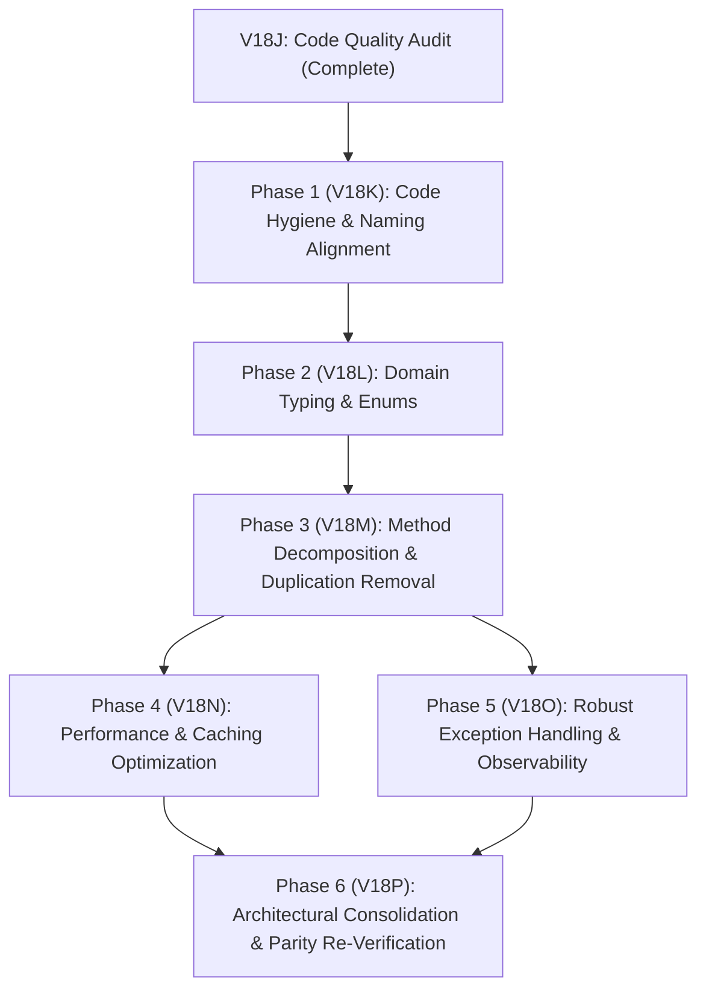

# Milestone V18J — Prioritized Refactoring Roadmap

**Document Reference**: `docs/73-v18j-prioritized-refactoring-roadmap.md`  
**Date**: November 2026  
**Status**: Proposal & Roadmap for Post-V18J Execution  
**Target Module**: Java Legacy Saving Calculator (`prolt-operations`)  
**Based on Audit**: [73-v18j-comprehensive-legacy-code-quality-audit.md](file:///home/ankit-jha/probus-workspace/prolt-operations/docs/73-v18j-comprehensive-legacy-code-quality-audit.md)

---

## 1. Strategic Overview & Guiding Principles

### 1.1 Objective
This roadmap provides a phased, prioritized, and risk-managed engineering plan to remediate the architectural weaknesses, loose typing, method bloat, duplicated logic, and exception-handling vulnerabilities discovered during the V18J code quality audit.

### 1.2 Core Guiding Principles & Invariants
1. **Absolute Numerical Parity**:
   All formulas, charge resolutions, dispatch optimizations, banking mechanics, and financial totals must produce mathematically identical outputs to the Node.js reference implementation (`IEX-Dashboard/backend`).
2. **Enterprise V2 Isolation**:
   `SavingsCalculatorNewService.java` and its associated components must remain **100% untouched** across all subsequent milestones.
3. **Database & Schema Invariance**:
   No Flyway migration modifications or database schema alterations. The test harness must maintain `spring.flyway.target=${FLYWAY_TARGET:8}` compatibility.
4. **Zero Downtime / Zero Regressions**:
   Each milestone must be independently deployable, covered by unit and integration tests, and accompanied by a dedicated verification report before initiating the next phase.

---

## 2. Milestone Phasing Overview



| Phase | Milestone | Focus Area | Key Findings Addressed | Risk Level | Effort |
| :---: | :---: | :--- | :--- | :---: | :---: |
| **1** | **V18K** | Code Hygiene, Imports & Naming | F-CLG-01, F-NAM-01, F-NAM-02, F-MAG-01 | **Near Zero** | Small |
| **2** | **V18L** | Domain Typing & Enums | F-TYP-01, F-TYP-02, F-TYP-03, F-TYP-04 | **Low** | Medium |
| **3** | **V18M** | Method Decomposition & Duplication | F-DUP-01, F-DUP-02, F-CMP-01 | **Medium** | Large |
| **4** | **V18N** | Performance & Lookup Optimization | F-PERF-01, F-PERF-02 | **Low** | Small |
| **5** | **V18O** | Exception Safety & Observability | F-EXC-01, F-EXC-02 | **Low** | Medium |
| **6** | **V18P** | Architectural Consolidation & Parity Verification | F-ARCH-01 + Full 417-Test Suite | **Low** | Medium |

---

## 3. Detailed Phase Breakdown

### Phase 1 — Milestone V18K: Code Hygiene, Naming Alignment, and Import Cleanup
- **Goal**: Clean cosmetic and readability defects with zero risk to business calculations.
- **Scope & Actions**:
  - Remove duplicated imports in `SavingsCalculatorService.java:51-59` (`F-CLG-01`).
  - Rename single-letter variables in `DemandShiftOptimizer.java` (`s` $\to$ `slot`, `orig` $\to$ `originalSlotCost`, `sm` $\to$ `shiftedSlotMap`) and `CalculatorUtils.java` (`b` $\to$ `baseBill`) (`F-NAM-01`).
  - Extract hardcoded loss factor `0.1211` into `CalculatorProperties` or `UnitConstants.DEFAULT_CONSUMER_BUS_LOSS_RATIO` (`F-MAG-01`).
  - Clarify mock fixture labeling in `calculateDirect` (`F-NAM-02`).
- **Safety Gate**: Re-run all 417 existing tests. Bytecode and behavior remain identical.

---

### Phase 2 — Milestone V18L: Domain Typing, Enums & Value Objects
- **Goal**: Eliminate runtime `@SuppressWarnings("unchecked")` casts and loose `Map<String, Object>` payloads across internal pipeline boundaries.
- **Scope & Actions**:
  - Introduce `DemandShiftInsights` Java record containing typed fields:
    ```java
    public record DemandShiftInsights(
        double potentialSavingsRs,
        String recommendedWindow,
        List<ShiftedSlot> shiftedSlots
    ) {}
    ```
    Replaces untyped Map returned by `DemandShiftOptimizer` and consumed by `ForwardBankingAllocator` (`F-TYP-01`).
  - Introduce `MonthlyMarketDecisionResult` Java record replacing raw Map with 25 keys returned by monthly decision providers in `ClientOverviewAggregator` (`F-TYP-02`).
  - Introduce `EnergyMarketType` enum (`DAM`, `RTM`, `GDAM`) and `EnergySource` enum (`DAM`, `RTM`, `GDAM`, `DISCOM`) in `model/calculator/` (`F-TYP-03`, `F-TYP-04`).
- **Safety Gate**: Validate that JSON serialization contracts of public endpoints (`/savings/calculate`, `/savings/calculate-market-decision`) remain 100% backward compatible.

---

### Phase 3 — Milestone V18M: Method Decomposition & Duplication Elimination
- **Goal**: Break down the monolithic 318 LOC `Hv2SavingsCalculator.calculateSavingsHV2` and unify shared tariff/ISTS resolution logic.
- **Scope & Actions**:
  - Extract shared ISTS date range lookup to `RegulatoryChargeResolver.findEffectiveIstsCharge(LocalDate, List<IstsCharges>)` (`F-DUP-01`).
  - Extract shared DISCOM energy tariff and ToD matching to `RegulatoryChargeResolver.resolveDiscomTariff(LocalDate, int slotNumber, ...)` (`F-DUP-02`).
  - Decompose `Hv2SavingsCalculator.calculateSavingsHV2` into 3 discrete, testable sub-methods (`F-CMP-01`):
    1. `simulateSlotDispatch(...)`: Evaluates market vs DISCOM for 96 slots.
    2. `aggregateMonthlyConsumptions(...)`: Aggregates ToD and slab consumptions with power factor conversions.
    3. `buildHv2FinancialSummary(...)`: Computes billing differences, taxes, and net savings.
- **Safety Gate**: Dedicated comparison test verifying that `Hv2SavingsCalculator` yields identical outputs before and after decomposition across 20 distinct input scenarios.

---

### Phase 4 — Milestone V18N: Performance, Caching & Allocation Profile
- **Goal**: Optimize slot iteration loops to prevent redundant collection traversals and GC allocation churn.
- **Scope & Actions**:
  - Pre-group state tariffs by month (`Map<Integer, List<StateTariff>>`) before entering slot iteration in `calculateSlotLandingCosts`, reducing complexity from $O(N \times K)$ to $O(N)$ (`F-PERF-01`).
  - Pre-index or cache ISTS charges by effective date range (`F-PERF-02`).
  - Reuse immutable calculation context across slot iterations rather than allocating intermediate objects.
- **Safety Gate**: Benchmark memory allocation and execution time for 12-month multi-slot simulation. Verify 0 numerical divergence.

---

### Phase 5 — Milestone V18O: Robust Exception Handling & Observability
- **Goal**: Prevent silent swallowing of exceptions in multi-month loops and make fallback assumptions transparent.
- **Scope & Actions**:
  - Refactor `ClientOverviewAggregator.aggregateMarketDecisionAllMonths`: If an individual month fails calculation, capture error details in a structured response object or throw a descriptive domain exception rather than logging and silently omitting the month (`F-EXC-01`).
  - Enrich `CalculatorUtils.toInternalSlots` metadata to include `syntheticFallbackUsed: true` when 96 mock slots are generated due to missing exchange rates (`F-EXC-02`).
- **Safety Gate**: Unit tests asserting error reporting behavior when simulated database queries fail for single and multiple months.

---

### Phase 6 — Milestone V18P: Architectural Consolidation & Parity Re-Verification
- **Goal**: Clean up constructor overload sprawl and execute a final regression verification against the Node.js baseline.
- **Scope & Actions**:
  - Deprecate or remove legacy constructors with manual component instantiation in `SavingsCalculatorService` (`F-ARCH-01`).
  - Enforce standard Spring Boot dependency injection across all calculator components.
  - Run full parity verification against Node.js `savings-calculator.service.ts` test suites.
  - Deliver final milestone documentation and update project architecture documentation.
- **Safety Gate**: All 417+ tests passing with 0 failures, 0 errors.

---

## 4. Verification and Governance Protocol

For each milestone executed under this roadmap, the following protocol is mandatory:
1. **Pre-Implementation Verification**: Run `mvn test` to verify 100% green baseline.
2. **Branching & Isolation**: Never modify Enterprise V2 (`SavingsCalculatorNewService.java`).
3. **Continuous Testing**: Add dedicated unit tests for all newly introduced records, enums, or helper methods.
4. **Post-Implementation Regression Run**: Execute the full suite:
   ```bash
   mvn test -Dtest=SavingsCalculatorServiceTest,SavingsCalculatorServiceNodeParityTest,CalculatorPropertiesPrecedenceTest,Hv2SavingsCalculatorTest,DemandShiftOptimizerTest
   ```
5. **Documentation**: Generate a milestone completion report in `docs/` detailing exact files modified, design decisions, and test outcomes.
