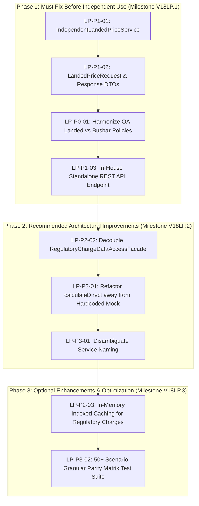

# Milestone V18LP — Independent Landed Price Calculator Completion Roadmap

## 1. Executive Summary

Based on the findings of the **V18LP Readiness Audit** (`docs/79-v18lp-landed-price-calculator-readiness-audit.md`), the core mathematical formulations for landed prices, compound transmission losses, regulatory charges, and DISCOM tariffs in `prolt-operations` are verified and numerically aligned with the authoritative Node.js reference (`IEX-Dashboard/backend`).

However, the capability to calculate landed prices independently of the Saving Calculator is **completely missing**. Currently:
- `/api/landing-price-calc/*` is merely an HTTP proxy forwarding requests to the external IEX website (`https://www.iexindia.com/api/v1/calculator`). If the external website is unreachable, the API fails.
- `/api/savings-calculator/calculate-direct` relies on hardcoded benchmark numbers for "Acme Steel Mills" or crude fallback constant multipliers.
- Real landed price calculations across DAM, RTM, GDAM, and DISCOM are locked inside private methods of `SavingsCalculatorService` and `Hv2SlotProcessor`.

This roadmap establishes a prioritized, phased engineering plan to transform the existing low-level math components into a first-class, standalone, independent Landed Price Calculator Engine.

---

## 2. Priority Classification Register

| Finding ID | Priority | Category | Problem Statement | Target Resolution |
| :--- | :---: | :--- | :--- | :--- |
| **LP-P0-01** | **P0** | Financial Correctness | **Calculation Divergence**: Commercial/Industrial calculates landed market cost as `(MCP + RegCharges) / LossCoeff`, whereas HV-2 compares raw `MCP / 1000` directly with DISCOM tariffs without regulatory charges or losses. | Establish an explicit calculation policy mode (`OPEN_ACCESS_LANDED` vs `BUSBAR_COMPARISON`) so all callers can deterministically choose the appropriate economic basis. |
| **LP-P1-01** | **P1** | Standalone Engine | **No Independent Calculation Service**: Landed price cannot be computed for a state, voltage, category, and MCP without creating a full `SavingsCalculatorEntry` with 12 months of bill data. | Create `IndependentLandedPriceService` that takes standalone input parameters and evaluates landed prices across DAM, RTM, GDAM, and DISCOM. |
| **LP-P1-02** | **P1** | Typed Contracts | **Missing Independent DTOs**: No standalone request/response models exist for single-slot or multi-slot landed price evaluations. | Introduce `LandedPriceRequest` and `LandedPriceResponse` (with full breakdown of energy, losses, individual statutory charges, taxes, and DISCOM comparative spread). |
| **LP-P1-03** | **P1** | Offline / Local API | **External Web Scraper Dependency**: `/api/landing-price-calc` proxies to `www.iexindia.com` rather than using internal database charges and loss tables. | Add an in-house REST endpoint (e.g. `/api/v1/landed-price/calculate-local` or local fallback in `LandingPriceService`) that calculates landed prices directly from local database tables. |
| **LP-P2-01** | **P2** | Architectural Cleanup | **Hardcoded Prospect Benchmarks**: `calculateDirect` in `SavingsCalculatorService` hardcodes Acme Steel Mills bill values (`10,525,000.00`, etc.) and fallback rates (`4.16`, `8.42`). | Refactor `calculateDirect` to delegate to the new `IndependentLandedPriceService` using parameterized benchmark profiles. |
| **LP-P2-02** | **P2** | Data Access Decoupling | **Data Access Tightly Coupled**: Regulatory charge and tariff retrieval is embedded in `SavingsCalculatorDataAccessService`, tying other consumers to the savings calculator module. | Extract a reusable `RegulatoryChargeRepository` or `RegulatoryChargeDataAccessFacade` accessible to all backend modules. |
| **LP-P2-03** | **P2** | Performance & Caching | **Repeated Linear Scans**: Querying `IstsCharges` and `StateTariff` executes linear scans over lists for every 15-minute slot. | Introduce pre-indexed interval tree or date-indexed map lookups (aligned with Milestone V18N). |
| **LP-P3-01** | **P3** | Naming Ambiguity | **Confusing Component Naming**: `LandingPriceService` (external IEX proxy) and `LandedCostCalculator` (internal math helper) have overlapping names with completely different capabilities. | Rename `LandingPriceService` to `IexWebScraperProxyService` and introduce `IndependentLandedPriceEngine` for internal calculations. |
| **LP-P3-02** | **P3** | Test Coverage | **Missing Granular Parity Tests**: No isolated test suite compares Java `LandedCostCalculator` outputs against Node.js `calcExchangeLanding` across a wide scenario matrix. | Add parameterized test suite `LandedPriceScenarioParityTest` covering 50+ combinations of states, voltages, and MCPs. |

---

## 3. Phased Implementation Roadmap

---

## 4. Phase-by-Phase Milestone Definitions

### Phase 1: Must Fix Before Independent Use (Milestone V18LP.1)
*Goal: Provide a fully functional, independent landed price calculation service and API that other modules can consume without depending on Saving Calculator orchestration.*

1. **Design Independent Calculation Contracts**:
   - `LandedPriceRequest`:
     - `stateCode` (required, e.g. "UP")
     - `consumerCategory` (required, e.g. "HV-2", "Industrial")
     - `voltageLevel` (required, e.g. "11 kV", "33 kV")
     - `deliveryDate` (optional, defaults to today)
     - `timeblock` (optional, 1..96, defaults to slot 1)
     - `damMcpRsPerMwh`, `rtmMcpRsPerMwh`, `gdamMcpRsPerMwh` (optional market inputs)
     - `powerFactor` (optional, defaults to 0.99)
     - `applyElectricityDuty` (optional, boolean)
     - `traderMarginRsPerKwh` (optional, defaults to 0.02)
     - `calculationMode` (`OPEN_ACCESS_LANDED` or `BUSBAR_MCP`)
   - `LandedPriceResponse`:
     - `marketPrices`: Map of market -> `{ mcpRsPerKwh, lossAdjustedMcp, landedPriceRsPerKwh, isEligible }`
     - `discomTariff`: `{ baseRate, todSlab, fppaAdder, dutyAdder, npclRebate, finalLandingPriceRsPerKwh }`
     - `losses`: `{ istsLossPercent, stuLossPercent, wheelingLossPercent, compoundLossCoefficient }`
     - `regulatoryCharges`: Detailed breakdown of CTU, STU, Wheeling, CSS, AS, Exchange Fee, Trader Margin, and GST
     - `recommendation`: Cheapest source, spread vs DISCOM, and savings per kWh
2. **Implement `IndependentLandedPriceService`**:
   - Injects `RegulatoryChargeResolver`, `LandedCostCalculator`, `ElectricalLossCalculator`, `NpclTariffSchedule`, `CalculatorProperties`, and `SavingsCalculatorDataAccessService`.
   - Resolves ISTS, STU, Wheeling losses, DISCOM tariffs, and regulatory adders for the given inputs without requiring an entity in `savings_calculator_entry`.
   - Calculates landed prices deterministically.
3. **Expose Standalone REST Endpoint**:
   - `POST /api/v1/landed-price/calculate` (accepts `LandedPriceRequest`, returns `LandedPriceResponse`).
   - Acts as local fallback for `/api/landing-price-calc/calculate` when external IEX website is unreachable.
4. **Unit and Integration Tests**:
   - Add `IndependentLandedPriceServiceTest` covering all procurement sources (DAM, RTM, GDAM, DISCOM) and edge cases.

---

### Phase 2: Recommended Architectural Improvements (Milestone V18LP.2)
*Goal: Eliminate hardcoded prospect mock data and decouple regulatory data access.*

1. **Decouple Regulatory Data Access**:
   - Extract `RegulatoryChargeDataAccessFacade` from `SavingsCalculatorDataAccessService`.
   - Allows clean querying of `StateCharges`, `IstsCharges`, and `StateTariff` across modules without depending on Saving Calculator internals.
2. **Refactor `calculateDirect`**:
   - Replace hardcoded numbers for "Acme Steel Mills" in `SavingsCalculatorService.calculateDirect()` with a benchmark industrial profile evaluated dynamically by `IndependentLandedPriceService`.
   - Preserve response format `LandedCostCalcResponse` for backward compatibility.
3. **Disambiguate Service Naming**:
   - Clearly delineate `LandingPriceService` (which is an external proxy) from the local calculation engine (`IndependentLandedPriceService`).

---

### Phase 3: Optional Enhancements & Optimization (Milestone V18LP.3)
*Goal: High-performance caching and comprehensive scenario parity.*

1. **In-Memory Indexed Caching**:
   - Pre-index `StateTariff` and `IstsCharges` by state and month to enable sub-millisecond calculation response times.
2. **Granular Multi-State Parity Suite**:
   - Create `LandedPriceScenarioParityTest` with 50+ golden combinations comparing Java calculations with Node.js across Uttar Pradesh, Maharashtra, Haryana, and Gujarat.

---

## 5. Architectural Safeguards Confirmation

All safeguards remain in effect:
- **Zero code modifications** were made during this audit.
- **Enterprise V2** (`SavingsCalculatorNewService.java`) remains 100% untouched.
- **Node.js reference repository** (`IEX-Dashboard/backend`) remains strictly read-only.
- **Database schema** remains at Flyway V14 (`spring.flyway.target=${FLYWAY_TARGET:8}`).
- **No Git commits or pushes** have been performed.
- **Stop Condition Met**: Both audit deliverables (`docs/79-v18lp-landed-price-calculator-readiness-audit.md` and `docs/79-v18lp-landed-price-calculator-completion-roadmap.md`) are created. Work is halted awaiting review.
