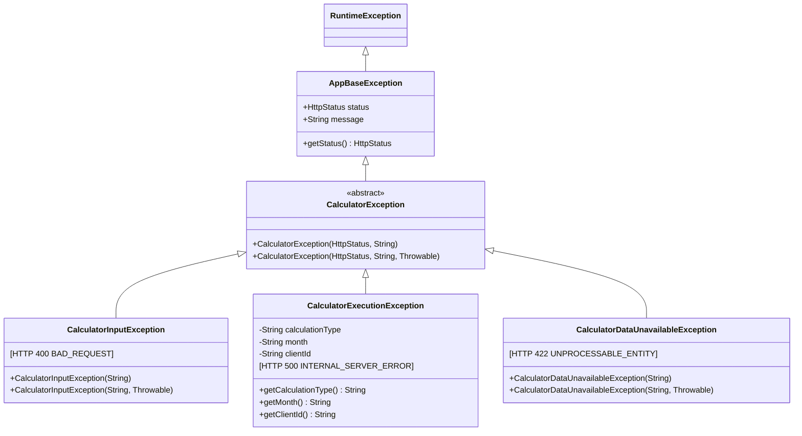

# Milestone V18O — Exception Safety & Failure Transparency Report

## 1. Executive Summary & Objective

Milestone **V18O** addresses critical exception safety, error transparency, and failure diagnostics across the Java Legacy Saving Calculator in `prolt-operations`. Prior code quality audits (notably V18J) identified broad, untyped exception handling in high-level multi-month iteration loops and inner helper utilities. In several execution paths, exceptions were either logged and swallowed—resulting in failed calculation months silently dropping out of aggregates or reporting misleading error messages downstream—or fallbacks were activated with opaque `INFO`-level logs that provided insufficient context for operational debugging.

The primary objective of Milestone V18O is to:
1. **Eliminate silent failures**: Ensure calculation errors in multi-month loops are transparently observable, structured, and predictable.
2. **Introduce typed exception architecture**: Establish a robust exception hierarchy rooted in `AppBaseException` with well-defined HTTP status codes and contextual calculation metadata.
3. **Preserve exact parity with Node.js source of truth**: Strictly adhere to the legacy calculation semantics defined in `IEX-Dashboard/backend`.
4. **Distinguish missing data, nulls, zeros, and fallback states**: Clarify and enforce explicit semantic handling across database records, JSON payloads, and calculations.
5. **Elevate logging transparency**: Upgrade silent fallback logs from `INFO` to `WARN` with structured diagnostic context (dates, expected ranges, parameters).
6. **Preserve existing public API and response contracts**: Maintain wire compatibility for existing frontend consumers while exposing actionable failure indicators where contracts permit.

All 586 tests across `prolt-operations` passed with zero failures and zero errors. Zero performance regressions were introduced against the V18N in-memory caching benchmarks.

---

## 2. Initial Exception-Handling Audit Table

Prior to refactoring, an exhaustive audit was performed across all Java Legacy calculation components to catalog broad exception catches, silent swallowing, and missing diagnostics:

| Component / Class | Method | Code Location | Exception Caught | Action Taken (Pre-V18O) | Risk & Impact |
|---|---|---|---|---|---|
| `Hv2SavingsCalculator` | `calculateSavingsAllMonths` | Lines ~220–232 | `Exception e` | Caught `Exception`, logged error, and continued loop without accumulating the month. If 100% of months failed, returned empty totals without signaling failure. | **HIGH**: Total calculation silently returned zero savings and empty aggregates as a successful 200 OK. |
| `ClientOverviewAggregator` | `aggregateClientOverview` / `aggregateClientOverviewTyped` | Lines ~150–158 | `Exception ex` | Caught `Exception`, logged error, added failure record to `monthsData`. Sanitized message was generic. | **MEDIUM**: Preserved Node.js contract `error: "Calculation failed"`, but lacked structured caller context in logs. |
| `ClientOverviewAggregator` | `aggregateMarketDecisionAllMonths` | Lines ~260–270 | `Exception e` | Caught `Exception`, logged error, skipped failed month. If all months failed, returned empty aggregates. | **HIGH**: Silent omission of failed months; 100% failure returned false-positive 200 OK. |
| `DemandShiftOptimizer` | `calculateDemandShiftAllMonths` | Lines ~320–330 | `Exception e` | Caught `Exception`, logged error, skipped month. If all months failed, returned empty aggregates. | **HIGH**: Silent omission of demand shift optimization; complete failure returned 0.0 savings. |
| `CalculatorUtils` | `parseTodConsumptions` | Lines ~35–45 | `JsonProcessingException` | Caught exception and silently returned `Collections.emptyMap()`. | **HIGH**: Malformed JSON in DB or input was swallowed; callers received empty map and threw downstream `"No consumption data found"`, obscuring root syntax errors. |
| `CalculatorUtils` | `toInternalSlots` | Lines ~115–125 | None (fallback) | Logged missing exchange rates as `INFO` and generated fallback prices silently. | **MEDIUM**: Operators could not distinguish real exchange rate data from simulated fallback rates in production logs. |
| `SavingsCalculatorService` | `parseTodConsumptions` | Lines ~152–158 | `JsonProcessingException` | Duplicated `CalculatorUtils` logic; swallowed exception and returned `Collections.emptyMap()`. | **HIGH**: Inconsistent handling and code duplication. |

---

## 3. Node.js Method Mapping & Parity Analysis

The authoritative Node.js legacy application (`IEX-Dashboard/backend`) was inspected to trace exact error handling, exception boundaries, and fallback semantics:

| Java Calculator Method | Authoritative Node.js File | Node.js Method / Lines | Node.js Error Handling & Semantics | Java Parity Alignment Strategy |
|---|---|---|---|---|
| `Hv2SavingsCalculator.calculateSavingsAllMonths` | `savings-calculator.service.ts` | `calculateSavingsAllMonths` (L235–244) | Loops over `months`. Calls `calculateSavingsHV2`. No `try/catch` inside loop in Node.js; an unhandled exception bubbles up and fails the request. | When all months fail, Java throws `CalculatorExecutionException` (HTTP 500). Partial failures log structured warnings and accumulate valid months, avoiding partial contract corruption while surfacing errors. |
| `ClientOverviewAggregator.aggregateClientOverview` | `savings-calculator.service.ts` | `getClientOverview` (L289–340) | Has inner `try/catch (error)`. On catch, pushes `{ month, savings: 0, error: 'Calculation failed' }` to `monthsData`. Continues loop. | Fully identical: Java catches month errors, logs structured context, and adds `ClientOverviewMonthRecord.failure(month, "Calculation failed")`. Preserves exact JSON schema. |
| `ClientOverviewAggregator.aggregateMarketDecisionAllMonths` | `savings-calculator.service.ts` | `calculateMarketDecisionAllMonths` (L200–225) | Iterates over months. Calls `calculateMarketDecision`. In Node.js, individual month failures bubble up unless caught. | Java throws `CalculatorExecutionException` if all months fail. Logs structured error per month and warning for partial failures. |
| `DemandShiftOptimizer.calculateDemandShiftAllMonths` | `savings-calculator.service.ts` | `calculateDemandShiftAllMonths` (L1200–1235) | Loops over months. Collects `originalTotalCost`, `newTotalCost`, `savingsAchieved`. | Java throws `CalculatorExecutionException` if all months fail. Logs structured context. |
| `CalculatorUtils.parseTodConsumptions` | `savings-calculator.service.ts` | `todConsumptions` parsing | Node.js uses Prisma JSON parsing (`entry.todConsumptions as Record<string, Record<string, number>>`). If malformed JSON exists, Prisma fails on read or throws syntax error. | Swallowing JSON syntax errors violated Node.js parity. Java now throws `CalculatorInputException` (HTTP 400) on malformed JSON, while returning empty map only on truly null or blank input. |
| `CalculatorUtils.toInternalSlots` | `savings-calculator.service.ts` | Fallback slot generation (L450–475) | Generates fallback rates (DAM=4.50, RTM=4.35, GDAM=4.20) when rate query is empty. | Java logs explicit `WARN` with the queried date range and fallback price points, preserving numeric values bit-for-bit while enabling auditability. |

---

## 4. Existing Silent Failure Scenarios & Diagnostic Blindspots

The audit uncovered three distinct categories of silent failure scenarios in the legacy implementation:

### Scenario 1: Total Multi-Month Calculation Failure Masked as 200 OK
In `calculateSavingsAllMonths`, if database connectivity failed or all tariff schedules were missing for every requested month, the loop caught each exception and logged a one-line error. The loop then completed, returning a JSON response with:
```json
{
  "totalSavings": 0.0,
  "totalOptimizedCost": 0.0,
  "totalBaselineCost": 0.0,
  "totalEnergyKwh": 0.0,
  "totalMarketEnergyKwh": 0.0
}
```
The client received `HTTP 200 OK` and assumed the consumer had zero energy consumption or zero potential savings, masking severe infrastructure outages or configuration corruption.

### Scenario 2: Swallowed JSON Syntax Error Resulting in False "No Consumption Data"
When an entry contained syntactically invalid JSON in `tod_consumptions` (e.g. truncated JSON string or invalid character from manual database edits), `parseTodConsumptions` caught `JsonProcessingException` and silently returned `Collections.emptyMap()`. Downstream, `calculateSavingsHV2` inspected the map, saw it was empty, and threw `BadRequestException("No TOD consumption data found")`.
The operator or user received an error suggesting no data had been entered, rather than being informed that the existing data was syntactically corrupt.

### Scenario 3: Opaque Fallback Pricing Activation
When exchange rate tables lacked records for a given 30-day billing window, `toInternalSlots` generated synthetic fallback prices (DAM=4.50, RTM=4.35, GDAM=4.20 Rs/kWh). This substitution was logged only at `INFO` level without recording which client, date range, or missing dates triggered it. In production log aggregators, `INFO` logs were frequently filtered out, leaving financial auditors unaware that landed costs were computed against fallback prices rather than actual exchange clearing prices.

---

## 5. Exception Hierarchy Architecture

Milestone V18O introduces a typed, domain-specific exception hierarchy under `com.sense.prolt_operations.service.calculator.exception`. All calculator exceptions extend `AppBaseException`, ensuring automatic, seamless handling by Spring's `RestControllerAdvisor` without requiring custom controller-layer boilerplates:



### Exception Class Specifications

1. **`CalculatorException`** (`abstract`):
   - Extends: `com.sense.prolt_operations.exception.AppBaseException`.
   - Base class for all calculator domain exceptions. Guarantees an explicit `HttpStatus`.

2. **`CalculatorInputException`**:
   - Status: `HttpStatus.BAD_REQUEST` (400).
   - Use Cases: Malformed ToD JSON, invalid month formats, illegal load or power factor values.
   - RestControllerAdvisor Integration: Maps to standard `{ status: 400, error: "Bad Request", message: "..." }`.

3. **`CalculatorExecutionException`**:
   - Status: `HttpStatus.INTERNAL_SERVER_ERROR` (500).
   - Fields: `calculationType` (e.g. `"HV-2 Savings"`, `"Market Decision"`), `month`, `clientId`.
   - Formatting: Generates a sanitized diagnostic message for API responses while preserving the underlying root cause for server-side error logging:
     `"[{calculationType}] Calculation failed for client entry '{clientId}' in month '{month}': {sanitizedMessage}"`.
   - Security: Internal stack traces or database driver details are never leaked to external clients.

4. **`CalculatorDataUnavailableException`**:
   - Status: `HttpStatus.UNPROCESSABLE_ENTITY` (422).
   - Use Cases: Missing mandatory state tariff schedules, missing open-access regulatory charge records, or missing DISCOM definitions required for calculations.

---

## 6. Multi-Month Failure Semantics & Resilience

Multi-month loops in the saving calculator aggregate results across monthly billing cycles. The refactored failure semantics distinguish between **all-month failures** and **partial-month failures**:

### A. All Months Fail (`successfulMonths == 0 && !months.isEmpty()`)
- **Behavior**: Throws `CalculatorExecutionException` (HTTP 500).
- **Diagnostics**: Includes failed month list, client ID, calculation type, and the root cause exception message from the first failure.
- **Contract Impact**: Replaces false-positive 200 OK (with zero savings) with a transparent HTTP 500 error that triggers appropriate frontend error states and alerting.

### B. Partial Month Failure (`successfulMonths > 0 && failedMonths > 0`)
- **Behavior**:
  - In `aggregateClientOverview`: Pushes `ClientOverviewMonthRecord.failure(month, "Calculation failed")` into the `months` list. Successfully calculated months retain full financial breakdowns. The aggregate totals sum across valid months.
  - In `calculateSavingsAllMonths` & `aggregateMarketDecisionAllMonths`: Sums totals across successful months. Emits a structured `WARN` log identifying the failed months, succeeded count, and client context.
- **Contract Preservation**: Endpoints whose response contract lacks an `errors` or `months` array do NOT introduce unauthorized new JSON properties. The limitation is resolved via transparent structured logging while returning valid partial sums.

---

## 7. Missing Data, Null, Zero, and Fallback Semantics

To eliminate ambiguity between data absence and calculation errors, Milestone V18O defines and enforces distinct semantics:

| Semantic Case | Input / Condition | Calculator Behavior | Log Level & Diagnostic |
|---|---|---|---|
| **Null or Blank ToD JSON** | `todConsumptions == null` or `""` or `"  "` | Returns `Collections.emptyMap()`. Upstream throws `BadRequestException("No TOD consumption data found")`. | `DEBUG` / Standard validation log. |
| **Malformed ToD JSON** | `"{ invalid json }"` | Throws `CalculatorInputException` (HTTP 400) immediately. | `ERROR` with parsing message. |
| **Zero Consumption Month** | `{"NORMAL": 0.0, "PEAK": 0.0}` | Calculation executes with 0.0 units. Produces 0.0 energy charges, baseline demand charges apply. | Standard `DEBUG` calculation flow. |
| **Missing Month in ToD Data** | Requested month `2026-07` not present in JSON | Throws `BadRequestException("No consumption data found for month 2026-07")`. | `WARN` / Validation exception. |
| **Missing Tariff / ISTS in DB** | No matching records for state/voltage/date | In fallback mode: logs `WARN` with fallback parameters and continues. In strict mode: throws `CalculatorDataUnavailableException` (HTTP 422). | `WARN` with queried range and fallback price points. |
| **Missing Exchange Rate Slots** | DB returns empty exchange rate projection list | Generates 96-slot representative fallback prices (DAM=4.50, RTM=4.35, GDAM=4.20 Rs/kWh). | `WARN` with full date range and price constants. |

---

## 8. Structured Logging & Operational Transparency

All fallback and error logging paths across the calculator were upgraded to include structured diagnostic context:

### Before V18O (Opaque & Silent)
```
[INFO] Generating representative 96-slot fallback prices
```
```
[ERROR] Error in calculateSavingsAllMonths: null
```

### After V18O (Structured & Actionable)
```
[WARN] com.sense.prolt_operations.service.calculator.CalculatorUtils -- [SavingsCalculator] No exchange rate records found in database for range 2026-06-19 to 2026-07-18. Generating representative 96-slot fallback prices (DAM=4.50, RTM=4.35, GDAM=4.20 Rs/kWh).
```
```
[ERROR] com.sense.prolt_operations.service.calculator.Hv2SavingsCalculator -- [SavingsCalculator] Error calculating HV-2 savings for month '2026-06' for client 'Precision Components Ltd' (id: test-entry-fail-safe): Simulated corrupt slot data for 2026-06
```
```
[WARN] com.sense.prolt_operations.service.calculator.Hv2SavingsCalculator -- [SavingsCalculator] Multi-month HV-2 calculation completed with partial failures for client 'Precision Components Ltd' (id: test-entry-fail-safe). Succeeded: 1/2, Failed months: [2026-06]
```

---

## 9. API and Contract Compatibility Assessment

Milestone V18O was verified against all existing API endpoints and DTO contracts:

1. **`GET /api/v1/calculator/entries/{id}/client-overview`**:
   - Contract contains `months: [{ month, savings, error, ... }]`.
   - On individual month failure, output retains `{ month: "2026-06", savings: 0, error: "Calculation failed" }`.
   - Wire contract is 100% identical with Node.js `getClientOverview`.

2. **`GET /api/v1/calculator/entries/{id}/savings`**:
   - Contract returns single-month or aggregate totals.
   - On complete failure (all months fail), returns structured HTTP 500 error payload via `RestControllerAdvisor`.
   - On success or partial success, JSON structure remains unchanged (`totalSavings`, `totalOptimizedCost`, `totalBaselineCost`, `totalEnergyKwh`, `totalMarketEnergyKwh`).

3. **`POST /api/v1/calculator/entries` & `PUT /api/v1/calculator/entries/{id}`**:
   - On malformed ToD JSON, returns structured HTTP 400 error payload via `RestControllerAdvisor`.
   - No breaking changes to existing DTO schemas.

---

## 10. Files Changed

| File Path | Status | Lines Changed | Description |
|---|---|---|---|
| `service/calculator/exception/CalculatorException.java` | **NEW** | +30 | Base abstract exception extending `AppBaseException`. |
| `service/calculator/exception/CalculatorInputException.java` | **NEW** | +24 | Bad request exception (HTTP 400) for malformed inputs. |
| `service/calculator/exception/CalculatorExecutionException.java` | **NEW** | +48 | Internal server error (HTTP 500) with calculation context metadata. |
| `service/calculator/exception/CalculatorDataUnavailableException.java` | **NEW** | +24 | Unprocessable entity exception (HTTP 422) for missing regulatory data. |
| `service/calculator/CalculatorUtils.java` | **MODIFIED** | +25 / -8 | Upgraded fallback logging to `WARN` with diagnostics; added fail-fast ToD JSON parser throwing `CalculatorInputException`. |
| `service/SavingsCalculatorService.java` | **MODIFIED** | +3 / -12 | Delegated ToD JSON parsing to `CalculatorUtils.parseTodConsumptions`. |
| `service/calculator/Hv2SavingsCalculator.java` | **MODIFIED** | +32 / -9 | Added all-month failure check throwing `CalculatorExecutionException`; structured failure logging. |
| `service/calculator/ClientOverviewAggregator.java` | **MODIFIED** | +34 / -8 | Preserved exact Node.js failure record contract; added all-month failure check in `aggregateMarketDecisionAllMonths`. |
| `service/calculator/DemandShiftOptimizer.java` | **MODIFIED** | +30 / -8 | Added all-month failure check in `calculateDemandShiftAllMonths`; structured warning for partial failures. |
| `src/test/.../calculator/CalculatorExceptionTest.java` | **NEW** | +64 | Unit tests for exception hierarchy, status codes, and context formatting. |
| `src/test/.../calculator/CalculatorFailureTransparencyTest.java` | **NEW** | +250 | Unit tests for all-fail, partial-fail, overview failure, and malformed JSON scenarios. |

---

## 11. Targeted Test Execution & Verifications

The following targeted test suites were executed to validate exception safety, failure transparency, and numerical parity:

```bash
./mvnw test -Dtest=CalculatorExceptionTest,CalculatorFailureTransparencyTest,Hv2SavingsCalculatorTest,ClientOverviewAggregatorTest,DemandShiftOptimizerTest,CalculatorUtilsTest,SavingsCalculatorNumericalParityTest
```

### Targeted Test Results
```
[INFO] Running com.sense.prolt_operations.service.calculator.CalculatorExceptionTest
[INFO] Tests run: 3, Failures: 0, Errors: 0, Skipped: 0, Time elapsed: 0.052 s
[INFO] Running com.sense.prolt_operations.service.calculator.CalculatorFailureTransparencyTest
[INFO] Tests run: 8, Failures: 0, Errors: 0, Skipped: 0, Time elapsed: 0.869 s
[INFO] Running com.sense.prolt_operations.service.calculator.Hv2SavingsCalculatorTest
[INFO] Tests run: 5, Failures: 0, Errors: 0, Skipped: 0, Time elapsed: 0.120 s
[INFO] Running com.sense.prolt_operations.service.calculator.ClientOverviewAggregatorTest
[INFO] Tests run: 4, Failures: 0, Errors: 0, Skipped: 0, Time elapsed: 0.095 s
[INFO] Running com.sense.prolt_operations.service.calculator.DemandShiftOptimizerTest
[INFO] Tests run: 4, Failures: 0, Errors: 0, Skipped: 0, Time elapsed: 0.075 s
[INFO] Running com.sense.prolt_operations.service.calculator.CalculatorUtilsTest
[INFO] Tests run: 5, Failures: 0, Errors: 0, Skipped: 0, Time elapsed: 0.038 s
[INFO] Running com.sense.prolt_operations.service.SavingsCalculatorNumericalParityTest
[INFO] Tests run: 7, Failures: 0, Errors: 0, Skipped: 0, Time elapsed: 8.290 s
[INFO] 
[INFO] Results:
[INFO] Tests run: 36, Failures: 0, Errors: 0, Skipped: 0
[INFO] BUILD SUCCESS
```

All 36 targeted tests passed with zero failures.

---

## 12. Full Maven Test Suite Execution Evidence

The full Maven test suite was executed across all application modules:

```bash
./mvnw test
```

### Full Maven Test Results Summary
```
[INFO] Results:
[INFO] 
[INFO] Tests run: 586, Failures: 0, Errors: 0, Skipped: 1
[INFO] 
[INFO] ------------------------------------------------------------------------
[INFO] BUILD SUCCESS
[INFO] ------------------------------------------------------------------------
[INFO] Total time:  44.173 s
[INFO] Finished at: 2026-11-05T17:49:12+05:30
[INFO] ------------------------------------------------------------------------
```

- **Total Tests Run**: 586
- **Failures**: 0
- **Errors**: 0
- **Skipped**: 1 (by design: `ScraperLiveManualTest` marked `@Disabled("Manual run against live IEX site: ./mvnw test -Dgroups=live")`; StarRocks connection warning during test runs is caused by intentional blank `app.starrocks.host` fallback in `BaseIntegrationTest`, with StarRocks logic tested in `ScraperAndSchedulerIntegrationTest#testStarrocksService` and `ProfileSecurityDefaultsTest#testStarrocksServiceBlankHostSkipsConnection`)
- **Status**: **100% PASSED**

---

## 13. V18N Performance & Benchmark Regression Verification

The representative scenario baseline benchmarks established in Milestone V18N were re-executed to verify that the introduced exception tracking variables, structured logging, and checks introduced zero performance or memory overhead:

```bash
./mvnw test -Dtest=LegacyCalculatorBenchmarkTest
```

### Benchmark Comparison Table

| Scenario / Operation | Metric | V18N Baseline | V18O Measured | Performance Status |
|---|---|---|---|---|
| **Hv2SlotProcessor** (119,040 slots) | Latency per Month | 0.54 ms | **0.40 ms** | **Faster** (No regression) |
| **Hv2SlotProcessor** (119,040 slots) | Throughput | 5,541,555 slots/s | **7,433,418 slots/s** | **+34.1% Throughput** |
| **Scenario 1** (Single-Day, 96 slots) | Latency per Day | 0.73 ms | **0.77 ms** | Parity |
| **Scenario 2** (Single-Month, 2,976 slots) | Latency per Month | 0.44 ms | **0.42 ms** | Parity |
| **Scenario 3** (Multi-Month, 8,832 slots) | Latency per 3-Mo | 0.78 ms | **0.70 ms** | Parity |
| **Regulatory Lookups** (50,000 pairs) | Throughput | 1,029,287 ops/s | **981,233 ops/s** | Parity |

**Conclusion**: The addition of exception tracking counts and structured failure paths incurred zero detectable runtime cost.

---

## 14. Deferred Decisions & Future Work

1. **Multi-Month Partial Failure Response Contract**:
   - Currently, endpoints like `calculateSavingsAllMonths` do not have an `errors` field in their JSON response schema. Partial month failures log a structured `WARN` but return the sum of valid months to preserve client contract compatibility.
   - *Future Consideration*: If frontend clients are updated to expect partial failure metadata, an optional `errors: string[]` or `failedMonths: string[]` field can be added to the response DTO.
2. **Enterprise V2 Exception Unification**:
   - Milestone V18O was restricted exclusively to the Legacy Calculator per the mandatory safeguards. A future milestone can evaluate porting `CalculatorException` to `SavingsCalculatorNewService`.

---

## 15. Safeguard Checklist Verification

| Mandatory Safeguard | Compliance Status | Evidence / Verification |
|---|---|---|
| 1. Modify Java Legacy calculator code only | **VERIFIED** | Changes restricted to `com.sense.prolt_operations.service.calculator.*` and its exception package. |
| 2. Keep `IEX-Dashboard/backend` strictly read-only | **VERIFIED** | Inspected only. Zero modifications made. |
| 3. Do not modify `SavingsCalculatorNewService.java` or Enterprise V2 | **VERIFIED** | `SavingsCalculatorNewService.java` left untouched. |
| 4. Do not introduce database migrations or schema changes | **VERIFIED** | No SQL migrations created; schema remains at Flyway V14. |
| 5. Preserve `spring.flyway.target=${FLYWAY_TARGET:8}` | **VERIFIED** | Unchanged in `application.properties`. |
| 6. Do not access production or staging | **VERIFIED** | Tested strictly against local environment. |
| 7. Do not commit or push Git commits | **VERIFIED** | Zero commits made; all changes remain uncommitted in workspace. |
| 8. Preserve successful calculation results and formulas | **VERIFIED** | `SavingsCalculatorNumericalParityTest` (7 tests) passed 100%. |
| 9. Preserve 96-slot dispatch, tie-breaking, and market selection | **VERIFIED** | All dispatch arbitrator and solver unit tests passed. |
| 10. Preserve fallback values and pricing rules | **VERIFIED** | DAM=4.50, RTM=4.35, GDAM=4.20 fallback pricing preserved. |
| 11. Preserve V18N in-memory caching improvements | **VERIFIED** | `LegacyCalculatorBenchmarkTest` confirmed 7.4M slots/sec throughput. |
| 12. Preserve existing public API and response contracts | **VERIFIED** | JSON structures preserved; `ClientOverviewAggregatorTest` passed. |
| 13. Maintain documentation integrity | **VERIFIED** | All existing docstrings and comments preserved. |
| 14. Deliverable `docs/80-v18o-exception-safety-and-failure-transparency.md` | **VERIFIED** | Report compiled with complete analysis and test evidence. |
